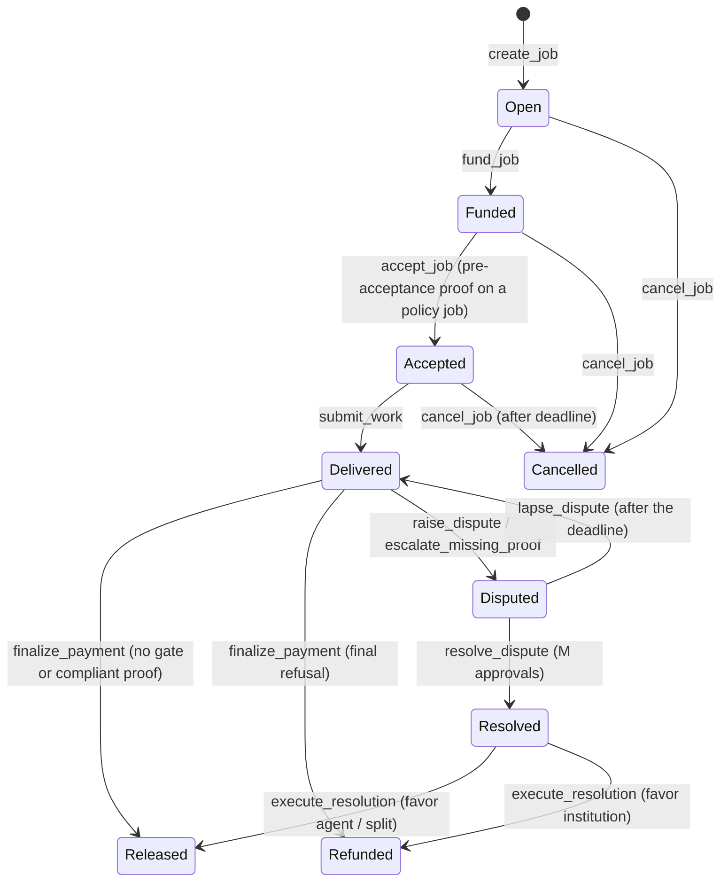
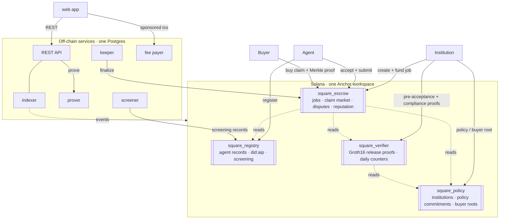

<div align="center">


# Square on Solana

**Compliance-gated settlement for autonomous agent work.**

Institutions mandate spending privately. Agents do the work.<br>
Escrow releases only against a zero-knowledge proof that the payment fits the mandate.

[](LICENSE)
[](docs/deploy/devnet.md)
[](docs/decisions/0007-anchor-surumu.md)
[](Anchor.toml)
[](docs/design/release-circuit.md)
[](.nvmrc)
[](package.json)

[Protocol](docs/protocol.md) · [Architecture](#architecture) · [Quick start](#quick-start) · [Devnet](docs/deploy/devnet.md) · [Documentation](#documentation) · [Decisions](docs/decisions/)

</div>

---

## Why Square

An institution that lets software spend money on its behalf has three problems at once. Its spending policy is
private, so it cannot simply publish the rules on chain. Regulated money cannot move without sanctions screening and
Travel Rule records. And the agents doing the work need to get paid promptly, without trusting the institution to
release funds by hand.

Square resolves all three on Solana:

- The institution writes its spending mandate to the chain **only as a salted Poseidon commitment** plus a public
  daily ceiling. The policy itself never leaves the institution.
- Registered agents (`did:aip`) accept and deliver jobs funded in USDC escrow.
- On a policy-bound job **no payment leaves escrow** until the institution binds a Groth16 proof that this exact
  payment (payee, amount, mint, day and running daily total) complies with the committed mandate. A refusing proof
  is a valid proof: it refunds the institution instead.
- Before the agent accepts, the institution also proves that the job's own terms (the full amount, paid to the
  agent's wallet) fit the mandate, so delivered work is never refused on terms the agent was shown up front.
- After delivery, the agent can sell the receivable at a discount during the challenge window, but **only to buyers
  the institution has approved**.

## Highlights

| | |
|---|---|
| **Private mandates** | A salted policy commitment and a buyer allow list (Merkle root) on chain; the policy document stays off chain. |
| **Zero-knowledge release gate** | A Circom circuit proves compliance with per-transaction and daily ceilings, mint and payee lists, categories and time windows. `square_verifier` checks the Groth16 proof, once before acceptance and once before payout, and keeps the institution's daily counter. |
| **On-chain screening** | Wallets are screened against the OFAC SDN list and the Chainalysis sanctions API; a `Flagged` party can neither fund nor be paid. |
| **Receivables market** | Delivered work becomes a claim that can be listed and bought at a discount by allow-listed, screened buyers. |
| **M-of-N arbitration** | Bonded disputes, arbitrator sets of up to seven, approve and reject votes, deadlines and lapse, and payouts that still pass the proof gate. |
| **Travel Rule** | A salted, job-bound commitment at or above the threshold; IVMS101 records are envelope-encrypted off chain with permissioned reads and an access log. |
| **Agent native** | `did:aip` v2 identities, signed agent cards, the A2A v1.0 task protocol, an agent SDK and a hosted agent runtime with per-capability MCP tools. |
| **Every rail** | USDC on Solana, cross-chain funding through CCTP, a Stripe MPP fiat rail, x402 paid HTTP endpoints, and sponsored transactions through a policy-checked fee payer. |
| **Operable by design** | Event indexer with reconciliation, permissionless keeper, prover, screener, REST API, CLI and MCP server, with Prometheus metrics, alerts and SLOs. |

## How it works

Eight steps take a job from mandate to payout ([protocol](docs/protocol.md),
[program interface](docs/design/program-interface.md)):

| # | Actor | What happens | Instructions |
|---|---|---|---|
| 1 | Institution | Opens its account and commits a spending policy and a public daily ceiling. | `init_institution`, `set_policy` |
| 2 | Agent | Registers; the record resolves as a `did:aip` identifier with the hash of its agent card. | `register_agent` |
| 3 | Screener, institution | Wallets are screened. The institution creates the job for the agent and funds it, committing Travel Rule data first when the amount requires it. On a policy job its software then binds a pre-acceptance proof that the job itself (the full amount, paid to the agent's wallet) breaks none of the mandate's standing rules ([ADR 0028](docs/decisions/0028-kabul-oncesi-on-ispat-ve-dispute-duzeltmeleri.md)). | `record_screening`, `create_job`, `commit_travel_rule`, `fund_job`, `set_preflight_proof` |
| 4 | Agent | Accepts, delivers (SHA-256 and URI of the work) and opens the challenge window. On a policy job acceptance fails with `PreflightRequired` until the pre-acceptance proof for the agent's current wallet is bound. | `accept_job`, `submit_work` |
| 5 | Agent, buyer | The agent may sell the receivable; the buyer must be on the institution's allow list and screened clear. | `list_claim`, `buy_claim` |
| 6 | Keeper | After the challenge window anyone can finalize and earn the keeper fee. On a policy job without a proof the release fails with `ProofRequired` and escrow waits; a final refusal refunds the institution. | `finalize_payment` |
| 7 | Institution's software | On a policy job, binds a Groth16 proof that the payment complies with the mandate, before finalize. | `set_compliance_proof` |
| 8 | Escrow, verifier | The payee (the buyer if the claim was sold) is paid; reputation, a validation record and the institution's daily counter are written. | `finalize_payment` with the `record_release` CPI |



Funding can also arrive from another chain: USDC burned through CCTP is minted and funds the job in the same
transaction ([CCTP funding](docs/design/cctp-funding.md)).

A fiat job (`create_fiat_job`) has no vault, challenge window, dispute or claim sale. After delivery the institution
pays by card through Stripe; the payment's attestation is bound together with the compliance proof
(`verify_mpp_payment_proof`) and `finalize_fiat_payment` releases the job
([ADR 0024](docs/decisions/0024-stripe-mpp-fiat-rayi.md), [ADR 0026](docs/decisions/0026-stripe-mpp-fiat-odemesi.md)).

## Architecture



Programs integrate by reading each other's accounts rather than through CPI wherever possible
([ADR 0003](docs/decisions/0003-mimari-yol-c-tek-anchor-workspace.md)).

### On-chain programs

| Program | Holds | Devnet |
|---|---|---|
| `square_registry` | Agent records (`did:aip`), wallet screening records | `AL5p4aTWrmBmWa4vxJFbBjQG7Xnx2juc15FJRGpwSsA9` |
| `square_policy` | Institutions, policy commitments, buyer allow-list roots | `63HKPj2L8a9DGeTa9Eh3NaZXthMrFUEgbs9Y28SNEc4` |
| `square_verifier` | Release proofs (Groth16), institutions' daily counters | `8yLdDR5zoAzeEWzkNX19DKy4HfVYXb7VcU3wWStwTFPh` |
| `square_escrow` | Jobs and vaults, claim market, disputes, reputation, validation records | `6yBTEVbizMVCWAp4c3jx6Xdsay3CiUmrJmTswY7QRWaX` |

The IDLs in [`idl/`](idl/) are the single source of the program contract; seeds, events and error codes are shared
through [`crates/square-common`](crates/).

### Off-chain services

| Service | What it does |
|---|---|
| [`apps/api`](apps/api/) | REST API: wallet (Ed25519) sessions and API keys, reads from the indexer database, transaction preparation for every step, delivery uploads, dispute evidence and x402 endpoint definitions ([OpenAPI](docs/api/openapi.yaml)). |
| [`apps/indexer`](apps/indexer/) | Event-based indexer: finalized Square transactions into events and mirror tables, with periodic reconciliation against the chain. |
| [`apps/keeper`](apps/keeper/) | Permissionless finalize and lapse crank with a profitability threshold and `ProofRequired` and screening awareness; optionally the CCTP relayer. |
| [`apps/prover`](apps/prover/) | Groth16 prover for the release circuit (`POST /v1/prove`), pinned to the artifact manifest. |
| [`apps/screener`](apps/screener/) | Sanctions screening (OFAC SDN and Chainalysis) that writes screening records as the screener authority. |
| [`apps/fee-payer`](apps/fee-payer/) | Sponsored transactions: decodes and policy-checks v0 transactions (allowed programs and instructions, compute budget, per-transaction and daily caps). |
| [`apps/compliance-api`](apps/compliance-api/) | Proof records and batch attestations, an unattested-payment watcher and an x402-paid compliance report. |
| [`apps/web`](apps/web/) | Next.js app: institution and agent flows, jobs, claims, policies, arbitration console, developer portal, `did:aip` resolver, network status, a public audit view per job (`/audit/[job]`) and in-app docs (`/docs`). |
| [`apps/demo`](apps/demo/) | Demo data and agent: a one-command, idempotent seed (funding, screening, policies, agent registration), a demo agent that does real work over A2A, and a scenario runner that checks every step on chain. |

### Packages

| Package | Purpose |
|---|---|
| [`@squaresdk/solana-sdk`](packages/sdk/) | IDLs, generated types, client, PDAs, transaction builders for all eight steps and the REST client. |
| [`@squaresdk/solana-types`](packages/types/) | Shared zod types: API envelope, views, agent cards, A2A tasks, event payloads. |
| [`@squaresdk/solana-policy`](packages/policy/) | Institution side: policy commitments, buyer Merkle trees, release witnesses, proving and binding. |
| [`@squaresdk/solana-identity`](packages/identity/) | `did:aip` resolver (v2 Solana profile and v1), DID document and agent card verification. |
| [`@squaresdk/solana-agent-sdk`](packages/agent-sdk/) | Build an agent: card and well-known route, A2A endpoint, job acceptance and delivery, claim listing. |
| [`@squaresdk/solana-a2a`](packages/a2a/) | A2A v1.0 task protocol (JSON-RPC 2.0 and SSE): server, client, durable task store, job mapping. |
| [`@squaresdk/solana-hosted`](packages/hosted/) | Configuration-driven institution agent that runs Claude with a per-capability MCP tool allow list and policy-gated delegation. |
| [`@squaresdk/solana-mcp`](packages/mcp/) | Two-way MCP: a Square MCP server (read tools and signing-flow writes) and a pooled MCP client for agents. |
| [`@squaresdk/solana-x402`](packages/x402/) | x402 v2 payment gateway on the official `@x402/*` stack: Solana exact scheme, own or remote facilitator, replay protection. |
| [`@squaresdk/solana-cctp`](packages/cctp/) | CCTP relayer core: burn records, Circle attestations, delivery and funding on Solana. |
| [`@squaresdk/solana-hardening`](packages/hardening/) | Shared protections: SSRF guard, durable rate limits and idempotency, RPC failover, signed actions, webhook signing. |
| [`@squaresdk/solana-observability`](packages/observability/) | Redacting structured logger, Prometheus metrics, health checks and alert rules. |
| [`@squaresdk/solana-cli`](packages/cli/) | `squaresdk-solana`: the eight steps, disputes and `did:aip` resolution from the terminal, with JSON output ([guide](docs/cli.md)). |
| [`@squaresdk/solana-config`](packages/config/) | Shared tsconfig, ESLint and Prettier settings. |

## Status

Square runs on **Solana devnet** ([deploy record](docs/deploy/devnet.md)).

- Programs were deployed, and every upgrade since applied, from a verifiable build (`solana-verify`); the on-chain
  hashes match the builds.
- The latest upgrade (2026-10-09) brought the verifier and escrow to program contract v0.9.0: the pre-acceptance
  proof and reject votes in disputes ([upgrades](docs/deploy/devnet.md#yükseltmeler)).
- The upgrade authority and every config admin is a **2-of-3 Squads v4 vault**
  ([ADR 0008](docs/decisions/0008-upgrade-authority-2-of-3-squads.md)).
- The eight-step smoke test has run on devnet with real transactions ([report](docs/deploy/smoke-devnet.md)).
- There is no mainnet environment ([ADR 0027](docs/decisions/0027-yalnizca-devnet.md)); network-independent code
  (CAIP-2, `did:aip`, cluster options) is kept.
- The web app and the services are hosted on Railway ([ADR 0002](docs/decisions/0002-web-hosting-railway.md),
  [deploy](#deploy)).
- Contracts: [program interface](docs/design/program-interface.md) and [API and SDK contract](docs/design/api-sdk-contract.md);
  the current version is in each document's header.

## Quick start

### Prerequisites

| Tool | Version | Pinned in |
|---|---|---|
| Rust | 1.94.1 | [`rust-toolchain.toml`](rust-toolchain.toml) |
| Solana CLI (Agave) | 4.1.2 | [`Anchor.toml`](Anchor.toml) |
| Anchor CLI | 1.2.0 (`avm install 1.2.0`) | [`Anchor.toml`](Anchor.toml) |
| Node.js | 24 | [`.nvmrc`](.nvmrc) |
| pnpm | 10.34.6 | [`package.json`](package.json) |
| circom | 2.2.3 | [`circuits/payment-compliance`](circuits/payment-compliance/) |
| Docker | any recent | Postgres and S3 test containers |
| gitleaks | 8.30.1 or later | [`scripts/security/gitleaks.env`](scripts/security/gitleaks.env) |

### Build and test

```bash
pnpm install        # also installs the git hooks (gitleaks pre-commit)
pnpm build
pnpm lint           # ESLint and Prettier
pnpm test           # vitest across the workspace
cargo test --workspace
mkdir -p target/deploy   # once, before the first anchor build in a fresh clone
anchor build
anchor test --validator legacy --skip-build   # program tests (LiteSVM, tests/programs)
```

Without `target/deploy`, the first `anchor build` generates fresh program keypairs and rewrites `declare_id!` and
`Anchor.toml` with random IDs; after a build `git status` should show no changes to those files.

### Run the eight steps on a local validator

```bash
(cd circuits/payment-compliance && npm ci && CIRCOM=/path/to/circom npm run build)   # wasm for in-process proofs
pnpm --filter @squaresdk/solana-smoke smoke:localnet
```

The run starts a throwaway `solana-test-validator`, loads the programs from `target/deploy`, initializes the
configs and runs every step, including the refused-proof, missing-proof and fiat variants
([smoke](tests/smoke/)).

### Run the whole service stack against localnet

```bash
pnpm --filter @squaresdk/solana-services-e2e test:localnet
```

This brings up the validator, Postgres, an S3-compatible store and the five core services (API, indexer, keeper,
prover, screener), runs the eight steps through them and checks that the indexer's reconciliation finds zero drift
([services](tests/services/)).

### Run the demo on localnet

```bash
pnpm --filter @squaresdk/solana-demo demo:localnet
```

This seeds a throwaway validator twice (the second run must change nothing), starts the demo agent and runs the
approved, claim-sale and refused scenarios, checking every payout and refund on chain ([demo](apps/demo/)).

### Run the web flows in a real browser

```bash
pnpm turbo build --filter @squaresdk/solana-api... --filter @squaresdk/solana-web --filter @squaresdk/solana-prover
SQUARE_LOCALNET=1 SQUARE_WEB_E2E=1 pnpm --filter @squaresdk/solana-api exec vitest run test/web-flow.e2e.test.ts
```

After `anchor build` and the circuit build, Playwright drives the built web app against localnet, Postgres (Docker),
the indexer and the prover: four roles with their own wallets go through the eight steps and the refused-proof case.
It uses Playwright's Chromium, or an installed browser through `SQUARE_WEB_E2E_CHANNEL=chrome`. `web-dispute` and
`web-smart-account` cover disputes and Squads smart accounts; each test runs in its own process
([apps/api](apps/api/README.md#testler)).

## Deploy

Each service builds from its own Dockerfile (`apps/<service>/Dockerfile`) with the repository root as the build
context, and validates its environment at startup: a missing or invalid variable stops it. The order matters
([services runbook](docs/runbooks/services.md)):

1. **Database:** apply the migrations, then seed the program IDs (`pnpm --filter @squaresdk/solana-db migrate:deploy`,
   then `seed`).
2. **Indexer** (backfills the programs' history), **prover**, then the **API**, which needs the prover and an
   S3-compatible store for deliveries and dispute evidence. The **keeper** runs as a single instance; the **fee
   payer** needs a funded sponsor key.
3. **Web:** `SQUARE_*` variables point it at the API, the prover and the fee payer; the API's `CORS_ORIGINS` and
   `API_AUTH_DOMAIN` must match the web app's address.

Variables and secrets per service are in [`docs/environments.md`](docs/environments.md); devnet values (program IDs,
lookup table) are in the [deploy record](docs/deploy/devnet.md#servislerin-devnet-değerleri).

## Repository layout

| Path | Contents |
|---|---|
| [`programs/`](programs/) | Anchor programs: registry, policy, verifier, escrow |
| [`idl/`](idl/) | Program interface contract (IDLs) |
| [`crates/`](crates/) | Shared Rust crates (`square-common`) |
| [`circuits/`](circuits/) | Circom compliance circuit, artifacts and trusted setup notes |
| [`packages/`](packages/) | TypeScript packages (`@squaresdk/solana-*`) |
| [`apps/`](apps/) | Web app, REST API and long-running services |
| [`db/`](db/) | The single Postgres schema and migrations (Prisma) |
| [`tests/`](tests/) | Program tests (LiteSVM), localnet and devnet smoke, service integration tests |
| [`scripts/`](scripts/) | Deploy, init, CI and maintenance scripts |
| [`infra/`](infra/) | Monitoring: Prometheus rules and Grafana dashboard |
| [`docs/`](docs/) | Protocol, design documents, decisions, runbooks, deploy records, security |

## Documentation

Design documents, decisions and runbooks are written in Turkish; code, identifiers and APIs are in English.

| Topic | Where |
|---|---|
| Protocol overview | [`docs/protocol.md`](docs/protocol.md) |
| Program interface, events | [`program-interface.md`](docs/design/program-interface.md), [`events.md`](docs/design/events.md) |
| Release circuit | [`release-circuit.md`](docs/design/release-circuit.md), [`circuits/payment-compliance`](circuits/payment-compliance/) |
| HTTP API | [`openapi.yaml`](docs/api/openapi.yaml), [`api-sdk-contract.md`](docs/design/api-sdk-contract.md) |
| Data model | [`data-model.md`](docs/design/data-model.md) |
| Agents and identity | [`a2a.md`](docs/design/a2a.md), [`did:aip` Solana profile](docs/did-aip/method-spec-v2-solana.md) |
| Funding and fees | [`cctp-funding.md`](docs/design/cctp-funding.md), [`tx-budget.md`](docs/design/tx-budget.md) |
| Architecture decisions | [`docs/decisions/`](docs/decisions/) |
| Operations | [runbooks](docs/runbooks/), [environments](docs/environments.md), [SLOs](docs/slo.md) |
| Deployments | [devnet](docs/deploy/devnet.md), [smoke reports](docs/deploy/) |
| Security | [threat models, reviews, pentest checklist, audit package](docs/security/) |
| CLI | [`docs/cli.md`](docs/cli.md) |

## Development

- **Work items:** every change belongs to an issue (`BC-` blockchain, `BE-` backend, `FE-` frontend) and lands
  through a pull request.
- **Checks:** the CI checks, their local commands and the merge rule are listed in [`docs/ci.md`](docs/ci.md).
- **Commits and releases:** conventional commits; package versions through
  [changesets](https://github.com/changesets/changesets) ([ADR 0001](docs/decisions/0001-ts-paket-adlandirma-ve-surumleme.md)).
- **Contract changes:** the program interface lives in `idl/`; an HTTP contract version change moves the OpenAPI
  spec, the contract document, `API_CONTRACT_VERSION` and the SDK together
  ([API and SDK contract](docs/design/api-sdk-contract.md)).
- **Editors:** shared settings in [`.editorconfig`](.editorconfig).

## Security

Threat models, review reports, the pentest checklist and the audit package are in [`docs/security/`](docs/security/).
Every commit is scanned for secrets with gitleaks. Please report suspected vulnerabilities privately to the
maintainers instead of opening a public issue.

## Lineage

Square brings the Solana code of three projects into one Anchor workspace and builds the missing links between them
on chain. The product scope follows Square on Arc; no code is carried over from it. Programs were moved with their
history and deployed under new program IDs ([ADR 0004](docs/decisions/0004-gecmisli-tasima-ve-yeni-program-idleri.md)).

| Layer | Source | In Square |
|---|---|---|
| Escrow, challenge window, arbitration, claim market | [Covenant](https://github.com/wienerlabs/covenant) | `square_escrow` |
| Policy commitment, Groth16 compliance proof | [Aperture](https://github.com/wienerlabs/aperture) | `square_policy`, `square_verifier`, `circuits/` |
| Agent identity, `did:aip`, A2A | [AIP](https://github.com/dr-wilson-empty/aip-beta) | `square_registry`, `@squaresdk/solana-identity` |

## License

[Apache-2.0](LICENSE) ([ADR 0005](docs/decisions/0005-lisans-apache-2-0-ve-notice.md)). The origins and original
licenses of the source projects are in [`NOTICE`](NOTICE); licensing rules for ported code and dependencies are in
[`docs/licensing.md`](docs/licensing.md), and the third-party inventory is in
[`docs/THIRD_PARTY_LICENSES.md`](docs/THIRD_PARTY_LICENSES.md).

<br>

<div align="center">
  <a href="https://wienerlabs.xyz"></a>
  <br>
  <sub>Built by <a href="https://wienerlabs.xyz">Wiener Labs</a></sub>
</div>
