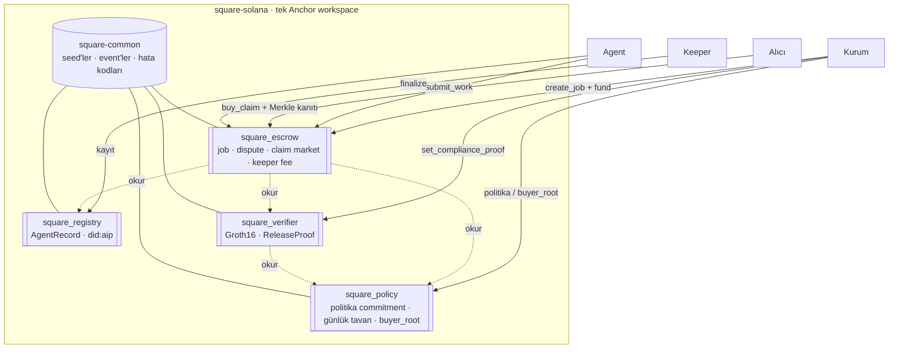

# Square (Solana)

Otonom agent işleri için **uyum kapılı settlement** (compliance-gated settlement), Solana üzerinde.

Kurum, harcama yetkisini (spending mandate) zincire yalnızca bir **commitment** olarak yazar;
politikanın kendisi zincire çıkmaz. Kimliği kayıtlı agent'lar bu yetkiye göre iş yapar. Escrow,
ödemenin mandate'e uyduğu bir **ZK ispatıyla** kanıtlanmadan serbest kalmaz. Teslimden sonra
challenge penceresinde oluşan alacak iskontolu satılabilir, ama yalnızca kurumun politikasının
onayladığı alıcıya.

> **Durum:** geliştirme aşamasında (M1 — Temel). Henüz deploy edilmiş program, yayımlanmış paket
> ya da çalışan servis yok. Milestone'lar ürün sürümü değil geliştirme fazıdır; kapsam ve sıra
> [kararlarda](docs/analysis/square-solana-analysis.md#12-kararlar) sabitlenmiştir.

## Kaynaklar ve yaklaşım

Square, üç projenin Solana kodunu tek bir Anchor workspace'inde birleştirir ve aralarındaki
eksik bağları zincir üzerinde kurar:

| Katman | Kaynak | Square'de |
|---|---|---|
| Escrow, challenge penceresi, arbitration, alacak piyasası | [Covenant](https://github.com/wienerlabs/covenant) | `square_escrow` |
| Politika commitment'ı, Groth16 uyum ispatı | [Aperture](https://github.com/wienerlabs/aperture) | `square_policy`, `square_verifier`, `circuits/` |
| Agent kimliği, `did:aip`, A2A | [AIP](https://github.com/dr-wilson-empty/aip-beta) | `square_registry`, `@squaresdk/solana-identity` |

Ürün kapsamı Arc üzerindeki Square'den referans alınır; kod oradan taşınmaz. Programlar
**geçmişleriyle** taşınır (`git subtree` ya da `git filter-repo`) ve **yeni program ID'leriyle**
deploy edilir.
Programlar arası entegrasyonda CPI yerine öncelik **account-read**'dedir
([§12.1](docs/analysis/square-solana-analysis.md#121-mimari-ve-ta%C5%9F%C4%B1ma)).

## Akış: mandate'ten ödemeye 8 adım

| # | Kim | Ne olur | Program |
|---|---|---|---|
| 1 | Kurum | Salt'lı politikanın Poseidon commitment'ını ve public günlük tavanı yazar | `square_policy` |
| 2 | Agent | Kaydolur, `did:aip` olarak resolve edilir | `square_registry` |
| 3 | Kurum | İş açar, USDC'yi kilitler (taraflar sanctions screening'den geçer) | `square_escrow` |
| 4 | Agent | Teslim eder, challenge penceresi açılır; agent kaydı job'a bağlanır | `square_escrow` |
| 5 | Agent / alıcı | Alacak listelenir; kurumun onaylı alıcı Merkle kökündeki alıcı satın alır | `square_escrow` ← `square_policy` |
| 6 | Keeper | Pencere itirazsız kapanınca ücretli, permissionless finalize | `square_escrow` |
| 7 | Kurumun yazılımı | Release'ten önce ispat job'a bağlanır; ispat yoksa `ProofRequired`, mandate reddederse `ReleaseRefused` | `square_verifier` → `square_escrow` |
| 8 | Zincir | Ödeme alıcıya gider, itibar işi yapan agent'a yazılır, gate sonucu validation kaydına düşer | `square_escrow`, `square_registry` |

## Hedef on-chain mimari



Off-chain tarafta: tek Postgres (Prisma), REST API ve uzun çalışan servisler (indexer, keeper,
prover, screener), `@squaresdk/solana-*` paketleri ve Next.js web uygulaması.

## Depo yapısı

| Dizin | İçerik |
|---|---|
| [`programs/`](programs/) | Anchor programları: escrow, policy, verifier, registry |
| [`idl/`](idl/) | Program arayüz sözleşmesinin tek kaynağı: IDL'ler ([`docs/design/program-interface.md`](docs/design/program-interface.md)) |
| [`crates/`](crates/) | Paylaşılan Rust crate'leri (`square-common`) |
| [`circuits/`](circuits/) | Circom uyum devresi ve trusted setup belgeleri |
| [`packages/`](packages/) | TS paketleri (`@squaresdk/solana-*`) |
| [`apps/`](apps/) | Web uygulaması, API ve servisler |
| [`db/`](db/) | Tek veritabanı şeması ve migration'lar |
| [`tests/`](tests/) | Program entegrasyon testleri ve uçtan uca testler |
| [`scripts/`](scripts/) | Deploy, init ve bakım script'leri |
| [`docs/`](docs/) | Analiz, [kararlar (ADR)](docs/decisions/), spec'ler, tasarım belgeleri |

Yapının gerekçesi: [§9](docs/analysis/square-solana-analysis.md#9-%C3%B6nerilen-monorepo-yap%C4%B1s%C4%B1).

## Geliştirme ortamı

| Araç | Sürüm | Kaynak |
|---|---|---|
| Rust (host) | 1.94.1 | [`rust-toolchain.toml`](rust-toolchain.toml) |
| Solana CLI (Agave) | 4.1.2 (platform-tools v1.54, rustc 1.89 ile SBF derlemesi) | `Anchor.toml` → `[toolchain]`, [`.cargo/config.toml`](.cargo/config.toml) |
| Anchor CLI | 1.2.0 (`avm install 1.2.0`) | `Anchor.toml` → `[toolchain]`, [ADR 0007](docs/decisions/0007-anchor-surumu.md) |
| Node.js | 24 (LTS) | [`.nvmrc`](.nvmrc) |
| pnpm | 10.34.6 | `package.json` → `packageManager`, [ADR 0011](docs/decisions/0011-monorepo-araclari-pnpm-ve-turborepo.md) |
| gitleaks | en az 8.30.1 (pre-commit kancası) | [`scripts/security/gitleaks.env`](scripts/security/gitleaks.env) |

```bash
pnpm install       # git kancalarını da kurar (.githooks/, pre-commit: gitleaks)
pnpm build
pnpm lint          # ESLint + Prettier (@squaresdk/solana-config)
pnpm check:names   # paket adları @squaresdk/solana- (ADR 0001)
pnpm test          # vitest
pnpm secrets:scan  # gitleaks, bütün git geçmişi
cargo build
node scripts/ci/rust-lint.mjs   # cargo fmt --check + clippy; kapsam scripts/ci/programs.mjs
cargo test --workspace
mkdir -p target/deploy   # temiz klonda ilk anchor build'den önce şart, aşağıya bakın
anchor build
node scripts/ci/idl-conformance.mjs   # program IDL'leri sözleşmeyle (idl/) uyumlu
anchor test --validator legacy --skip-build   # program testleri (LiteSVM, tests/programs)
```

- **Temiz klonda `anchor build`:** Anchor 0.31, `target/deploy` yokken yapılan ilk derlemede
  programlar için yeni anahtar çifti üretir ve `declare_id!` değerleriyle `Anchor.toml`'u bu
  rastgele ID'lerle değiştirir. Önce `mkdir -p target/deploy` çalıştırın; derlemeden sonra
  `git status` bu dosyalarda değişiklik göstermemeli.
- **Rust kontrolleri:** Programlar, `crates/*` ve `tests/programs` `cargo fmt --check` ve
  `cargo clippy -D warnings`'ten geçer. Programların sözleşmeye göre durumu
  [`scripts/ci/programs.mjs`](scripts/ci/programs.mjs)'tedir.
- **CI ve merge kuralı:** Kontrollerin listesi, yerel karşılıkları ve zorunlu kontrol kuralı
  [`docs/ci.md`](docs/ci.md)'de.

Editör ayarları [`.editorconfig`](.editorconfig) ile paylaşılır.

## Belgeler

- [Birleştirme analizi](docs/analysis/square-solana-analysis.md): kaynak projeler, özellik eşlemesi,
  riskler.
- [Kararlar (§12)](docs/analysis/square-solana-analysis.md#12-kararlar): mimari, kapsam,
  varsayılanlar, lisans, proje yönetimi. §12 ile çelişen her şeyde §12 geçerlidir.
- [Mimari karar kayıtları (ADR)](docs/decisions/): §12 kararlarının kalıcı kaydı (0001-0011) ve
  [ADR şablonu](docs/decisions/sablon.md).
- [Milestone'lar](https://github.com/wienerlabs/square-solana/milestones) ve
  [issue'lar](https://github.com/wienerlabs/square-solana/issues): her iş bir issue'ya bağlıdır
  (`BC-` blockchain, `BE-` backend, `FE-` frontend).

## Lisans

[Apache-2.0](LICENSE) ([§12.5](docs/analysis/square-solana-analysis.md#125-lisans),
[ADR 0005](docs/decisions/0005-lisans-apache-2-0-ve-notice.md)). Kaynak
projelerin kökenleri ve orijinal lisansları [`NOTICE`](NOTICE)'tedir. Taşınan kod ve bağımlılık
lisansı kuralları [`docs/licensing.md`](docs/licensing.md)'de, üçüncü taraf envanteri
[`docs/THIRD_PARTY_LICENSES.md`](docs/THIRD_PARTY_LICENSES.md)'dedir.
