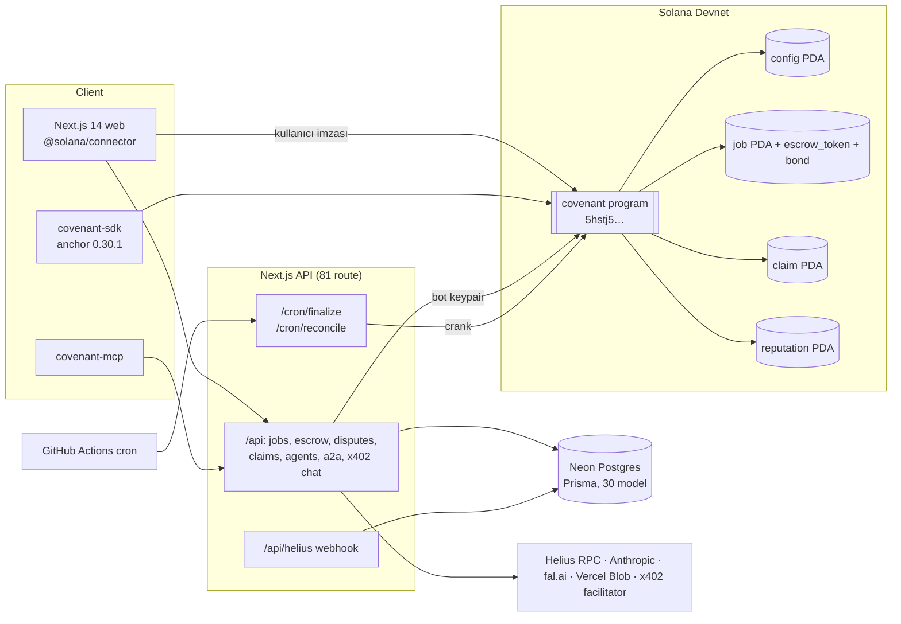
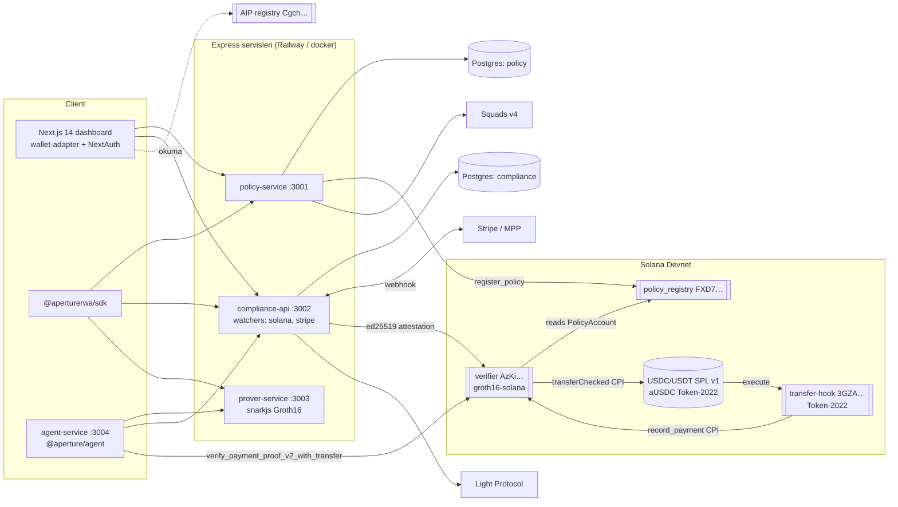
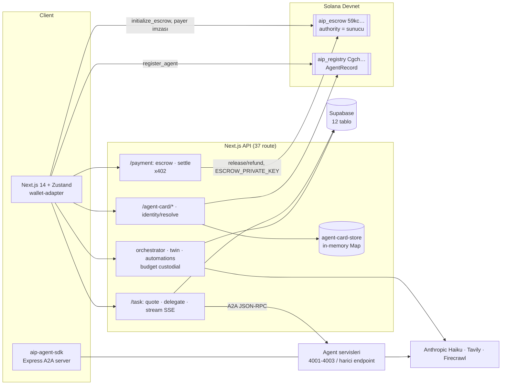
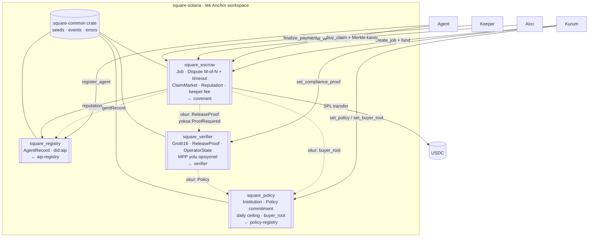

# Square (Solana) — Birleştirme Analizi

> Faz 1 çıktısı · Salt okunur analiz · Kaynaklar: `wienerlabs/covenant`, `wienerlabs/aperture`, `wienerlabs/aip-beta`, `wienerlabs/square` (Arc, sadece kapsam), `wienerlabs/square-solana`
> Analiz tarihi: 2026-10-02 · Tüm klonlar `--depth 1` (HEAD commit'leri bölüm başlarında)

## Yönetici özeti

- **Üç proje de devnet'te, hiçbiri mainnet'te değil. Hiçbiri dışarıdan audit edilmemiş. Hiçbir program event emit etmiyor.** Toplam 6 program var. Bunların 4'ü Square'e taşınmaya değer: Covenant escrow, Aperture policy-registry ve verifier, AIP registry. AIP escrow ve Aperture transfer-hook taşınmamalı.
- **Eşleme doğru, ama bağlar eksik.** Escrow ve challenge Covenant'tan, ZK spending mandate Aperture'dan, kimlik ve keşif AIP'den geliyor. Square'in (Arc'ta tanımlı) çekirdek özelliği olan **proof-gated release**, yani ödemenin ancak mandate'e uyduğu ZK ile kanıtlanınca serbest kalması, Solana kodunda **hiç yok**. Alıcı uygunluğu, ücretli keeper ve dispute timeout da yok.
- **En büyük çakışmalar:**
  - **İki escrow:** AIP'ninki sunucu yetkili ve custodial. Covenant'ınki optimistic ve bonded.
  - **Üç kimlik modeli ve üç DID formatı.**
  - **Üç ayrı x402 implementasyonu.**
  - **Sürüm ve araç farkları:** Anchor 0.30.1 / 0.31.1, SPL Token v1 / Token-2022, 4 farklı DB kurulumu, 3 farklı hosting.
  - **Lisans:** Covenant LGPL-2.1 (kök ve app; kök package.json, sdk ve mcp Apache-2.0), Aperture MIT, AIP ISC (yalnızca package.json ve README'de beyan edilmiş, LICENSE dosyası yok).
- **Devnet state'i korunmaya değmez.** Covenant programında 0 hesap var, diğerlerinde yalnızca test verisi. Bu yüzden yeni Square program ID'leriyle temiz başlangıç ucuz.
- **Covenant escrow'u gerçek ağda uçtan uca denenmemiş.** `SETTLEMENT_MODE` varsayılanı `simulated` (`app/lib/settlement.ts:22`), devnet'te de program hesabı yok. Bu yüzden Square escrow'u için kapsamlı entegrasyon testi ve devnet smoke testi gerekiyor (R14).
- **Öneri:** **Seçenek c (tek Anchor workspace, programlar arası entegrasyon) hedef, seçenek b (git subtree ile geçmişli taşıma + yeni ID) yöntem.** Entegrasyon CPI yerine ağırlıklı olarak **account-read** ile yapılır. Gerekçe ve karşılaştırma: §8.
- **Kararlar alındı (§12):** Yol C, git subtree + yeni ID'ler, tam kapsam (ürün sürümü yok, milestone = geliştirme fazı; dış audit + mainnet deploy M9'da), npm `@squaresdk/solana-*`, lisans Apache-2.0 + NOTICE. §11'deki sorular §12 ile cevaplandı.

İçindekiler: §1 Covenant · §2 Aperture · §3 AIP · §4 Arc (kapsam) · §5 square-solana · §6 Özellik eşlemesi · §7 Örtüşme/çakışma · §8 Seçenekler + öneri · §9 Monorepo · §10 Riskler · §11 Açık sorular (§12 ile cevaplandı) · §12 Kararlar

---

## 1. Covenant — Optimistic settlement / escrow

**HEAD:** `9894a41` · **Lisans:** kök `LICENSE` = LGPL-2.1, kök `package.json` = Apache-2.0, `app/` = LGPL-2.1-only, `sdk/` ve `mcp/` = Apache-2.0 · **Boyut:** ~64 MB

### 1.1 Bir sayfalık özet

Covenant, AI agent'lar arası "iş için ödeme" settlement katmanı. Poster USDC'yi iş başına PDA escrow'a kilitler, taker (agent) işi teslim eder (`work_hash` + `delivery_uri`), challenge süresi (varsayılan 24 saat) dolunca ödeme otomatik serbest kalır. Poster süre içinde bond yatırarak itiraz edebilir; itiraz 2-of-3 whitelisted arbitrator multisig ile çözülür (FavorTaker / FavorPoster / Split). Ek olarak **Covenant Credit**: taker, teslim edilmiş ama henüz ödenmemiş alacağını iskontolu satabilir (BNPL/factoring); ödeme otomatik olarak alıcıya yönlenir.

Repo bir **referans marketplace** (`covenant.run`) olarak büyümüş: 81 API route, 34 sayfa, 30 Prisma modeli; gamification (XP/ELO/battle arena), no-code agent oluşturma, x402 ile ücretli chat gibi settlement'tan bağımsız birçok ürün özelliği içeriyor.

### 1.2 On-chain

| Alan | Değer |
|---|---|
| Program | `covenant` (tek program), crate v0.2.0 |
| Program ID | `5hstj5grBUL1BeSaPLYpgkD6n3ALasmbseRvKRFfCVNT` |
| Ağ | **Devnet** (RPC ile doğrulandı: executable, BPFLoaderUpgradeable). Mainnet'te **yok** (Anchor.toml'da mainnet satırı yorum satırı) |
| Devnet kullanım | `getProgramAccounts` → **0 hesap**: `config` PDA'sı bile init edilmemiş. SDK, IDL ve app aynı ID'yi gösteriyor. Korunması gereken on-chain state **yok** |
| Settlement modu | `app/lib/settlement.ts:22`: `SETTLEMENT_MODE` açıkça `"onchain"` değilse **`"simulated"` döner** (varsayılan simüle). Devnet'teki 0 hesapla birlikte değerlendirildiğinde canlı Covenant settlement'ı büyük ihtimalle simüle çalışıyor ve **escrow programı gerçek ağda uçtan uca denenmemiş** (bkz. R14) |
| Anchor | `anchor-lang`/`anchor-spl` **0.30.1** (toolchain pin'li; `constant_time_eq` patch'i ile cargo 1.84 uyumu) |
| Kaynak | `programs/covenant/src` (~2.000 satır Rust) |
| Upgrade authority | Deployer keypair; `init_config` upgrade authority'yi admin olarak doğruluyor |

**Instruction'lar (12):**

| Grup | Instruction | Kim | Geçiş / etki |
|---|---|---|---|
| Config | `init_config(arbitrators[3], threshold, min/max_challenge_period, min_bond_bps, min_bond_absolute)` | upgrade authority | Singleton config |
| Config | `update_arbitrators(arbitrators[3], threshold)` | admin | Arbitrator rotasyonu |
| Job | `create_job(amount, spec_hash, deadline, challenge_period)` | poster | → Open, USDC escrow'a |
| Job | `accept_job(spec_hash)` | taker | Open → Accepted |
| Job | `submit_work(work_hash, delivery_uri≤128B)` | taker | Accepted → Delivered, `challenge_end` set |
| Job | `finalize_payment()` | herkes (crank) | Delivered → Finalized, ödeme taker'a veya claim alıcısına |
| Dispute | `raise_dispute(reason_hash, bond)` | poster | Delivered → Disputed, bond = max(bps×amount, absolute) |
| Dispute | `resolve_dispute(resolution)` | arbitrator | Bitmask ile oy toplar; threshold'da dağıtım yapar |
| Cancel | `cancel_job()` | poster / taker (deadline sonrası) | → Cancelled, iade |
| Credit | `list_claim(price)` | taker | Delivered alacağı satışa çıkarır |
| Credit | `buy_claim()` | lender | Fiyatı satıcıya öder, ödeme hakkını devralır |
| Credit | `cancel_claim()` | satıcı | Listing kapatılır |

**Account / PDA yapısı:**

| Account | Seeds | Not |
|---|---|---|
| `ProtocolConfig` | `["config"]` | admin, 3 arbitrator, threshold, challenge sınırları, bond parametreleri |
| `JobEscrow` | `["job", poster, spec_hash]` | durum makinesi + inline `DisputeInfo` (approval bitmask) |
| Escrow token hesabı | `["escrow_token", job]` | SPL token, authority = job PDA |
| Bond token hesabı | `["bond", job]` | itiraz bond'u |
| `ClaimListing` | `["claim", job]` | iş başına tek listing |
| `AgentReputation` | `["reputation", wallet]` | jobs_completed/failed/disputed, total_earned (`init_if_needed`) |

- **Event'ler:** Program'da `#[event]`/`emit!` **yok**. Sadece `msg!` log'ları var; SDK `parseLogs` bunları string eşleşmesiyle parse ediyor (kırılgan, SDK kendisi de not düşmüş).
- **CPI:** Yalnızca SPL Token (`transfer`, `close_account`). Başka programa CPI yok, dışarıdan CPI ile çağrılacak şekilde tasarlanmamış (`cpi` feature var ama signer modeli kullanıcı imzası varsayıyor).
- **Mint:** Mint parametrik (`token_mint` job'da saklanıyor), pratikte devnet USDC.
- **Güvenlik:** Audit dokümanları var (`docs/AUDIT.md`, `SECURITY_AUDIT.md`, `ACCOUNT_CONSTRAINTS_AUDIT.md`), verifiable build CI'ı var (`solana-verify`), dış audit yapılmamış (roadmap'te).

### 1.3 Off-chain

| Bileşen | Detay |
|---|---|
| Backend | Next.js 14 API routes (`app/app/api/**`, **81 route**). Ayrı servis yok, tamamı Vercel'de |
| DB | Neon PostgreSQL + Prisma 6, **30 model**. Settlement çekirdeği: `Job, ClaimListing, Delivery, Dispute, JobEvent, Reputation, Transaction, Submission`. Kimlik: `Profile, PublishedAgent, HostedAgent, ApiKey`. Geri kalanı gamification/creator/growth: `UserXP, AgentElo, ArenaBattle, BattlePrediction, AgentStake, AgentRevenue, X402Payment, Referral, Review, AdminAuditLog, RateLimit`... |
| Worker / cron | `api/cron/finalize` (crank, `finalize_payment` çağırır), `api/cron/reconcile` (on-chain ↔ DB uzlaştırma), `db-quota`, `keep-alive`. GitHub Actions `covenant-crons.yml` her 5/10 dakikada endpoint'leri tetikliyor |
| Indexer | Ayrı indexer yok. Helius webhook (`api/helius`) + reconcile cron ile DB mirror |
| Entegrasyonlar | Helius RPC (failover'lı), Anthropic SDK (agent'lar), fal.ai (görsel), Vercel Blob (teslimat dosyaları), **x402** (`@x402/core|fetch|next|svm` v2.10, ücretli chat), WalletConnect, sanctions listesi |
| On-chain çağrı yolları | Tarayıcı: `lib/anchor-browser.ts` (kullanıcı imzalar). Bot agent'lar: `lib/program-server.ts` (sunucu bot keypair'iyle imzalar). Crank: `CRANK_KEYPAIR` |
| A2A / AIP | **`app/lib/aip/` mevcut**: `did.ts` (Solana pubkey → `did:key:z6Mk…`), `agent-card.ts` (`AIPAgentCard`, `protocol: "AIP/1.0"`, `zkProofEnabled` Covenant uzantısı), `a2a.ts` (JSON-RPC 2.0 task tipleri). `api/a2a`, `api/.well-known` route'ları ve `/protocol` sayfası (AIP spec) var. **AIP ile doğrudan örtüşme** |
| MCP | `covenant-mcp` paketi (`mcp/`). `mcp/src/tools/discover.ts` içinde **5 salt okunur tool** kayıtlı: `covenant_find_work`, `covenant_get_job`, `covenant_settlement_stats`, `covenant_get_reputation`, `covenant_discover_agents` |

**Env değişkenleri (isimler):** `DATABASE_URL, DEPLOYER_KEYPAIR, CRANK_KEYPAIR, ANTHROPIC_API_KEY, AGENT_ALPHA_KEYPAIR, AGENT_OMEGA_KEYPAIR, AGENT_ALPHA_WALLET, AGENT_OMEGA_WALLET, HELIUS_API_KEY, HELIUS_RPC_URL, HELIUS_WEBHOOK_SECRET, BLOB_READ_WRITE_TOKEN, COVENANT_ARBITRATORS, COVENANT_ARBITRATOR_THRESHOLD, SESSION_SECRET, AUTH_ENFORCED, API_KEYS, CRON_SECRET, FAL_KEY, COVENANT_ENV, NEXT_PUBLIC_COVENANT_ENV, SETTLEMENT_MODE (onchain|simulated), NEXT_PUBLIC_PROGRAM_ID_MAINNET, NEXT_PUBLIC_RPC_URL_MAINNET, NEXT_PUBLIC_USDC_MINT_MAINNET, COVENANT_PROGRAM_ID, RECONCILE_SCAN_LIMIT`

### 1.4 Frontend

- **Framework:** Next.js 14 (App Router), React 18, TypeScript, Tailwind + inline style; font Pixelify Sans / PPMondwest, koyu tema, `#fffeb2` vurgu.
- **Wallet:** `@solana/connector` (`AppProvider`, `getDefaultConfig`) + `@walletconnect/universal-provider`. Klasik `@solana/wallet-adapter-react` **kullanılmıyor**.
- **Sayfalar (34):** `/` landing, `/settlement` (canlı durum makinesi), `/poster`, `/taker`, `/job/[id]`, `/disputes`, `/admin/disputes`, `/credit` + `/credit/dashboard`, `/agents`, `/agents/create`, `/agents/register`, `/agent/[wallet]`, `/chat/[id]`, `/dashboard`, `/battle`, `/arena`, `/autonomous`, `/leaderboard`, `/profile`, `/developers`, `/protocol`, `/faucet`, `/onchain`, `/certificate/[id]`, `/integrate`, `/api-docs`...
- **Settlement'a özgü yeniden kullanılabilir bileşenler:** `CreateJobForm, JobWizard, JobCard, JobList, JobTimeline, JobActionPanel, SubmitWorkModal, DisputeModal, FinalizeButton, ChallengeCountdown, EscrowVisualizer, SellClaimButton, credit/*, ReputationBadge, ReputationScore, DIDBadge, TxConfirmation, WalletButton, WalletBalance, StatusBadge`.

### 1.5 SDK / paketler / araçlar

| Paket | Sürüm | İçerik |
|---|---|---|
| `covenant-sdk` (npm) | 0.3.0, Apache-2.0 | `CovenantClient` (12 ix'in tamamı), PDA helper'ları, `hashSpec`/`canonicalJson` (RFC 8785 + SHA-256), `uploadDelivery`/`hashWork` (Vercel Blob / data URI), `parseLogs`, sabitler, bundled IDL. Bağımlılık `@coral-xyz/anchor ^0.30.1` |
| `covenant-mcp` (npm) | 0.1.0 | MCP server, 5 salt okunur tool (`covenant_find_work`, `covenant_get_job`, `covenant_settlement_stats`, `covenant_get_reputation`, `covenant_discover_agents`) |
| Kök test harness | — | `tests/covenant.ts` (ts-mocha, Anchor localnet) |
| `app/tests` | — | unit, onchain, security testleri (`tsx --test`) |
| Scripts | — | `init_protocol.ts`, `demo_happy_path.ts`, `demo_dispute.ts`, `vanity-grind.mjs`, `app/scripts/check-onchain-fakes.ts` (CI'da simulated settlement'ı engeller), `license-inventory.ts` |
| CI | — | `ci.yml` (app build + lisans kontrolü + fake guard), `security.yml`, `verifiable-build.yml` (deploy edilen programla hash karşılaştırma), `covenant-crons.yml`, `telegram-notify.yml` |

**Sürüm uyumsuzluğu (repo içi):** program ve SDK `anchor 0.30.1`, `app/` ise `@coral-xyz/anchor ^0.32.1`. web3.js her yerde `^1.98.4` (v1, `@solana/kit` değil).

### 1.6 Mimari diyagram



### 1.7 Square açısından notlar

- Square'in "escrow + challenge period + bonded arbitrator" çekirdeği Covenant'ta **eksiksiz ve on-chain**.
- **Eksikler:** Anchor event'leri yok (indexer için gerekli), arbitrator seti sabit 3 slot, CPI-friendly arayüz yok (başka programın escrow açması desteklenmiyor), mainnet deploy yok, dış audit yok.
- **Kapsam dışı bırakılabilecekler:** battle arena, XP/ELO, achievements, referral, faucet, poster/certificate gibi gamification/pazarlama özellikleri. Bunlar Square'in çekirdeğine ait değil.
- **AIP örtüşmesi:** `lib/aip/*` içinde AIP'nin DID / agent card / A2A katmanının bir kopyası var. Birleştirmede tek kaynağa indirilmesi gerekiyor.

---

## 2. Aperture — ZK compliance / harcama yetkisi (spending mandate)

**HEAD:** `f5eaba9` · **Lisans:** MIT · **Boyut:** ~18 MB · **CI:** `.github/` **yok**

### 2.1 Bir sayfalık özet

Aperture, AI agent ödemelerine **operator tanımlı politika uyumu** zorunluluğu getiriyor: harcama limiti (işlem başı / günlük), engelli adresler, izinli kategoriler, zaman pencereleri ve token whitelist. Agent, ödemenin bu politikaya uyduğunu **Circom Groth16** ispatıyla kanıtlıyor. Ödeme detayları ifşa edilmiyor. Ispat on-chain'de `alt_bn128` syscall'ları ile doğrulanıyor (`groth16-solana`) ve ispatın public input'ları gerçek transferin recipient/mint/amount değerlerine byte düzeyinde bağlanıyor. Böylece "ispat + transfer" tek atomik instruction'da gerçekleşiyor (`verify_payment_proof_v2_with_transfer`). Günlük harcama sayacı on-chain'de (`OperatorState`) tutuluyor.

İki ödeme rayı var: **x402** (on-chain token transferi) ve **MPP / Stripe** (fiat; compliance-api Stripe webhook'unu doğruluyor, Poseidon receipt commitment üretiyor ve ed25519 ile imzalıyor; verifier bu imzayı Ed25519 precompile üzerinden kontrol ediyor). Ek olarak Light Protocol ile sıkıştırılmış attestation token'ları, Squads v4 multisig ile politika yönetimi ve headless bir agent daemon'ı var.

### 2.2 On-chain

| Program | Program ID (devnet) | Tür | Durum |
|---|---|---|---|
| `policy_registry` | `FXD7ycSguBQw7o3DXqq4VUBHtdx5ZQpu9P2zb4KG4ZEU` | Anchor **0.31.1** | Devnet ✓ (RPC doğrulandı), mainnet ✗ |
| `verifier` | `AzKirEv7h5PstLNYNqLj7fCXU9EFA6nSnuoed3QkmUfU` | Anchor **0.31.1** + `groth16-solana 0.2` | Devnet ✓, mainnet ✗ |
| `transfer-hook` | `3GZAsASQHTJTCfHGRKaj26zdAVqcD9VZdpfV9FEwcCQt` | **Native** (`solana-program 2.2`, `spl-token-2022 7`, `spl-transfer-hook-interface 0.8`), IDL yok | Devnet ✓, mainnet ✗ |

Ek: Address Lookup Table `Fi9WdrUvNFwqV339v3MBrueASEWhn867gHwGT1vFHVcf` (devnet; v0 tx boyutu için).

**policy_registry instruction'ları (7):** `initialize_operator(name)`, `register_policy(policy_id, merkle_root, policy_data_hash)`, `update_policy`, `deactivate_policy`, `set_multisig(vault_index)` (Squads v4 vault bağlama), `register_policy_multisig`, `update_policy_multisig`.

| Account | Seeds |
|---|---|
| `OperatorAccount` (authority, name, policy_count, multisig?, ...) | `["operator", authority]` |
| `PolicyAccount` (operator, policy_id, merkle_root, policy_data_hash, version, active) | `["policy", operator_account, policy_id]` |

**verifier instruction'ları (8):**

| Instruction | Not |
|---|---|
| `verify_payment_proof` / `verify_batch_attestation` | **v1, RISC Zero receipt yolu (legacy)**. RISC Zero `_archive/`'a taşınmış, bu ix'ler artık kullanılmıyor |
| `verify_payment_proof_v2(proof_a,b,c, public_inputs[10])` | Circom Groth16; `ProofRecord` yazar, `OperatorState.pending_proof_hash` set eder |
| `verify_batch_attestation_v2` | **Batch devresi yok**, VK sıfır placeholder, fail-closed |
| `initialize_operator_state` | `OperatorState` PDA |
| `record_payment(expected_recipient, mint, amount)` | Transfer-hook tarafından CPI ile çağrılır, `daily_spent` ilerletir |
| `verify_mpp_payment_proof` | Stripe/MPP B-flow: önceki ix'teki Ed25519 precompile imzasını Sysvar Instructions'tan okur. **`MPP_AUTHORITY_PUBKEY` derleme zamanında sabit** (`46i1zh…`) |
| `verify_payment_proof_v2_with_transfer(..., transfer_amount)` | **Ana yol.** Ispat doğrulama, inner transfer binding, daily_spent kontrolü ve `transferChecked` CPI tek instruction'da |

| Account | Seeds |
|---|---|
| `ProofRecord` (policy_id, proof_hash, recipient, token_mint, amount, verified, consumed) | `["proof", operator, proof_hash \| public_inputs[1]]` |
| `ComplianceStatus` | `["compliance", operator]` |
| `OperatorState` (daily_spent_lamports, day_start_unix (UTC), total_lifetime_payments, pending_proof_hash) | `["operator_state", operator]` |
| `AttestationRecord` | `["attestation", operator, batch_hash]` |

**transfer-hook:** `HookConfig` (authority, policy_registry_program, verifier_program, active), ExtraAccountMetaList, execute handler. Verifier program ID'si sabit kodlu, `record_payment`'a CPI yapıyor. "Legacy aUSDC path" olarak işaretli (vUSDC'den aUSDC'ye migration izleri var).

- **Event'ler:** `emit!` **yok** (sadece `msg!`).
- **CPI:** verifier → SPL Token / Token-2022 `transferChecked` (`invoke`); transfer-hook → verifier `record_payment`; verifier, policy-registry'nin `PolicyAccount` struct'ını crate bağımlılığıyla (`features=["cpi"]`) okuyor (cross-program account read, CPI değil).
- **Token modeli:** USDC/USDT = SPL Token v1; **aUSDC = Token-2022 + transfer hook** (Aperture'a özel test mint'i).

### 2.3 ZK devreleri

| Öğe | Detay |
|---|---|
| Devre | `circuits/payment-prover/payment.circom`, `PaymentCompliance(10, 10, 8)`: 10 whitelist token, 10 engelli adres, 8 kategori. circomlib (Poseidon, comparators) |
| Private girdiler | max_per_tx, max_daily, whitelist/blocked/categories + mask'ler, zaman penceresi (gün bitmask'i, UTC saat aralığı) |
| Public çıktılar (10) | `is_compliant, policy_data_hash, recipient_high/low, amount_lamports, token_mint_high/low, daily_spent_before, current_unix_timestamp, stripe_receipt_hash` |
| Artefaktlar | `services/prover-service/artifacts/{payment.wasm, payment.zkey, payment_vk.json}` repoda. **Setup belgeli ama yalnızca geliştirme amaçlı:** `circuits/payment-prover/README.md` tek katılımcılı (`--name="dev"`, sabit entropy `-e="any"`) yerel bir powers-of-tau + phase-2 setup'ı belgeliyor ve bunun "local, not production" olduğunu açıkça yazıyor. Production ceremony README'deki "Phase 5" planında (Hermez ptau drop-in), henüz yapılmamış |
| VK | `programs/verifier/src/groth16_vk.rs` (`scripts/extract-vk-rust.mjs` ile üretiliyor) |
| Test girdileri | `test-inputs/`: ok_compliant, bad_amount, bad_recipient, bad_token |
| Arşiv | `_archive/risc0/` (eski RISC Zero zkVM devreleri + prover, ölü kod). `sdk/prover` (Rust) hâlâ RISC Zero arayüzü, **legacy** |

### 2.4 Off-chain

| Servis | Port | Stack | Sorumluluk |
|---|---|---|---|
| `policy-service` | 3001 | Express + pg + zod + swagger + `@sqds/multisig` | `/api/v1/policies` (CRUD, `/:id/compile`, `/:id/merkle-tree`, `/:id/merkle-proof/:rule`, `/:id/onchain-payload`), `/api/v1/squads` (binding, proposal, derive-vault), `/api/v1/auth` (signup/signin/wallet), `/api/v1/keys` |
| `compliance-api` | 3002 | Express + pg + stripe + Light Protocol + node-cache | `/api/v1/proofs`, `/api/v1/attestations` (+ batch), `/api/v1/compliance/*` (rapor, MPP report, MPP protected service, public-config, verified-payment, compressed-attestation), `/api/v1/mpp` (Stripe webhook), `/api/v1/agent/stripe/*` (setup-intent, credentials), `/api/v1/unattested-payments`. Watcher'lar: `solana-watcher.ts`, `stripe-watcher.ts` |
| `prover-service` | 3003 | Express + **snarkjs** (JS, `src/*.js`) | `POST /prove` (Groth16 ispatı üretir) |
| `agent-service` | 3004 | Express + stripe | `POST /start`, `POST /stop`, `GET /status`, `GET /activity` (otonom agent döngüsü) |

- **DB:** 2 ayrı PostgreSQL 16 veritabanı (policy, compliance). Raw `pg`, ORM yok, el yazımı migration'lar (policy: 8, compliance: 7). `policies.aip_agent_did` kolonu var (migration 004): **politika AIP agent DID'ine bağlanıyor**.
- **Deploy:** docker-compose (2×postgres + 4 servis + dashboard), Railway (servisler), Vercel (dashboard).
- **Harici entegrasyonlar:** Stripe (`stripe ^22`, webhook, SetupIntent, off-session kart), **MPP** (`mppx ^0.5.7`), x402 (kendi adapter'ı, resmi `@x402/*` paketleri değil; `X402_FACILITATOR_URL`), Light Protocol (`@lightprotocol/stateless.js|compressed-token 0.23`), Squads v4, RPC (`SOLANA_RPC_URL`, sağlayıcıya özel değil).

**Env değişkenleri (isimler):** `POSTGRES_HOST, POSTGRES_PORT, POSTGRES_USER, POSTGRES_PASSWORD, POSTGRES_DB_POLICY, POSTGRES_DB_COMPLIANCE, SOLANA_RPC_URL, SOLANA_WEBSOCKET_URL, USDC_MINT_ADDRESS, USDT_MINT_ADDRESS, AUSDC_MINT_ADDRESS, NEXT_PUBLIC_AUSDC_MINT, POLICY_SERVICE_PORT, COMPLIANCE_API_PORT, PROVER_SERVICE_URL, PROVER_SERVICE_PORT, X402_FACILITATOR_URL, X402_NETWORK, MPP_API_URL, MPP_NETWORK, MPP_SECRET_KEY, STRIPE_SECRET_KEY, STRIPE_PUBLISHABLE_KEY, STRIPE_API_VERSION, NEXT_PUBLIC_STRIPE_PUBLISHABLE_KEY, STRIPE_WEBHOOK_SECRET, STRIPE_CUSTOMER_ID, STRIPE_PAYMENT_METHOD_ID, MPP_AUTHORITY_KEYPAIR_BASE58, NEXT_PUBLIC_LIGHT_RPC_URL, LIGHT_RPC_URL, NEXT_PUBLIC_COMPRESSED_ATTESTATION_MINT, COMPRESSED_ATTESTATION_MINT, LIGHT_PAYER_PRIVATE_KEY, AGENT_SERVICE_PORT, AGENT_WALLET_PRIVATE_KEY, AGENT_INTERVAL_MS, LOG_LEVEL, NODE_ENV` (+ dashboard: `NEXT_PUBLIC_SOLANA_RPC_URL`, NextAuth/Google OAuth)

### 2.5 Frontend

- **Framework:** Next.js **14.2.35**, React 18, Tailwind + **shadcn / base-ui**, framer-motion, three.js / tsparticles (landing).
- **Wallet:** klasik `@solana/wallet-adapter-react` 0.15 + `-react-ui` + `-wallets` (Phantom, Solflare). **Covenant'tan farklı** (`@solana/connector`).
- **Auth:** NextAuth 4 (wallet imzası + e-posta/şifre + Google OAuth).
- **Sayfalar:** `/` landing, `/dashboard` (sekmeler: Overview, Policies, Compliance, Payments, Multisig, AIP Agents, Agent Activity, Settings), `/audit/[attestationId]` (public denetim sayfası), `/aip`, `/integrate`, `/developers`, `/docs`, `/api-docs`, `/status`, `/changelog`, `/auth/signin|signup`.
- **Dashboard API route'ları:** `/api/keys`, `/api/aip/agents` (**AIP registry programını `CgchXu2dRV3r9E1YjRhp4kbeLLtv1Xz61yoerJzp1Vbc` devnet'ten doğrudan okuyor**, Borsh decode elle yazılmış), `/api/auth/[...nextauth]`, `/api/status/ping`, `/api/docs/[service]/spec`.
- **Yeniden kullanılabilir bileşenler:** `MerkleTreeViewer, ProofIntegrityCard, AttestationCard, AuditTrailTimeline, ComplianceStatsRow, PaymentResultPanel, FlowDiagram, EligibilityChecklist, CompressionSavingsCard, Multisig*` (6 bileşen), `AgentStripeCard, ActivityFeed, AgentControlCard`.

### 2.6 SDK / paketler / araçlar

| Paket | Sürüm | İçerik |
|---|---|---|
| `@aperturerwa/sdk` (npm) | 0.1.2 | Üçüncü taraf agent entegrasyonu: `client, policy, compliance, attestation, audit, prover, x402, mpp, operator-admin`. **Anchor client'ı yok**: instruction'lar `src/anchor/*` içinde elle encode ediliyor (pda, instructions, operator-state, batch-attestation) |
| `@aperture/types` | 0.1.0 | Ortak zod tipleri (policy, payment, attestation, multisig, time, solana, api) |
| `@aperture/x402-adapter` | 0.1.0 | Özel x402 adapter + interceptor |
| `@aperture/mpp-adapter` | 0.1.0 | `mppx` sarmalayıcı |
| `@aperture/agent` | 0.1.0 | Otonom agent: policy-checker, prover-client, x402-payer, mpp-payer |
| `aperture-prover` (Rust) | 0.1.0 | RISC Zero arayüzü, **legacy** |
| Scripts | — | `deploy.sh`, `setup-x402-alt.ts`, `init-transfer-hook*.ts` (v2/v3), `create-vusdc.sh`, `create-compressed-mint.ts`, `squads-*`, çok sayıda `test-hook-*.ts` debug scripti |
| Testler | — | compliance-api / policy-service: vitest. `@aperturerwa/sdk`: unit + integration. prover-service: integration/tamper/devnet-verify scriptleri. **Anchor program testleri yok** (`tests/` dizini yok, Anchor.toml test script'i boşa işaret ediyor) |

### 2.7 Mimari diyagram



### 2.8 Square açısından notlar

- Square'in "**ZK spending mandate**" özelliği Aperture'ın `PaymentCompliance` devresi + `verifier` + `OperatorState` ile **büyük ölçüde mevcut**. Politika = mandate, operator = agent sahibi.
- **Eksikler / riskler:** batch devresi yok (v2 batch ix placeholder), trusted setup yalnızca tek katılımcılı dev setup'ı (README "not production" diyor, production ceremony "Phase 5" planında), `MPP_AUTHORITY_PUBKEY` sabit kodlu (rotasyon = program upgrade), v1 RISC Zero ix'leri hâlâ programda (ölü yüzey), Anchor program testleri yok, CI yok, mainnet yok, event yok.
- **Covenant ile token uyumsuzluğu:** Covenant escrow'u klasik `anchor_spl::token` (`Token` programı) kullanıyor. **Token-2022 mint'leriyle (aUSDC + hook) çalışmaz.** Birleşik akışta escrow'a giden ödemenin hangi mint/program ile yapılacağı netleştirilmeli.
- **AIP bağları:** `policies.aip_agent_did`, dashboard'da AIP Agents sekmesi ve AIP registry program okuyucusu var. Aperture zaten AIP'yi kimlik katmanı olarak tüketiyor.

---

## 3. AIP (Agent Internet Protocol) — Keşif / müzakere / settlement

**HEAD:** `9655c15` · **Lisans:** **ISC** (`package.json` ve README'de beyan edilmiş; LICENSE dosyası yok) · **Boyut:** ~3 MB · **CI:** `ci.yml` (tsc + vitest + next build) · **Repo kökeni:** `package.json` → `Agent-Internet-Protocol/aip-website`

### 3.1 Bir sayfalık özet

AIP, "agentic web" için açık bir protokol PoC'si: agent kimliği (DID), agent card (yetenekler + fiyatlar), A2A JSON-RPC 2.0 ile görev el sıkışması, x402 ile ödeme teklifi (402 quote) ve on-chain PDA escrow ile koşullu ödeme. Agent'lar on-chain registry'ye kaydolarak keşfedilebilir hale geliyor. Uygulama tarafında bir "agent ağı" ürünü var: marketplace, Digital Twin (kullanıcı yerine agent seçen asistan), orchestrator agent'lar (bütçeyle alt görev delege eden), no-code agent builder, otomasyonlar (cron / webhook / on-chain tetikleyici), agent bütçeleri, puanlama ve leaderboard. Agent zekâsı Claude Haiku. Web zenginleştirme Tavily + Firecrawl ile yapılıyor.

**Settlement modeli Covenant'tan temelden farklı:** AIP escrow'unda **sunucu authority'si** (`ESCROW_PRIVATE_KEY`) release/refund kararını tek başına veriyor. Challenge süresi, bond ve arbitrator yok. Payer yalnızca deadline sonrasında iptal edebiliyor.

### 3.2 On-chain

Anchor workspace iç içe bir dizinde: `programs/aip-escrow/` (Anchor.toml + `programs/{aip-escrow, aip-registry}`).

| Program | Program ID (devnet) | Anchor | Durum |
|---|---|---|---|
| `aip_escrow` | `59kc3swV6j6NqvhJoKKXAw1uWqGisY2txtf3LLM9Myhz` | **0.30.1** (`anchor-spl` 0.30.1); TS tarafı `@coral-xyz/anchor ^0.32.1` | Devnet ✓ (**307 hesap**), mainnet ✗ |
| `aip_registry` | `CgchXu2dRV3r9E1YjRhp4kbeLLtv1Xz61yoerJzp1Vbc` | **0.30.1** | Devnet ✓ (**15 agent kaydı**), mainnet ✗ |

**aip_escrow (4 ix, ~370 satır):**

| Instruction | Kim | Etki |
|---|---|---|
| `initialize_escrow(task_id≤64, amount, deadline)` | payer | USDC'yi vault'a kilitler. `payee` ve `authority` serbest hesap olarak veriliyor |
| `release_escrow()` | **authority (sunucu)** | Vault → payee |
| `refund_escrow()` | **authority (sunucu)** | Vault → payer |
| `cancel_escrow()` | payer, `now ≥ deadline` | Vault → payer |

| Account | Seeds | Not |
|---|---|---|
| `EscrowState` (task_id, payer, payee, authority, mint, amount, deadline, status, created_at, bumps) | `["escrow", task_id]` | **Global namespace**: task_id payer'a bağlı değil. Başkası aynı task_id ile önce init ederek işlemi engelleyebilir (front-run/squat). Hesaplar kapatılmıyor (rent geri dönmüyor) |
| Vault (TokenAccount) | `["vault", task_id]` | authority = vault PDA'sının kendisi |

**aip_registry (3 ix, ~190 satır):** `register_agent(agent_id≤32, did≤100, name≤64, endpoint≤200, wallet_address, agent_type 0/1/2, capabilities_json≤512, version≤16)`, `update_agent`, `deregister_agent` (close).

| Account | Seeds | Not |
|---|---|---|
| `AgentRecord` (1048 B) | `["agent", owner, agent_id]` | `did` alanı **on-chain doğrulanmıyor** (serbest string). Capabilities JSON string olarak saklanıyor. Keşif `getProgramAccounts` + discriminator filtresiyle yapılıyor, indexer yok |

- **Event'ler:** yok (`msg!`). **CPI:** yalnızca SPL Token `transfer`. Programlar birbirini çağırmıyor. Escrow, registry'deki agent'ın varlığını kontrol etmiyor.
- **Token:** klasik SPL Token (`anchor_spl::token`), devnet USDC (`USDC_MINT_DEVNET`).
- **Testler:** `programs/aip-escrow/tests/aip-escrow.ts` 16 satırlık iskelet (fiilen test yok). Kökteki `tests/*.test.ts` (vitest) TS client'larını test ediyor.

### 3.3 Off-chain

| Bileşen | Detay |
|---|---|
| Backend | Next.js 14 API routes, **37 route**: `task/{quote, delegate, [taskId]/stream (SSE)}`, `tasks/history`, `payment/{escrow, settle}`, `agent-card/{fetch, detail, status, my-agents, analytics}`, `hosted-agent/register`, `identity/resolve`, `auth/login`, `budget/info`, `wallet/balance`, `automations/{run, results}`, `trigger/[automationId]`, `twin/{messages, analyze}`, `orchestrator/ensure`, `memory`, `ratings`, `leaderboard`, `files`, `web/agent`, `chain`, `preferences`, `setup`, `health` + `/.well-known/agent.json` |
| Protokol modülleri | `lib/protocol/`: `a2a-client`, `a2a-dispatcher`, `agent-card-schema` (zod), `agent-card-store` (**`globalThis` üzerinde in-memory Map**, serverless ortamda kalıcı değil), `agent-orchestrator`, `chain-executor`, `task-machine`, `messages`, `seed-agents` |
| Ödeme | `lib/payment/`: `x402.ts` (kendi x402 implementasyonu, `@x402/core ^2.8` tipleri), `escrow.ts`, `agent-budget.ts`, `commission.ts` (**%20 platform komisyonu**), `usdc.ts`. Bütçe sistemi **custodial**: USDC platform cüzdanına yatırılıyor, bakiye Supabase'de tutuluyor, atomik işlemler Supabase RPC ile |
| Kimlik | `lib/identity/`: `did.ts` (pubkey → DID), `canonical-did.ts` → **`did:aip:{owner_ilk_8_karakter}:{agent_id}`**. SDK agent'ları `did:key:z6Mk…`, platform agent'ları `did:aip:platform:*` kullanıyor (**3 DID formatı birlikte**; 8 karakterlik prefix çakışmaya açık). `verify.ts` (ed25519) |
| Auth | Ed25519 wallet imzasıyla 24 saatlik session (`lib/auth/wallet-auth.ts`, `signed-fetch.ts`). API anahtarları AES-256-GCM ile şifreleniyor |
| DB | **Supabase** (Postgres), 12 tablo: `tasks, escrows, twin_messages, automations, automation_results, hosted_agents, agent_budgets, agent_budget_txns, agent_memory, ratings, agent_cache, preferences`. Şema yalnızca `supabase-schema.md`'de. **Migration dosyası (`sql/phase7-migration.sql`) repoda yok** |
| Worker | `node-cron` (otomasyonlar), `lib/trigger/onchain-listener.ts` (USDC bakiye izleme), webhook tetikleyici (HMAC). Ayrı indexer yok |
| Demo agent servisleri | `packages/agents` (portlar 4001-4003, Express + Anthropic) |
| Entegrasyonlar | Anthropic (Haiku), Tavily, Firecrawl, Supabase, Solana RPC (sağlayıcıdan bağımsız), dosya parse (pdf-parse, xlsx) |
| Deploy | **Netlify** (`netlify.toml`, `@netlify/plugin-nextjs`) |

**Env değişkenleri (isimler):** `NEXT_PUBLIC_APP_URL, SOLANA_RPC_URL, SOLANA_NETWORK, NEXT_PUBLIC_SOLANA_RPC_URL, NEXT_PUBLIC_SOLANA_NETWORK, USDC_MINT_DEVNET, ESCROW_PRIVATE_KEY, ANTHROPIC_API_KEY, SUPABASE_URL, SUPABASE_SERVICE_ROLE_KEY, NEXT_PUBLIC_SUPABASE_URL, NEXT_PUBLIC_SUPABASE_ANON_KEY, TAVILY_API_KEY, FIRECRAWL_API_KEY` (+ `API_KEY_ENCRYPTION_SECRET`, yoksa `ESCROW_PRIVATE_KEY`'e düşüyor)

### 3.4 Frontend

- **Framework:** Next.js 14 (App Router), React 18, Tailwind, **Zustand** (6 store: agent, agentBuilder, log, task, twin, wallet).
- **Wallet:** klasik `@solana/wallet-adapter-react` (Phantom). Aperture ile aynı, Covenant'tan farklı.
- **Sayfalar (14):** `/`, `/how`, `/marketplace`, `/agent/[did]`, `/create-agent`, `/my-agents`, `/task/[taskId]`, `/dashboard`, `/log`, `/automations`, `/twin`, `/connect`, `/leaderboard`, `/profile`.
- **Bileşenler:** `explorer/` (AgentCardPanel, RegisterAgentForm, AgentAnalytics, AgentCompare, AgentBudget, BudgetDepositModal, FetchPanel, ProtocolInfo), `dashboard/` (TaskForm, ProtocolFlow, LiveLog, ChainHistory), `log/` (TaskTable, TaskDetailModal, StatsRow), `ui/` (ArtifactRenderer, FileUpload, Nav...). Hook'lar: `useRegisterAgent`, `useTaskSSE`, `useX402Payment`.
- **Artık dosya:** kökte bağımsız `react-app.js` (18 KB, kullanılmıyor gibi görünüyor).

### 3.5 SDK / paketler

| Paket | Sürüm | İçerik |
|---|---|---|
| `aip-agent-sdk` (`packages/agent-sdk`, README'de `@aip/agent-sdk`) | 0.1.0, ISC, **npm'de yayımlanmamış görünüyor** | `createAgent({name, port, type, walletAddress})`, `.capability(id, {price, handler})`, `haiku()` helper. Express tabanlı A2A server iskeleti |
| `aip-agents` (`packages/agents`) | 1.0.0 | 3 demo agent |
| On-chain client | — | `src/lib/solana/{escrow-program, registry-program}.ts` + `idl/{aip_escrow, aip_registry}.json`. Kökte `@coral-xyz/anchor` bağımlılığı **yok** (web3.js ile elle encode ediliyor) |

### 3.6 Mimari diyagram



### 3.7 Square açısından notlar

- Square'in "**agent identity / discovery**" özelliği AIP registry + agent card + DID ile karşılanıyor. Ancak DID on-chain doğrulanmıyor, 3 farklı DID formatı var ve keşif `getProgramAccounts`'a dayanıyor (ölçeklenmez).
- **Negotiation** kısmı zayıf: `task/quote` sabit capability fiyatını döndürüyor, karşı teklif veya pazarlık akışı yok. Square'in "negotiation" vaadi için yeni iş gerekebilir (Arc kapsamıyla karşılaştırılacak).
- **İki ayrı escrow:** AIP escrow (sunucu yetkili, anında release) ile Covenant escrow (optimistic + challenge + arbitrator) çakışıyor. Güven modeli açısından Covenant üstün. AIP escrow'unun Square'de **kaldırılması veya Covenant'a "instant release / challenge_period = 0" profili olarak indirgenmesi** gerekiyor.
- **Güvenlik riskleri (kodda doğrulandı):** global `task_id` seed'i (squatting), sunucu tek imzayla fonları yönlendirebiliyor, custodial bütçe havuzu, in-memory agent-card store, kodda olmayan migration, LICENSE yok.
- Covenant `lib/aip/` ve Aperture `api/aip/agents` bu repodaki kavramları **kopyalayarak** kullanıyor. Square'de tek bir `identity` paketi olmalı.

---

## 4. Square (Arc) — SADECE özellik kapsamı referansı

**HEAD:** `dc0157f` · **Lisans:** Apache-2.0 (+ NOTICE) · **Zincir:** Arc Testnet (EVM, chain id 5042002) · **Not:** Kod taşınmayacak. Bu bölüm yalnızca "Square ne yapmalı" sorusunun cevabı.

### 4.1 Square'in tanımı (Arc README'den)

> "Compliance-gated settlement for autonomous agent work." Kurum (institution) özel bir **harcama yetkisini (spending mandate)** on-chain'e **commitment** olarak yazar, politikanın kendisi zincire çıkmaz. Kimliği doğrulanmış agent'lar bu yetkiye göre iş yapar. Escrow'u serbest bırakan hook'ta bir compliance slotu vardır: release, ödemenin mandate'e uyduğunu ZK ile kanıtlamalıdır. Teslimden sonra challenge penceresinde oluşan alacak iskontolu satılabilir, ama yalnızca kurumun politikasının onayladığı alıcıya.

Arc README'deki **Provenance** tablosu birleştirme eşlemesini zaten doğruluyor: Aperture'dan Circom devresi, Poseidon politika commitment'ı ve prover servisi; aip-beta'dan `did:aip` spec + resolver, A2A, MCP köprüsü ve agent SDK; Covenant'tan escrow durum makinesi (spec olarak), x402 verifier ve hardening katmanı.

### 4.2 Ürün akışı: "mandate'ten ödemeye" 8 adım (`docs/design/mandate-to-payment.md`)

| # | Kim | Ne olur | Arc'taki karşılığı |
|---|---|---|---|
| 1 | Kurum | Salt'lı politikanın Poseidon commitment'ını + **public günlük tavanı** zincire yazar | `PolicyRegistry.setPolicy(commitment, dailyLimit)` |
| 2 | Agent | Kimlik kaydı, `did:aip` olarak resolve edilir | ERC-8004 `IdentityRegistry.register` |
| 3 | Kurum | İş açar, USDC'yi kilitler (taraflar sanctions screening'den geçer) | `createJob, setBudget, fund` |
| 4 | Agent | Teslim eder, challenge penceresi açılır. Agent id job'a bağlanır | `submit(jobId, deliverable, optParams)` |
| 5 | Agent / alıcı | Alacak face değerin altında listelenir. Kurumun **onaylı alıcı Merkle root'undaki** alıcı satın alır | `ClaimMarket.list/buy`, `PolicyRegistry.setBuyerRoot` |
| 6 | Keeper | Pencere itirazsız kapanınca **ücretli, permissionless** finalize | `KeeperEvaluator.finalize` (+ keeper fee) |
| 7 | Kurumun yazılımı | Release'den önce ispat job'a bağlanır (payee/net/token/günlük sayaç/saat). Ispat yoksa escrow bekletilir, mandate reddederse para kuruma iade edilir ve sebep on-chain yazılır | `SquareJob.setComplianceProof`, `SquareHook.resolvePayout` → `ReleaseVerified` / `ReleaseRefused` |
| 8 | Zincir | Ödeme alıcıya gider, **itibar işi yapan agent'a** yazılır, gate sonucu validation registry'ye kaydedilir | pull-payment `withdraw`, ERC-8004 Reputation/Validation |

Ek kapsam: bonded M-of-N arbitration (lapsed dispute bond'u iade eder), Travel Rule commitment'ı (kişisel veri zincire çıkmaz), sanctions screening (TRM API), CCTP ile cross-chain USDC fonlama, ERC-4337 smart account (opsiyonel), x402 v2 gateway (kendi facilitator'ı), MCP sunucusu (Claude Desktop), hosted agent (konfigürasyondan çalışan kurum agent'ı, politika altında delegasyon), CLI.

### 4.3 Bileşen envanteri (kapsam karşılaştırması için)

| Katman | Arc'ta olan |
|---|---|
| Kontratlar (9) | `SquareJob` (ERC-8183 kernel, pull-payment), `KeeperEvaluator`, `Arbitration`, `ClaimMarket`, `SquareHook`, `ComplianceModule`, `PolicyRegistry`, `ScreeningRegistry`, `Groth16Verifier` |
| Servisler (4) | `indexer` (event reducer + API), `keeper` (ekonomik crank, screening), `prover` (Circom/snarkjs, kural normalizasyonu, eşzamanlılık), `screener` (sanctions) |
| Paketler (14, `@squaresdk/*`; README 13 yayımlanan paketten bahsediyor) | `core, policy, did-resolver, did-aip-driver, cli, a2a, agent, hosted, mcp, x402, aa, data` (tek Postgres + plain SQL migration + PGlite test), `hardening` (SSRF, idempotency, rate limit, RPC failover, signed actions), `observability` |
| Uygulamalar | `app/` (Next.js static export, wagmi. Sayfalar: `/`, `/new`, `/job`, `/dashboard`, `/policy`, `/network`), `site/` (pazarlama sitesi) |
| ZK | Circom devresi, **phase-1 gerçek PPoT (#80)**, phase-2 ceremony henüz yapılmadı (`docs/ceremony/`), disclosure belgeleri |
| Kimlik | **`did:aip` v2** ERC-8004'e taşındı. **v1.0 Solana'ya anchor'lıydı** (AIP registry programı), W3C DID Extensions'a kayıtlı (w3c/did-extensions#704). v1 tanımlayıcıları hâlâ resolve edilebilir |
| CI | 19 workflow (contracts, circuits, packages, services, stack, security, Arc acceptance/refusal senaryoları, publish...) |
| Event şeması | `docs/design/storage-and-events.md`: her kontrat için normatif event listesi. Indexer bunlara dayanıyor |

### 4.4 Square-Solana için çıkarımlar

- Arc sürümü, Solana tarafındaki üç projeden **daha olgun bir ürün tanımına** sahip: proof-gated **release** (deposit değil), payee'ye bağlı ispat, alıcı uygunluğu, ücretli keeper, ProofRequired / ReleaseRefused semantiği, itibarın agent'ta kalması.
- Solana'daki mevcut kod bu akışın **parçalarını ayrı ayrı** içeriyor ama **bağlantılar eksik**: Covenant escrow'unda compliance slotu yok, Aperture'ın ispatı escrow release'ine değil doğrudan transfere bağlı, AIP kimliği escrow'a bağlı değil, Covenant'ın claim market'inde alıcı uygunluğu yok, keeper ücretsiz.
- `did:aip` **v1 = Solana**. Square-Solana için mantıklı yol v1'i (veya v2'nin bir Solana profilini: `did:aip:solana:<cluster>:<registry>:<agent>`) kanonik kimlik olarak almak.

---

## 5. square-solana (hedef repo) — mevcut durum

| Alan | Durum |
|---|---|
| İçerik | Yalnızca `LICENSE` (**MIT**, "Copyright (c) 2026 Wiener Labs"), tek commit `134fee1 Initial commit` |
| Görünürlük | **Private**, oluşturulma 2026-10-02T12:35Z, default branch `main` |
| Issues / Projects | Açık (`hasIssuesEnabled`, `hasProjectsEnabled` = true). **0 issue, 0 milestone** |
| Label'lar | GitHub varsayılan 9 label: `bug, documentation, duplicate, enhancement, good first issue, help wanted, invalid, question, wontfix` |
| Yerel klon | `/Users/makinci/Desktop/square-solana` ile içerik birebir aynı |

**Lisans uyumu notu:** Hedef MIT. Kaynaklar: Covenant karışık (kök `LICENSE` LGPL-2.1, kök `package.json` Apache-2.0, `app/` LGPL-2.1-only, `sdk/` ve `mcp/` Apache-2.0), Aperture MIT, AIP ISC (package.json + README beyanı, LICENSE dosyası yok), Arc Apache-2.0 (zaten taşınmıyor). LGPL-2.1 kodun MIT bir repoya taşınması lisans karışıklığı yaratır: dosya bazında LGPL kalır, MIT'e çevrilemez. Wiener Labs telif sahibiyse yeniden lisanslama kararı gerekir (bkz. §11 açık sorular).

---

# SENTEZ

## 6. Square özelliği ↔ kaynak proje eşlemesi

Senin verdiğin eşleme (escrow/challenge → Covenant, ZK spending mandate → Aperture, agent identity/discovery → AIP) **doğru**, ama Square'in (Arc'ta tanımlanan) ürünü bu üç parçanın **birbirine bağlanmasını** gerektiriyor. Mevcut Solana kodunda bu bağlar **hiç yok**. Aşağıdaki tablo, kod okunarak doğrulanmış durumu gösteriyor.

Durum: ✅ var, kullanılabilir · 🟡 var ama eksik/farklı · ❌ yok (yeni iş)

| # | Square özelliği (Arc kapsamı) | Kaynak | Durum | Solana'da ne var | Gereken iş |
|---|---|---|---|---|---|
| 1 | İş escrow'u (create / accept / submit) | Covenant | ✅ | `create_job, accept_job, submit_work`; PDA escrow; mint parametrik | Event ekle; `task_id`/A2A eşlemesi |
| 2 | Optimistic challenge penceresi + permissionless finalize | Covenant | ✅ | `challenge_end`, `finalize_payment` herkes çağırabilir | — |
| 3 | Ücretli keeper (crank ekonomisi) | — | ❌ | Crank ücretsiz, GitHub Actions cron'u ile tetikleniyor | Keeper fee (bps), ayrı keeper servisi |
| 4 | Bonded dispute + M-of-N arbitration | Covenant | 🟡 | 2-of-3, **sabit 3 slot**, bond = max(bps, absolute) | Configurable M-of-N; **dispute timeout / lapsed bond iadesi yok**: arbitrator'lar oy vermezse fonlar sonsuza kadar kilitli kalır |
| 5 | Alacak (receivable) satışı | Covenant (Covenant Credit) | ✅ | `list_claim, buy_claim, cancel_claim`, payout routing alıcıya | — |
| 6 | Alıcı uygunluğu (kurumun onaylı alıcı Merkle root'u) | — | ❌ | `buy_claim` herkese açık | Policy'ye `buyer_root`, `buy_claim`'de Merkle kanıtı |
| 7 | İtibar işi yapan agent'ta kalır | Covenant | 🟡 | `AgentReputation` PDA **wallet bazlı**, registry'deki agent'a bağlı değil | Reputation'ı `AgentRecord`'a bağla |
| 8 | Harcama yetkisi (mandate) commitment'ı | Aperture `policy_registry` | 🟡 | `merkle_root` + `policy_data_hash` (Poseidon) | Salt'lı commitment, **public günlük tavan** alanı, `buyer_root` |
| 9 | ZK uyum ispatı (Groth16) | Aperture devre + `verifier` | ✅ | `PaymentCompliance(10,10,8)`, `verify_payment_proof_v2`, `alt_bn128` | Batch devresi yok (kapsam dışı bırakılabilir) |
| 10 | On-chain günlük harcama sayacı | Aperture `OperatorState` | ✅ | UTC günlük reset, `daily_spent` | — |
| 11 | **Proof-gated release** (ispat escrow release'ini kapılar, payee'ye bağlı) | — | ❌ | Aperture ispatı **doğrudan transfere** bağlı. Covenant release'inde compliance kontrolü yok | **Square'in çekirdek yeni işi**: escrow'a compliance slotu; ispat `(job, payee, net, mint)`'e bağlanır; `ProofRequired` / `ReleaseRefused` semantiği |
| 12 | Agent kimlik kaydı | AIP `aip_registry` | 🟡 | `AgentRecord ["agent", owner, agent_id]` | DID on-chain doğrulanmıyor; event/indexer yok |
| 13 | `did:aip` DID metodu + resolver | AIP `lib/identity` | 🟡 | **3 DID formatı** (`did:aip:{8char}:{id}`, `did:key:z6Mk…`, `did:aip:platform:*`). Arc spec'ine göre v1 = Solana | Tek kanonik format + resolver paketi (method spec v1 / v2-Solana profili) |
| 14 | Agent card + A2A görev protokolü | AIP (+ Covenant'taki kopya) | ✅ | zod şema, JSON-RPC 2.0, SSE | Tek paket; A2A task durumu ↔ job durumu eşlemesi |
| 15 | Müzakere (negotiation) | AIP `task/quote` | 🟡 | Sabit capability fiyatı, karşı teklif yok | Kapsam kararı (bkz. §11) |
| 16 | Agent SDK | AIP `aip-agent-sdk` + Aperture `@aperture/agent` | 🟡 | İki ayrı SDK (biri A2A server, diğeri policy + prove + pay) | Birleşik agent SDK |
| 17 | x402 ödeme geçidi | Covenant / Aperture / AIP | 🟡 | **3 ayrı implementasyon** (resmi `@x402/*` v2.10 / özel / özel + `@x402/core` 2.8) | Tek paket (resmi kütüphane üzerine) |
| 18 | MCP | Covenant `covenant-mcp` | 🟡 | 5 salt okunur tool (iş bulma, job okuma, settlement istatistikleri, itibar, agent keşfi). Yazma yok | Square MCP sunucusu (yazma araçları dahil) |
| 19 | Prover servisi | Aperture `prover-service` | ✅ | snarkjs, `POST /prove` | Arc kararı: ispat politikanın bulunduğu yerde üretilir, yani prover kurum tarafında. Servis + client lib |
| 20 | Trusted setup ceremony | Aperture (yalnızca dev setup) | ❌ | `payment.zkey` tek katılımcılı, sabit entropy'li yerel setup'tan geliyor. README "not production" diyor, production ceremony "Phase 5" planında | Phase-1 PPoT + kamusal phase-2 ceremony |
| 21 | Indexer (event tabanlı) | Covenant (Helius webhook + reconcile), Aperture (`solana-watcher`) | 🟡 | **Hiçbir programda `emit!` yok** | Anchor event'leri + tek indexer servisi |
| 22 | Sanctions screening | Covenant (statik `sanctions-list.json`) | 🟡 | Off-chain, statik liste | On-chain screening registry + sağlayıcı entegrasyonu (kapsam kararı) |
| 23 | Kurum multisig yönetimi | Aperture (Squads v4) | ✅ | `set_multisig`, `*_multisig` ix'leri | Escrow admin/arbitrator için de kullanılabilir |
| 24 | Fiat rayı (Stripe MPP) | Aperture | ✅ | `verify_mpp_payment_proof`, compliance-api | **Arc kapsamında yok** → kapsam kararı |
| 25 | Sıkıştırılmış attestation (Light Protocol) | Aperture | ✅ | compressed-token mint | Opsiyonel |
| 26 | Hosted agent / no-code builder | Covenant + AIP | 🟡 | İki ayrı implementasyon | Birleştir veya kapsam dışı bırak |
| 27 | Hardening (SSRF, rate limit, idempotency, RPC failover) | Covenant `lib/*`, AIP `lib/auth` | ✅ | Dağınık modüller | `packages/hardening` |
| 28 | Travel Rule commitment | — | ❌ | — | Kapsam kararı (muhtemelen sonraya) |
| 29 | CLI | — | ❌ | — | Kapsam kararı |
| 30 | Cross-chain fonlama (CCTP) / AA | — | n/a | Solana'da fee payer / Squads smart account ile karşılanır | Kapsam dışı önerilir |

**Square çekirdeğine ait olmayan ve şu an kodda bulunan özellikler** (kapsam dışı bırakma adayları): Covenant'ta battle arena, XP/ELO, achievements, referral, faucet, poster/certificate, autonomous mode demo. AIP'de Digital Twin, otomasyonlar (cron/webhook), agent memory, file parse, web enrichment, leaderboard. Aperture'da transfer-hook/aUSDC legacy yolu, v1 RISC Zero ix'leri, batch v2 placeholder.

## 7. Örtüşmeler ve çakışmalar

| # | Konu | Covenant | Aperture | AIP | Etki / öneri |
|---|---|---|---|---|---|
| 1 | **Escrow** | Optimistic + challenge + bond + arbitrator | (yok, doğrudan transfer) | **Sunucu authority'li**, anında release/refund, global `task_id` seed | 🔴 İki escrow. **Covenant escrow'u kanonik olmalı**, AIP escrow'u kaldırılmalı. "Anında release" ihtiyacı `challenge_period = min` profiliyle karşılanır |
| 2 | **Agent kimliği** | `did:key` (lib/aip) + `PublishedAgent/HostedAgent` (DB) + `AgentReputation` (wallet) | `OperatorAccount` (policy sahibi) + `policies.aip_agent_did` | `AgentRecord` PDA + 3 DID formatı | 🔴 Tek kimlik: `AgentRecord` (registry) kanonik. Escrow, policy ve reputation bunu referans almalı |
| 3 | **Rol terminolojisi** | poster / taker / arbitrator / lender | operator / agent | payer / payee / authority / caller | 🟡 Square sözlüğü: **institution** (kurum = poster = operator), **agent** (taker = payee), **buyer**, **arbitrator**, **keeper** |
| 4 | **Reputation** | On-chain PDA + DB `Reputation` + `AgentElo` | — | DB `ratings` | 🟡 On-chain reputation tek kaynak, DB yalnızca cache |
| 5 | **x402** | resmi `@x402/core|fetch|next|svm` ^2.10 | özel `@aperture/x402-adapter` | özel `lib/payment/x402.ts` + `@x402/core` ^2.8 | 🟡 Tek `packages/x402`, resmi kütüphane üzerine |
| 6 | **Anchor (Rust)** | 0.30.1 (pinned, cargo 1.84 patch'i) | **0.31.1** | 0.30.1 | 🔴 Tek workspace için tek sürüm şart |
| 7 | **Anchor (TS)** | SDK 0.30.1, app **0.32.1** | yok (elle encode) | programs/ 0.32.1, app'te yok (elle encode) | 🟡 IDL'den üretilen tek typed client |
| 8 | **Native program** | — | transfer-hook (`solana-program 2.2`, `spl-token-2022 7`) | — | 🟡 Legacy yol. Kapsam dışı önerilir |
| 9 | **Token programı** | SPL Token v1 (`anchor_spl::token`) | v1 (USDC/USDT) **+ Token-2022 (aUSDC + hook)** | SPL Token v1 | 🔴 Covenant escrow'u Token-2022 ile çalışmaz. Öneri: `token_interface` + yalnızca USDC (v1). aUSDC/hook bırakılır |
| 10 | **web3.js** | v1 ^1.98.4 | v1 ^1.98.4 | v1 ^1.98.4 | 🟢 Uyumlu (`@solana/kit`'e geçiş ayrı karar) |
| 11 | **Wallet** | `@solana/connector` + WalletConnect | `wallet-adapter-react` | `wallet-adapter-react` | 🟡 Tek seçim (§11) |
| 12 | **Auth** | Wallet session (`SESSION_SECRET`) + Ed25519 imzalı API anahtarları | NextAuth (wallet + e-posta + Google) | Ed25519 24h session + AES API anahtarı | 🟡 Tek auth katmanı |
| 13 | **DB** | Neon + **Prisma**, 30 model | **2×** Postgres, raw `pg`, el yazımı migration | **Supabase**, 12 tablo, migration repoda yok | 🔴 Tek Postgres, tek migration sistemi |
| 14 | **Backend modeli** | Next.js API routes (81), Vercel | 4 Express mikroservis, Railway/docker | Next.js API routes (37), Netlify | 🟡 Tek API servisi + uzun çalışan worker'lar |
| 15 | **Cron / crank** | GitHub Actions → HTTP endpoint | `solana-watcher`, `stripe-watcher` | `node-cron` | 🟡 Ayrı keeper + indexer servisleri |
| 16 | **Multisig** | Program içi 3 slot arbitrator bitmask | Squads v4 (policy yönetimi) | — | 🟡 Admin/upgrade authority Squads, arbitrator seti program içi M-of-N |
| 17 | **Agent card şeması** | `AIPAgentCard` (+`zkProofEnabled`) | registry Borsh okuyucusu | zod `agent-card-schema` | 🟡 Tek şema (`packages/identity`) |
| 18 | **Hosted agent / builder** | `/agents/create`, `HostedAgent` | — | `/create-agent`, `hosted_agents` | 🟡 Tek implementasyon veya kapsam dışı |
| 19 | **Event'ler** | yok | yok | yok | 🔴 Indexer için tüm programlara `emit!`/`emit_cpi!` |
| 20 | **Tasarım sistemi** | Pixelify Sans, koyu tema, inline style | shadcn / base-ui | Tailwind custom | 🟡 Tek design system |
| 21 | **Hosting** | Vercel | Railway + Vercel | Netlify | 🟡 Tek platform kararı |
| 22 | **Lisans** | Kök LICENSE ve `app/` **LGPL-2.1**; kök package.json, `sdk/`, `mcp/` Apache-2.0 | MIT | **ISC** (package.json + README beyanı, LICENSE dosyası yok) | 🔴 LGPL kodu için yeniden lisanslama onayı gerekli (karar: §12) |
| 23 | **Paket yöneticisi** | npm + yarn.lock (app) | npm workspaces | npm | 🟡 pnpm + Turborepo önerisi |

## 8. Birleştirme seçenekleri

Ortak varsayımlar: 3 kişilik ekip (MuhammedAkinci, mehmethayirli, kh0ra). Off-chain birleştirme (SDK + backend + frontend + tek DB) **her üç seçenekte de** yapılır; aşağıdaki karşılaştırma on-chain tarafa odaklanır.

Devnet durumu kararı kolaylaştırıyor: Covenant programında **0 hesap** var, AIP (307 escrow, 15 agent) ve Aperture (90 policy hesabı, 2.515 verifier hesabı) ise yalnızca **test verisi** taşıyor. Yeni program ID'lerine geçmenin veri kaybı maliyeti pratikte sıfır.

### a) Deploy edilmiş programlar aynen kalır, Square = birleşik SDK + backend + frontend

| | |
|---|---|
| **Artılar** | En hızlı yol, Rust'a dokunulmaz, redeploy yok. Mevcut devnet verisi ve npm paketleri çalışmaya devam eder |
| **Eksiler** | Square'in çekirdek değeri (proof-gated release, alıcı uygunluğu, kimliğe bağlı itibar) **on-chain'de zorlanamaz**, yalnızca backend orkestrasyonuyla "uygulanır" (güven backend'de kalır, ürün iddiası zayıflar). İki escrow yaşamaya devam eder. AIP escrow'unun custodial authority'si ve `task_id` squat açığı kalır. Covenant'ın dispute timeout eksikliği düzeltilemez. Event yok, indexer kırılgan kalır. Programlar 3 repoda, 3 upgrade authority ile, 2 Anchor sürümünde kalır. LGPL sorunu SDK düzeyinde sürer |

### b) Programlar square-solana monoreposuna taşınır (git subtree, geçmiş korunur), Square adıyla yeni ID'lerle deploy edilir

| | |
|---|---|
| **Artılar** | Tek repo, tek CI, tek Anchor sürümü. Geçmiş korunur (`git subtree split --prefix=programs/...` ile yalnızca ilgili dizinlerin geçmişi alınır, gamification/app kodu taşınmaz). Programlar değiştirilebilir hale gelir (event ekleme, güvenlik düzeltmeleri, ölü kod temizliği). Temiz Square marka ID'leri. Upgrade authority tek elde (Squads) toplanır |
| **Eksiler** | Programlar hâlâ **birbirinden habersiz**, entegrasyon yine off-chain (a'nın ürün zaafı büyük ölçüde sürer). Anchor sürüm birleştirmesi (0.30.1 → ≥0.31.1) Covenant'ın pin'li toolchain'i yüzünden emek ister. Eski npm paketleri (`covenant-sdk`, `@aperturerwa/sdk`) eski ID'lere işaret eder. LGPL dosyaları MIT repoya girer |

### c) Tek Anchor workspace, programlar birbiriyle CPI / account-read üzerinden konuşur

| | |
|---|---|
| **Artılar** | Square ürününü **on-chain'de** gerçekleştiren tek seçenek: release, `(job, payee, net, mint)`'e bağlı ispatı doğrular. Job, registry'deki agent'a bağlanır. Claim alıcısı policy'deki `buyer_root` ile kontrol edilir. İtibar agent kaydına yazılır. Ortak `square-common` crate'i (seeds, event'ler, hata kodları). Tek event şeması, tek indexer. Arc tasarımıyla birebir kavramsal eşleşme |
| **Eksiler** | En büyük efor ve audit yüzeyi. Covenant escrow'unun yeniden tasarımı gerekiyor (compliance slotu, `ProofRequired`, refuse-with-reason, keeper fee, dispute timeout). Verifier'a "release proof" yolu eklenmeli. Compute ve tx boyutu baskısı: Groth16 doğrulaması (yüz binlerce CU mertebesi) + proof (256 B) + 10 public input (320 B) → ALT zorunlu (Aperture zaten kullanıyor). CPI derinlik sınırı (4) özellikle Token-2022 hook ile birlikte sorun çıkarır |

### Önerim: **c hedef mimari, b taşıma yöntemi** (aşamalı hibrit)

1. **Taşıma (b mekaniği):** Covenant `programs/covenant`, Aperture `programs/{policy-registry, verifier}` + `circuits/` ve AIP `programs/aip-escrow/programs/aip-registry` dizinleri `git subtree split` ile **geçmişleriyle** tek Anchor workspace'ine alınır. **AIP escrow, transfer-hook ve verifier'ın v1/RISC Zero ve batch-v2 ix'leri taşınmaz** (ölü veya yerine başka bir şey gelen yüzey). Tek Anchor sürümüne çıkılır, tüm programlara event eklenir, yeni Square program ID'leriyle devnet'e deploy edilir.
2. **Entegrasyon (c):** CPI yerine mümkün olan her yerde **account-read** tercih edilir (Aperture verifier zaten `PolicyAccount`'u bu şekilde okuyor). Arc'ın 7. adımındaki model izlenir: kurum ispatı **release'den önce** `set_compliance_proof` ile verifier'a bağlar. Verifier, `(job, payee, net, mint, daily counter, clock)`'a bağlı bir `ReleaseProof` PDA yazar. Escrow'un `finalize_payment` / `resolve_dispute` instruction'ları bu PDA'yı **owner + seed kontrolüyle okur**. Böylece keeper'ın tx'inde proof taşınmaz, CU ve tx boyutu sorunu crank'ten ayrışır, CPI derinliği artmaz.
3. **Off-chain:** Birleşik SDK (IDL'den), tek API servisi + indexer/keeper/prover worker'ları, tek Postgres, tek Next.js app. Covenant/AIP'nin çekirdek dışı özellikleri ilk sürümde **taşınmaz**.

**Neden:** (a) Square'in "compliance-gated settlement" iddiasını on-chain'de karşılamıyor, yani ürün olarak Arc sürümünün gerisinde kalıyor. (b) tek başına aynı açığı taşıyor ve taşıma maliyetini ödeyip ürün kazancını almıyor. Devnet'te korunacak gerçek state olmadığı için yeni ID'lerle temiz başlangıcın maliyeti düşük. Aşamalı yaklaşımda b adımı (~1. milestone) bitince ekip zaten çalışan, tek repolu bir sisteme sahip oluyor. c'nin entegrasyonları milestone'lar halinde eklenebiliyor ve her biri bağımsız test edilebiliyor.

**Hedef on-chain mimari:**



## 9. Önerilen monorepo yapısı

```
square-solana/
├── Anchor.toml · Cargo.toml (workspace) · rust-toolchain.toml
├── programs/
│   ├── square-escrow/          ← covenant/programs/covenant (subtree, geçmişli)
│   ├── square-policy/          ← aperture/programs/policy-registry
│   ├── square-verifier/        ← aperture/programs/verifier (v1 RISC0 + batch-v2 ix'leri çıkarılır)
│   └── square-registry/        ← aip-beta/programs/aip-escrow/programs/aip-registry
├── crates/
│   └── square-common/          seeds, event'ler, hata kodları, sabitler (yeni)
├── circuits/
│   └── payment-compliance/     ← aperture/circuits/payment-prover (+ ceremony/ belgeleri)
├── packages/                   (TS, pnpm workspace; paket adları @squaresdk/solana-<ad>, §12.4)
│   ├── sdk/                    @squaresdk/solana-sdk: IDL'den typed client, PDA helper'ları, event decoder (← covenant-sdk + @aperturerwa/sdk)
│   ├── identity/               did:aip resolver, agent card şeması, DID (← aip lib/identity + covenant lib/aip)
│   ├── a2a/                    JSON-RPC 2.0 task protokolü, task ↔ job durum eşlemesi (← aip lib/protocol)
│   ├── policy/                 kurum tarafı: policy derleme, Poseidon commitment, Merkle, prover client (← aperture policy-service utils + sdk/agent)
│   ├── x402/                   tek x402 implementasyonu, resmi @x402/* üzerine (← covenant lib/x402*)
│   ├── agent-sdk/              agent yazma kiti (← aip-agent-sdk + @aperture/agent)
│   ├── mcp/                    Square MCP sunucusu (← covenant-mcp)
│   ├── hardening/              SSRF, rate limit, idempotency, RPC failover (← covenant lib)
│   ├── types/                  ortak zod şemaları (← @aperture/types)
│   └── config/                 tsconfig / eslint / prettier ortak ayarlar
├── apps/
│   ├── web/                    Next.js: jobs, policies, agents, disputes, claims, audit
│   ├── api/                    REST API + auth + Stripe/MPP webhook (opsiyonel) (← covenant API çekirdeği + aperture compliance/policy servisleri)
│   ├── indexer/                Anchor event → Postgres (← covenant reconcile + aperture solana-watcher)
│   ├── keeper/                 finalize crank, dispute timeout (← covenant cron/finalize)
│   └── prover/                 snarkjs prover servisi (← aperture prover-service)
├── db/                         tek şema + migration'lar
├── tests/                      Anchor entegrasyon (bankrun/litesvm), e2e
├── scripts/                    deploy, init, ALT kurulumu, devnet smoke
├── docs/                       ADR'ler (decisions/), spec'ler, mimari
└── .github/workflows/          programs, circuits, packages, apps, security, verifiable-build
```

Araçlar: **pnpm workspaces + Turborepo** (TS), Cargo workspace (Rust), `solana-verify` ile verifiable build (Covenant CI'ından), gitleaks (Covenant'tan).

## 10. Riskler

| # | Risk | Seviye | Kaynak / kanıt | Önlem |
|---|---|---|---|---|
| R1 | **Trusted setup production'a uygun değil**: `payment.zkey` belgelenmiş ama tek katılımcılı ve sabit entropy'li (`-e="any"`) bir **dev setup'ından** geliyor. README bunu "local, not production" olarak işaretliyor. Toxic waste'i bilen biri (entropy sabit olduğu için herkes) sahte ispat üretebilir | 🔴 Yüksek | Aperture `circuits/payment-prover/README.md` (Phase 5 planı), `services/prover-service/artifacts/`; Arc README aynı uyarıyı veriyor | Phase-1 PPoT + kamusal phase-2 ceremony. O zamana kadar "assurance claim" yok |
| R2 | **Dispute timeout yok**: arbitrator'lar oy vermezse escrow ve bond kalıcı olarak kilitlenir | 🔴 Yüksek | Covenant `resolve_dispute` / `cancel_job` (Disputed durumundan çıkış yok) | Dispute deadline + lapsed bond iadesi |
| R3 | AIP escrow'unda **sunucu tek imzayla** fonları yönlendirebiliyor; `task_id` global seed'i squat'a açık | 🔴 Yüksek | `aip_escrow` `release/refund` + `["escrow", task_id]` | AIP escrow'u taşınmaz, Covenant escrow kullanılır |
| R4 | Hiçbir program dışarıdan audit edilmemiş. Aperture ve AIP'nin program testleri yok | 🔴 Yüksek | Aperture'da `tests/` yok, AIP testi 16 satırlık iskelet | Her programa entegrasyon testi + audit milestone'u |
| R5 | `MPP_AUTHORITY_PUBKEY` derleme zamanında sabit; rotasyon = program upgrade | 🟡 Orta | `verify_mpp_payment_proof.rs` | Config PDA'sına taşı (MPP kapsamdaysa) |
| R6 | Compute / tx boyutu: Groth16 + public input'lar + entegrasyon hesapları | 🟡 Orta | Aperture ALT kullanmak zorunda kalmış | Account-read modeli, proof'u crank'ten ayırma, ALT |
| R7 | Anchor sürüm göçü (0.30.1 → hedef): IDL formatı, `init_if_needed` ve toolchain pin'leri | 🟡 Orta | Covenant Anchor.toml ve `[patch.crates-io]` | M1'in ilk işi, CI'da sabitlenir |
| R8 | **Lisans**: LGPL-2.1 kodu MIT repoya giriyor; AIP'de LICENSE yok | 🟡 Orta | §5 | Yazılı yeniden lisanslama kararı (telif Wiener Labs'taysa) |
| R9 | Kapsam şişmesi: Covenant ve AIP'deki çekirdek dışı özellikler (arena, twin, otomasyon...) | 🟡 Orta | §6 sonu | İlk sürüm kapsamını yazılı sabitle |
| R10 | Mevcut npm paketleri ve canlı siteler (covenant.run vb.) eski ID'lere bağlı | 🟢 Düşük | `covenant-sdk` 0.3.0, `@aperturerwa/sdk` 0.1.2 | Deprecation notu, eski repolar dokunulmadan kalır |
| R11 | Devnet test verisi yeni ID'lere taşınmaz | 🟢 Düşük | §8 | Bilinçli kabul |
| R13 | "Compliance" kelimesinin hukuki iddia gibi okunması | 🟢 Düşük | Arc `docs/disclosure/` | Disclosure metni |
| R14 | **Covenant escrow programı gerçek ağda uçtan uca denenmemiş**: `SETTLEMENT_MODE` varsayılanı `simulated` ve devnet'te program hesabı yok (0). Square escrow'u bu kodun üzerine kurulacak | 🔴 Yüksek | `app/lib/settlement.ts:22`, devnet `getProgramAccounts` = 0 | Square escrow için kapsamlı entegrasyon test paketi + devnet uçtan uca smoke testi (ayrı backlog issue'ları) |

## 11. Açık sorular (Faz 2'ye geçmeden önce cevap gerekiyor) — **§12'de cevaplandı**

1. **Birleştirme modeli:** Önerim "c hedef, b yöntemi" (§8). Onaylıyor musun, yoksa a / b / c'den birini saf haliyle mi istiyorsun?
2. **İlk sürüm kapsamı:** Aşağıdakilerden hangileri **içeride**?
   - Stripe MPP fiat rayı (Arc'ta yok)
   - Light Protocol sıkıştırılmış attestation
   - Transfer-hook / aUSDC legacy yolu (önerim: dışarıda)
   - Hosted agent / no-code builder
   - Negotiation (karşı teklif akışı)
   - Sanctions screening (on-chain registry)
   - CLI
   - Travel Rule commitment
   - Covenant gamification (arena, XP, ELO) ve AIP Digital Twin / otomasyonlar (önerim: dışarıda)
3. **Arbitration:** Sabit 2-of-3 mi kalsın, yoksa configurable M-of-N + dispute timeout mu? (Önerim: M-of-N + timeout.)
4. **İspat bağlama modeli:** Arc'taki gibi "kurum ispatı release'den önce bağlar, keeper ispattan habersiz" modeli mi, yoksa Aperture'daki "atomik verify + transfer" modeli mi? (Önerim: Arc modeli.)
5. **Kimlik:** `did:aip` v1 (Solana) formatı mı, v2'nin bir Solana profili (`did:aip:solana:<cluster>:<registry>:<agent>`) mı?
6. **Anchor hedef sürümü:** En az 0.31.1, yoksa M1 sırasında en güncel kararlı sürüm mü? (Covenant app'i ve AIP TS tarafı zaten 0.32.1 kullanıyor.)
7. **Program ID'leri ve upgrade authority:** Yeni ID'ler vanity mi olsun (Covenant'ta `vanity-grind.mjs` var)? Upgrade authority Squads multisig mi olacak, üyeleri kim?
8. **Lisans:** square-solana MIT kalacak mı? Covenant'ın LGPL-2.1 kodunu MIT olarak yeniden lisanslama yetkisi var mı? AIP'nin lisansı ne?
9. **Altyapı:** Tek Postgres sağlayıcısı (Neon / Supabase / Railway) ve ORM (önerim: Prisma). Hosting: Vercel (web) + Railway (api ve worker'lar)?
10. **Frontend:** Wallet kütüphanesi `wallet-adapter-react` mı (2/3 projede var) yoksa `@solana/connector` mı? Hangi tasarım sistemi (Covenant pixel teması / Aperture shadcn / yeni)?
11. **Hedef ağ:** MVP sadece devnet mi? Mainnet ve audit kapsamda mı?
12. **Ceremony:** Phase-2 trusted setup ceremony bu projenin kapsamında mı?
13. **Eski artefaktlar:** `covenant-sdk` / `@aperturerwa/sdk` npm paketleri ve canlı siteler için deprecation yapılacak mı? (Bu oturumda o repolarda hiçbir değişiklik yapılmayacak.)
14. **Monorepo araçları:** pnpm + Turborepo uygun mu?

---

## 12. Kararlar

> Kaynak: kullanıcı kararları, 2026-10-02 (Faz 2 başlangıcı). Bu bölüm kesindir. §8 ve §11'deki öneri ve sorularla çeliştiği yerde bu bölüm geçerlidir.

### 12.1 Mimari ve taşıma

- **Yol C:** Tek Anchor workspace. Programlar zincir üzerinde birbirine bağlı, entegrasyonda **account-read öncelikli** (CPI yalnızca gerektiğinde).
- **Taşıma yöntemi:** `git subtree` ile **geçmişli** taşıma + **yeni Square program ID'leri**. Subtree için kaynak repolar **tam geçmişle** klonlanır (`--depth 1` değil).
  - Not: Covenant'ın tam geçmişi bu analizde çekildi (268 commit, katkıcılar §12.5'te).
- **Taşınanlar:**
  - Covenant `programs/covenant`
  - Aperture `programs/{policy-registry, verifier}` ve `circuits/payment-prover`
  - AIP `programs/aip-escrow/programs/aip-registry`
  - Off-chain kod, kapsam içi modüller bazında taşınır (§12.3).

### 12.2 Teslim modeli

- **Ürün sürümü yok.** Square **tam kapsamla** teslim edilir. Kapsamdan hiçbir şey "sonraya" atılmaz.
- **Milestone = geliştirme fazı** (M1, M2, ...), ürün sürümü değil.
- **Demo:** hedef MVP'nin üstü + demo. Geliştirme fazları, Arc'taki **8 adımlı "mandate'ten ödemeye" akışı** (§4.2) demoda uçtan uca çalışacak sırayla dizilir. Demo fazının milestone adı "Demo".
- Hiçbir milestone'a ya da issue'ya tarih verilmez.

### 12.3 Kapsam

**İÇERİDE** (Arc'taki Square'in tamamı, Solana'ya uyarlanmış):

| Alan | Kapsam |
|---|---|
| Settlement | Job escrow, challenge penceresi, permissionless finalize, **keeper fee** |
| Arbitration | **M-of-N** arbitration, **dispute timeout**, **lapsed bond iadesi** |
| Alacak piyasası | Claim market + **alıcı uygunluğu** (buyer Merkle root) |
| Policy | Policy commitment + **public günlük tavan** |
| Compliance | Groth16 verifier + **proof-gated release** (`ProofRequired` / `ReleaseRefused`) |
| Kimlik | Agent registry + **itibar** + **validation kaydı** |
| Regülasyon | **Sanctions screening registry**, **Travel Rule commitment** |
| Gözlemlenebilirlik (on-chain) | **Tüm programlarda event'ler** |
| ZK | **Tam trusted setup ceremony** (phase-1 PPoT + phase-2) |
| Servisler | indexer, keeper, prover, screener, API, **tek DB** |
| Paketler | `sdk`, `identity` (did:aip resolver), `a2a`, `policy`, `x402` gateway, `agent-sdk`, `hosted` agent, `mcp`, `cli`, `hardening`, `observability`, `types` |
| Uygulama | Web app + demo |
| Fonlama | **CCTP** ile cross-chain USDC fonlama |
| Hesap modeli | **Squads smart account + fee payer** (ERC-4337 karşılığı) |
| Fiat rayı | **Stripe MPP** |
| Audit ve mainnet | **Dış audit** (firma seçimi, kapsam, bulguların kapatılması) ve **audit'e bağlı mainnet deploy** (M9; audit hazırlığı BC-39 ön koşul) |

**DIŞARIDA:**
- Covenant gamification: arena, XP/ELO, achievements, referral, faucet, certificate.
- AIP: Digital Twin, otomasyonlar, agent memory, web enrichment, **AIP escrow**.
- Aperture: transfer-hook / aUSDC, RISC Zero v1 ix'leri, batch-v2 placeholder, **Light Protocol**.

### 12.4 Varsayılanlar

| Konu | Karar |
|---|---|
| DID | `did:aip` **v2 formatının Solana (CAIP-2) biçimi**. v1 tanımlayıcıları resolve edilebilir kalır |
| Anchor | **En güncel kararlı sürüm**, M1'de sabitlenir |
| Upgrade authority | **2-of-3 Squads** multisig: MuhammedAkinci, mehmethayirli, kh0ra |
| DB | Tek Postgres + **Prisma** |
| Hosting | **Vercel** (web) + **Railway** (api ve worker'lar) |
| Wallet | `@solana/wallet-adapter-react` |
| Görsel kimlik | Arc Square'den **referans** (kod taşınmaz) |
| Monorepo araçları | **pnpm + Turborepo** |
| npm isim alanı | **`@squaresdk`**; bu repodaki tüm paketler **`@squaresdk/solana-<ad>`** (ör. `@squaresdk/solana-sdk`, `@squaresdk/solana-cli`). `square` ve `@square/*` Square Inc.'e ait, kullanılmaz. `@squaresdk` npm org'unun varlığı kontrol edilir, yoksa oluşturulur (BE-01) |

### 12.5 Lisans

- **Hedef lisans: Apache-2.0 + NOTICE.** NOTICE dosyası Covenant, Aperture (MIT) ve AIP (ISC) kökenlerini belirtir. Repodaki mevcut MIT `LICENSE` Apache-2.0 ile değiştirilir.
- **Covenant LGPL kodu:** yeniden lisanslama için şu kişilerden **yazılı onay** alınır: **kh0ra, mehmethayirli, MuhammedAkinci, virjilakrum**.
- **sravan27'nin tek commit'i** (`0491af6`, "Harden webhook signatures against replay (#229)"): ya **onay alınır** ya da o parça **yeniden yazılır**.

Tam geçmişten doğrulanan Covenant katkıcıları (`git shortlog -sne`, 268 commit):

| Git kimliği | Commit | Kişi | Not |
|---|---|---|---|
| `0raclus`, `kh0ra`, `Andrey Markov` (aynı e-posta) | 237 + 8 + 7 | **kh0ra** | Program kodunun neredeyse tamamı |
| `Mehmet {zk}` | 13 | **mehmethayirli** | Program'a 1, app'e 11 commit |
| `Makinci` | 1 | **MuhammedAkinci** | `.github/notify/*`, telegram-notify workflow |
| `virjiλ` | 1 | **virjilakrum** | `README.md`'den 1 satır silme |
| `sravan27` | 1 | **sravan27** | `0491af6`: `app/lib/webhooks.ts`, **`app/app/integrate/page.tsx`**, **`app/tests/unit/webhooks.test.ts`** (yeniden yazım seçilirse üç dosya da kapsamda) |

### 12.6 Proje yönetimi

| Konu | Karar |
|---|---|
| Status başlangıcı | **Backlog** (Cortex'teki seçenekler; yeni seçenek eklenmez) |
| Tarihler | Milestone ve issue'lara **tarih verilmez** (due date, Start/Target date yok) |
| Öncelik | **P0** = M1–M4 ve Demo milestone'larındaki tüm issue'lar (68) · **P1** = M5–M9 (31) · P2 kullanılmaz. Kural: hiçbir issue kendisinden düşük öncelikli bir issue tarafından (doğrudan ya da dolaylı) bloke edilmez |
| Başlangıç sırası | `critical-path` label'ı (demo kritik yolundaki 22 issue) |
| Label'lar | `area:*` (her issue'da tam 1), tür/konu label'ları, `critical-path`. Ayrı `demo` label'ı yok (faz bilgisi milestone'da) |

### 12.7 Sonraki adım

Bu kararlara göre backlog taslağı: `~/square-planning/square-solana-backlog.md` (Faz 2). GitHub'a yazma Faz 3'te ve yalnızca onaydan sonra yapılır.
