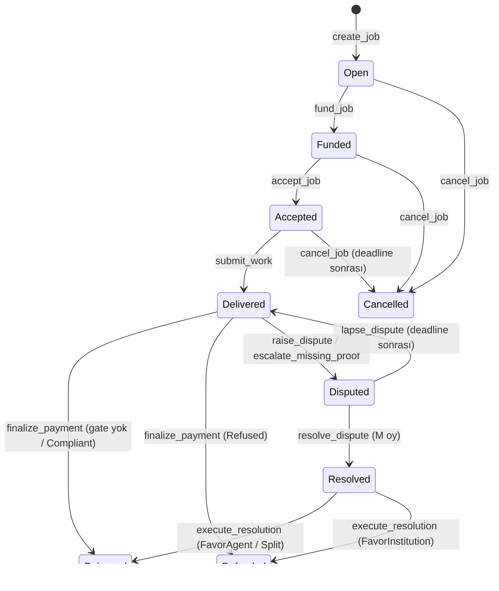
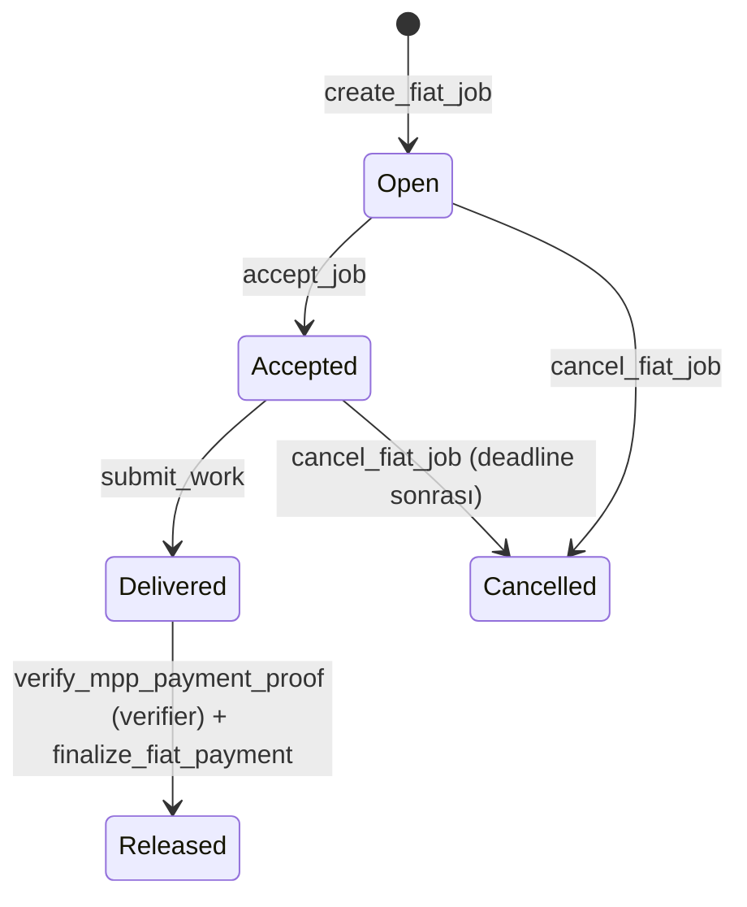

# Program arayüz sözleşmesi

**Sözleşme sürümü:** v0.8.0 (taslak) · **Issue:** BC-44 (#101), BC-47 (#119), BE-10 (#42), BC-17 (#25), BC-15 (#24), BC-21 (#29), BC-34 (#71), BC-09 (#9), BC-36 (#77), BC-32 (#69), BC-33 (#70), BC-37 (#78), BC-38 (#92) · **IDL'ler:** [`idl/`](../../idl/)

Bu doküman Square'in dört Solana programının (`square_registry`, `square_policy`, `square_verifier`, `square_escrow`) dış arayüzünü sabitler: instruction adları ve argümanları, hesap sırası ve imzacılar, account düzenleri, PDA seed'leri, event'ler ve hata kodları. Backend (BE-35 API/SDK sözleşmesi, servisler) ve frontend (FE-24 veri katmanı) bu sözleşmeye göre geliştirir. Gerçek programlar `programs/` altında taşındıkça ve değiştikçe bu arayüze uyar; uyum BC-13 ile CI'da denetlenir.

Sözleşmenin tek doğruluk kaynağı `idl/*.json` dosyalarıdır. Bu dokümandaki referans tabloları ([§10](#10-referans-tabloları)) IDL'den üretilmiştir. IDL'in taşımadığı kurallar (programlar arası okumaların owner ve alan kontrolleri, akış ve durum geçişleri) §3–§8'de yazılıdır.

## 1. Dosyalar

| Program | IDL | Gerçek program | Program ID |
|---|---|---|---|
| `square_registry` | `idl/square_registry_contract.json` | `programs/square-registry` (BC-07) | `AL5p4aTWrmBmWa4vxJFbBjQG7Xnx2juc15FJRGpwSsA9` |
| `square_policy` | `idl/square_policy_contract.json` | `programs/square-policy` (BC-05) | `63HKPj2L8a9DGeTa9Eh3NaZXthMrFUEgbs9Y28SNEc4` |
| `square_verifier` | `idl/square_verifier_contract.json` | `programs/square-verifier` (BC-05) | `8yLdDR5zoAzeEWzkNX19DKy4HfVYXb7VcU3wWStwTFPh` |
| `square_escrow` | `idl/square_escrow_contract.json` | `programs/square-escrow` (BC-04) | `6yBTEVbizMVCWAp4c3jx6Xdsay3CiUmrJmTswY7QRWaX` |

- **Program ID'leri:** IDL'deki `address` alanı Square'in kendi program kimlikleridir (BC-09, v0.5.0; [upgrade runbook'u](../runbooks/upgrade.md)). v0.4.2'ye kadar taşınan kaynak programların kimlikleri (aip-registry, Aperture policy-registry ve verifier, Covenant) kullanılıyordu. Program keypair'leri repoda değil, secret store'dadır. İstemciler adresi IDL'den değil, ortam yapılandırmasından alır.
- **IDL adları:** IDL'in `metadata.name` alanı `square_<program>_contract` biçimindedir. İstemci üretiminde kullanılacak ad (`square_<program>`) BE-35'te kesinleşir.
- **Hata kodları:** Anchor varsayılanıyla her programda 6000'den başlar ve programlar arasında çakışır. Örneğin escrow tx'inde `record_release` CPI'ından dönen bir verifier hatası, escrow koduyla aynı numarayı taşıyabilir. İstemciler hatayı (program ID, kod) çiftiyle eşler. `#[error_code(offset)]` kullanılmaz, çünkü Anchor 0.31 IDL'e offset'i yazmıyor; IDL ile program birbirinden ayrılırdı.

### IDL'lerin bakımı

Sözleşme değişikliği doğrudan `idl/*.json` üzerinde, sürüm notuyla ([§11](#11-sözleşme-değişiklik-kaydı)) yapılır. Türetilen dosyalar aynı PR'da yeniden üretilir:

```bash
pnpm --filter @squaresdk/solana-types gen   # zod + OpenAPI şemaları
pnpm --filter @squaresdk/solana-sdk gen     # SDK'nın IDL kopyası + Anchor uyumlu camelCase TS tipleri
pnpm contract:check                         # ikisinin güncelliği (CI: contract.yml)
```

Bir program gerçek uygulamasına kavuştuğunda, o programın `anchor build` ile ürettiği IDL'in `idl/`'dakiyle aynı olması BC-13'te CI'a eklenir. Anchor 0.31, `target/deploy` klasörü yokken yapılan ilk derlemede `declare_id!` değerlerini rastgele anahtarlarla değiştirir (program ID eşitlemesi); temiz bir klonda derlemeden önce `mkdir -p target/deploy` gerekir.

## 2. Roller

| Rol | Kim | Ne imzalar |
|---|---|---|
| `institution` | Kurumun anahtarı; `set_institution_multisig` sonrasında policy ve verifier'da **yalnızca** bağlı Squads v4 vault PDA'sı. Escrow'un iş talimatlarında yetkili `Job.institution`, yani işi açan imzacıdır: bağlamadan önce açılmış işlerde açan anahtar kalır ([BC-39 P-02](../security/review-bc-39.md#p-02-multisige-geçişte-açık-işlerin-yetkisi-açan-anahtarda-kalır-orta)) | policy: `set_institution_multisig`, `set_policy`, `update_policy`, `set_buyer_root`, `deactivate_policy`; verifier: `set_compliance_proof`; escrow: `create_job`, `commit_travel_rule`, `fund_job`, `raise_dispute`, `cancel_job` |
| `agent` | `Job.agent_wallet` (kayıttaki `AgentRecord.wallet`'ın job'a kopyası) | `accept_job`, `submit_work`, `list_claim`, `escalate_missing_proof` |
| agent `owner` | `AgentRecord.owner` (kaydı yöneten anahtar, Squads vault olabilir) | `register_agent`, `update_agent`, `set_agent_status`, `transfer_agent_ownership`, `deregister_agent`, escrow `sync_agent_wallet` |
| `seller` | Alacağı listeleyen agent cüzdanı | `cancel_claim` |
| `buyer` | Kurumun onaylı alıcı listesindeki, screening'i temiz adres | `buy_claim` |
| `arbitrator` | `EscrowConfig.arbitrators[..arbitrator_count]` | `resolve_dispute` (M-of-N oy) |
| `keeper` | Herkes (permissionless) | `finalize_payment`; `keeper_fee_bps` kadar ücret alır |
| permissionless çağıran | Herkes | `execute_resolution`, `lapse_dispute` |
| `screener_authority` | `RegistryConfig.screener_authority` (screener servisi, BE-16) | `record_screening` |
| `admin` | Program upgrade authority'si (Squads vault, BC-09); `init_*` bunu `program_data` ile doğrular | `init_*` ve `update_*` config instruction'ları |
| `payer` | Rent ve ücret ödeyen (sponsor fee payer olabilir) | Hesap açan instruction'lar; rol imzacısından ayrıdır (BC-22, BC-35) |
| `escrow_authority` | Escrow programının `["escrow_authority"]` PDA'sı | Verifier'a `record_release` CPI'ı (`invoke_signed`) |

`institution` adı iki yerde iki ayrı şeyi gösterir. Escrow'da `Job.institution` kurumun **imzacı cüzdanıdır** (kendi anahtarı veya Squads vault'u). Policy ve verifier'da `institution` ise square_policy'nin **`Institution` PDA'sıdır**.

**Rent kuralı:** Rol imzacıları rent ödemez. İki istisna var: config'i açan `admin`, ve oluşturdukları itibar ve validation PDA'larının rentini ödeyen permissionless çağıranlar (`keeper`, `execute_resolution` çağıranı). Kapanan hesapların (vault, bond vault, listeleme) renti, hesabı açan `rent_payer`'a döner.

## 3. Sekiz adımlı akış → instruction eşlemesi

| # | Aktör | Instruction | Program | Okunan dış hesaplar |
|---|---|---|---|---|
| 1 | Kurum | `init_institution`, (opsiyonel `set_institution_multisig`), `set_policy(policy_id, commitment, daily_ceiling)` | policy | — |
| 2 | Agent | `register_agent(agent_id, agent_card_uri, agent_card_hash, wallet)`; `did:aip` olarak çözümlenir (BC-14) | registry | — |
| 3 | Screener | `record_screening(wallet, status, source_hash)`: kurum, agent ve alıcı cüzdanları için | registry | — |
| 3 | Kurum | `create_job(spec_hash, amount, deadline, challenge_period)` + opsiyonel `policy` (snapshot alınır) → `commit_travel_rule` (eşiğe eşit ya da üstündeki işte zorunlu) → `fund_job` | escrow | `AgentRecord`, `Policy`, `Institution`, iki `ScreeningRecord` |
| 4 | Agent | `accept_job(spec_hash)`, `submit_work(work_hash, delivery_uri)` | escrow | `AgentRecord` |
| 5 | Kurum | `set_buyer_root(buyer_root)` | policy | — |
| 5 | Agent / alıcı | `list_claim(price)`, `buy_claim(price, leaf_salt, merkle_proof)`, `cancel_claim` | escrow | `Policy.buyer_root`, alıcı `ScreeningRecord` |
| 7 | Kurumun yazılımı | `set_compliance_proof(proof_a, proof_b, proof_c, public_inputs)` → `ReleaseProof` | verifier | `Institution`, `Policy`, `Job`, `ClaimListing` |
| 6 + 8 | Keeper | `finalize_payment`: keeper ücreti, proof gate, ödeme, itibar, validation kaydı, `record_release` CPI | escrow → verifier | `ReleaseProof`, `OperatorState`, payee `ScreeningRecord` |
| — | Kurum / arbitrator / herkes | `raise_dispute` / `escalate_missing_proof` → `resolve_dispute` oyları (M) → `execute_resolution`; karar çıkmazsa `lapse_dispute` | escrow | `ReleaseProof` (agent tarafına ödeme varsa) |
| Fiat | Kurum, agent, MPP authority, herkes | `create_fiat_job(spec_hash, amount, deadline)` (vault yok, policy zorunlu) → `accept_job` (açıkken) → `submit_work` → kurum Stripe ile öder → Ed25519 attestation + `verify_mpp_payment_proof` → `finalize_fiat_payment` ([ADR 0024](../decisions/0024-stripe-mpp-fiat-rayi.md)) | escrow, verifier | `AgentRecord`, `Policy`, `Institution`, iki `ScreeningRecord`; `Job`, Instructions sysvar; `ReleaseProof`, `OperatorState` |

Policy'li işlerde 7. adım, 6. adımdaki finalize'dan **önce** gelir (Arc modeli): kurum ispatı release'den önce job'a bağlar, keeper ispattan habersizdir. İspat yoksa `finalize_payment` `ProofRequired` ile reddedilir ve escrow bekler. Agent'ın bu durumdaki başvuru yolu `escalate_missing_proof`'tur ([ADR 0016](../decisions/0016-dispute-m-of-n-zaman-asimi-ve-ispatsiz-bekleme.md)).

## 4. Programlar arası erişim

**Kural:** CPI yerine account-read. Okuyan program; hesabın owner'ını, PDA seed'lerini yeniden türeterek adresini ve gereken alanlarını kontrol eder. IDL'de `pda.program` alanı olan hesaplar ("IDL'de" sütunu ✓) istemci tarafından otomatik çözümlenebilir; diğerleri SDK'da bu tabloya göre türetilir.

| Okuyan instruction | Hesap (sahibi) | Seed'ler | Kontroller | IDL'de |
|---|---|---|---|---|
| escrow `create_job` | `AgentRecord` (registry) | `["agent", creator, agent_id]` | owner; `status == Active`; `wallet` → `Job.agent_wallet` | — |
| escrow `create_job` | `Policy`, `Institution` (policy) | `["policy", institution, policy_id]`, `["institution", owner_key]` | owner; `active`; imzacı kurumun güncel yetkilisi; `commitment`, `daily_ceiling`, `version` job'a kopyalanır | — |
| escrow `fund_job` | `ScreeningRecord` ×2 (registry) | `["screening", wallet]` | `status == Clear`, `expires_at > now`; kurum ve `job.agent_wallet` | ✓ |
| escrow `accept_job` | `AgentRecord` (registry) | (job'a bağlı adres) | `status == Active`; imzacı `job.agent_wallet` | — |
| escrow `sync_agent_wallet` | `AgentRecord` (registry) | (job'a bağlı adres) | imzacı `owner`; güncel `wallet` job'a kopyalanır | — |
| escrow `buy_claim` | `Policy` (policy) | `job.policy` | güncel `buyer_root`; yaprak `sha256(buyer ‖ leaf_salt)`, sıfır kök = kısıtsız | — |
| escrow `buy_claim` | alıcı `ScreeningRecord` (registry) | `["screening", buyer]` | temiz ve taze | ✓ |
| escrow `finalize_payment`, `execute_resolution` | `ReleaseProof` (verifier) | `["release_proof", job]` | owner; `verdict`; `payee`, `net_amount`, `mint` escrow'un hesapladığıyla aynı; `consumed == false` | ✓ |
| escrow `finalize_payment`, `execute_resolution` | `OperatorState` (verifier) | `["operator_state", release_proof.institution]` | `daily_spent == release_proof.daily_spent_before` (tazelik); CPI ile yazılır | — |
| escrow `finalize_payment`, `execute_resolution` | `VerifierConfig` (verifier) | `["verifier_config"]` | CPI'a geçirilir | ✓ |
| escrow `finalize_payment`, `execute_resolution` | payee `ScreeningRecord` (registry) | `["screening", payee]` | temiz ve taze; değilse ödeme bekler | — (payee claim'e bağlı) |
| escrow `escalate_missing_proof` | `ReleaseProof` (verifier) | `["release_proof", job]` | owner; hesap yoksa, ret geçiciyse ya da ispat başka bir UTC gününde değerlendirildiyse başvuru açılır | ✓ |
| verifier `set_compliance_proof` | `Institution`, `Policy` (policy) | yukarıdaki gibi | owner; imzacı kurumun güncel yetkilisi; `policy.institution == institution` | — |
| verifier `set_compliance_proof` | `Job` (escrow) | `["job", institution_wallet, spec_hash]` | owner; durum Delivered/Disputed/Resolved; `job.policy == policy`; ispat `job.policy_commitment` ve `policy_daily_ceiling`'e karşı doğrulanır | — |
| verifier `set_compliance_proof` | `ClaimListing` (escrow) | `["claim", job]` | yoksa payee agent; `Bought` ise payee alıcı | ✓ |
| escrow `create_fiat_job` | `AgentRecord`, `Policy`, `Institution` (registry, policy) | `create_job`'daki gibi | `create_job`'daki gibi; policy zorunlu | — |
| escrow `create_fiat_job` | `ScreeningRecord` ×2 (registry) | `["screening", wallet]` | kurum ve `AgentRecord.wallet`: temiz ve taze (`fund_job`'ın kuralı) | — |
| escrow `finalize_fiat_payment` | `ReleaseProof`, `OperatorState`, `VerifierConfig` (verifier) | `finalize_payment`'taki gibi | payee `job.agent_wallet`, net `job.amount`; uyumlu ve taze; `record_release` CPI | ✓ (`ReleaseProof`, `VerifierConfig`) |
| verifier `verify_mpp_payment_proof` | `Institution`, `Policy` (policy), `Job` (escrow) | `set_compliance_proof`'taki gibi | `job.rail == Fiat`, `Delivered`, `job.policy == policy`; ispat 13 sinyale (payee agent, net `job.amount`, sinyal 12 makbuz) karşı | — |
| verifier `verify_mpp_payment_proof` | Instructions sysvar | — | önceki talimat Ed25519 precompile; tek imza, kendi verisinde; imzacı `config.mpp_authority`, mesaj `"square/mpp-attestation/v1" ‖ job ‖ stripe_receipt_hash ‖ amount (u64 LE)` | — |

**Kontrollerin paylaşımı:** Verifier ispatı job'un policy snapshot'ına karşı doğrular; payee ve mint'i `Job` / `ClaimListing`'den bağlar. Net tutarı ise doğrulamaz, ispattaki değeri kaydeder. Escrow release anında net tutarı kendi config'iyle (`amount − keeper fee`, dispute'ta agent tarafı tutarı) hesaplar ve ispattaki payee, tutar, mint ve günlük sayaçla karşılaştırır. Herhangi biri farklıysa `StaleReleaseProof` döner ve kurum ispatı yeniden bağlar.

**Tek CPI:** escrow → verifier `record_release`. İmzacı, escrow programı altında türetilen `["escrow_authority"]` PDA'sıdır; verifier bunu `VerifierConfig.escrow_program` ile doğrular. Gerekçe: `OperatorState` (günlük harcama sayacı) verifier'a aittir, escrow yazamaz. `release_proof` ve `operator_state` dış instruction'da da yazılabilir geçirilir (CPI yazma yetkisini yükseltemez). CPI derinliği 1'dir (token transferleri hariç).

**Program ID'lerinin kaynağı:** Escrow okuduğu programların ID'lerini `EscrowConfig.{registry,policy,verifier}_program` alanlarında, verifier ise `VerifierConfig.{escrow,policy}_program` alanlarında tutar. Bu alanlar yalnızca upgrade authority'nin çağırabildiği `init_*` ile yazılır. Escrow ile verifier birbirinin hesabını okuduğu için ID'leri crate bağımlılığıyla paylaşmak döngü yaratırdı. Paylaşılan seed'ler, hesap tipleri ve owner/seed doğrulamalı okuma yardımcısı [`crates/square-common`](../../crates/square-common/)'dadır (BC-10); tipler ve seed'ler bu sözleşmenin IDL'lerinden üretilir.

## 5. PDA seed tablosu

Her programın kendi seed'leri IDL'de `constants` olarak da yayımlanır.

| Program | Hesap | Seed'ler | Not |
|---|---|---|---|
| registry | `RegistryConfig` | `["registry_config"]` | singleton |
| registry | `AgentRecord` | `["agent", creator, agent_id]` | `creator` değişmez; sahiplik devri adresi değiştirmez; kayıt kapatılmaz (`Deregistered`), aynı `agent_id` tekrar kullanılamaz |
| registry | `ScreeningRecord` | `["screening", wallet]` | `init_if_needed`; her screening üzerine yazar |
| policy | `Institution` | `["institution", owner_key]` | Aperture: `OperatorAccount` `["operator", authority]` |
| policy | `Policy` | `["policy", institution, policy_id]` | `policy_id: [u8; 32]` |
| verifier | `VerifierConfig` | `["verifier_config"]` | singleton |
| verifier | `OperatorState` | `["operator_state", institution]` | `institution` = policy `Institution` PDA'sı; Aperture seed'i korunur |
| verifier | `ReleaseProof` | `["release_proof", job]` | `job` = escrow `Job` PDA'sı; tüketilene kadar yeniden bağlanabilir |
| escrow | `EscrowConfig` | `["config"]` | Covenant seed'i |
| escrow | `Job` | `["job", institution, spec_hash]` | Covenant seed'i; `institution` = imzacı cüzdan |
| escrow | vault (token hesabı) | `["escrow_token", job]` | token authority = `job`; settlement'ta kapanır |
| escrow | bond vault (token hesabı) | `["bond", job]` | token authority = `job`; bump `Job.bond_bump` |
| escrow | `ClaimListing` | `["claim", job]` | job başına tek listeleme; `cancel_claim` kapatır, yeniden listelenebilir |
| escrow | `AgentReputation` | `["reputation", agent_record]` | Covenant'ta `["reputation", wallet]` idi (BC-26) |
| escrow | `ValidationRecord` | `["validation", job]` | job başına tek kayıt |
| escrow | `escrow_authority` | `["escrow_authority"]` | veri ve fon tutmaz; yalnızca CPI imzacısı |

**Hesap düzeni:** Sabit boyutlu alanlar önce, değişken boyutlu alanlar (`String`, `Option`, veri taşıyan enum) sonda gelir. Böylece indexer ve keeper, sabit önekteki alanlarda `memcmp` filtresi kullanabilir. Örnekler: `Job.status`, `Job.agent_record`, `AgentRecord.wallet` / `status`, `ClaimListing.status`.

### Alıcı listesi Merkle ağacı (`set_buyer_root`, `buy_claim`)

Kurum onaylı alıcıları bir Merkle köküyle taahhüt eder (`Policy.buyer_root`); `buy_claim` alıcının listede olduğunu kanıtla gösterir. Kanıt yalnızca kardeş düğümleri taşıdığı için iç düğümler sıralı çiftle hash'lenir:

| Öğe | Tanım |
|---|---|
| Yaprak | `sha256(buyer ‖ leaf_salt)`: alıcının 32 baytlık adresi ve alıcıya özel 32 baytlık salt |
| İç düğüm | `sha256(min(a, b) ‖ max(a, b))`; `min` / `max` 32 baytın sözlük sırasıyla |
| Tek kalan düğüm | Bir seviyede eşi olmayan son düğüm üst seviyeye değişmeden taşınır |
| Kök | Kalan tek düğüm; tek yapraklı ağaçta yaprağın kendisi |
| Boş liste | Kök 32 sıfır bayt: alım kısıtsızdır (`buy_claim` kanıt istemez) |
| Kanıt | Yapraktan köke kardeş düğümler, en fazla 16 tane (en çok 65 536 alıcı) |

Salt, listeyi görmeyen birinin bir adresin listede olup olmadığını kökten sınamasını engeller. Yapraklar aynı ağaçta tekrar edemez. Kökü ve kanıtları `@squaresdk/solana-policy` üretir (BE-10). Zincirdeki doğrulama yardımcısı `square_common::merkle`'dir (BC-18); `buy_claim` onu kullanır (BC-25). İki uygulamanın uyumu ortak test vektörleriyle denetlenir (`crates/square-common/tests/fixtures/buyer-merkle-vectors.json`, `packages/policy/scripts/buyer-vectors.mjs`).

## 6. Escrow durum makinesi



Fiat işin ([ADR 0024](../decisions/0024-stripe-mpp-fiat-rayi.md)) vault'u, fonlama adımı, challenge penceresi, dispute'u ve alacağı yoktur:



- `finalize_payment` yalnızca `challenge_end` geçtikten sonra ve aktif dispute yokken çalışır. Keeper ücreti her dalda ödenir: `net = amount − amount × keeper_fee_bps / 10 000`.
- Payee çözümlemesi her yerde aynıdır: `ClaimListing.status == Bought` ise alıcı, değilse `Job.agent_wallet`. İspat bağlama (`ReleaseProof.payee`) ve ödeme aynı kuralı kullanır. Settlement'ta listeleme `Settled` olur; iş kuruma iade edilirse `Defaulted` olur ve alıcıya ödeme yapılmaz.
- Dispute iki adımlıdır: arbitrator oyları (`resolve_dispute`) yalnızca kararı kaydeder. Ödemeyi `execute_resolution` yapar, böylece settlement hesapları ve rentler tek bir çağrıda kullanılır. Her job'da en fazla bir dispute açılabilir.
- İtibar her zaman `AgentRecord`'a yazılır, alacak satılmış olsa da alıcıya yazılmaz. Her settlement bir `ValidationRecord` üretir (`Verified` / `Refused` / `NoGate` / `NoPayout`).
- Agent cüzdanı değişirse (registry `update_agent`) job eski cüzdanda kalır; kayıt sahibi `sync_agent_wallet` ile job'u güncel cüzdana taşır. `set_agent_status(Inactive)` yeni iş açmayı ve kabulü engeller; kabul edilmiş işler teslim edilip çözülebilir.

## 7. M5–M6 taslakları

Aşağıdakiler sözleşmede **taslak** olarak yer alır; ayrıntılar ilgili issue'larda kesinleşir ve sözleşme sürümü buna göre artar.

| Konu | Sözleşmedeki yüzey | Kesinleşeceği issue |
|---|---|---|
| M-of-N arbitration | `update_arbitrators(arbitrators: Vec<Pubkey>, threshold)`; N ≤ 7, 2 ≤ M ≤ N; `arbitrator_set_version` ve dispute'taki snapshot'ı; `ArbitratorsUpdated`, `DisputeVote`, `DisputeDecided` | BC-32: v0.6.0'da kesinleşti ([ADR 0016](../decisions/0016-dispute-m-of-n-zaman-asimi-ve-ispatsiz-bekleme.md)); set değişince sonraki oy sayımı yeni setle baştan başlar |
| Dispute timeout | `EscrowParams.dispute_timeout_secs` (> 0), `DisputeInfo.deadline`, permissionless `lapse_dispute`: bond iade edilir, dispute düşer, iş `Delivered`'a döner ve normal finalize yolundan çözülür; `DisputeLapsed`, `DisputeNotExpired`, `InvalidDisputeTimeout` | BC-33: v0.6.0'da kesinleşti (ADR 0016) |
| İspatsız bekleme | `EscrowParams.proof_timeout_secs` (>= 0), `escalate_missing_proof`: policy'li işte `challenge_end + proof_timeout_secs` (lapse'tan sonra kapanıştan) sonra, bugün işi kapatabilecek bir ispat yoksa agent bond'suz dispute açar; `MissingProofEscalated`, `ProofTimeoutNotReached` | BC-33: v0.6.0'da kesinleşti (ADR 0016) |
| Travel Rule | `EscrowParams.travel_rule_threshold` (0 = kapalı), `commit_travel_rule(commitment)`, `Job.travel_rule_commitment`, `TravelRuleCommitted`, `TravelRuleCommitmentRequired` | BC-34: v0.4.2'de kesinleşti ([ADR 0015](../decisions/0015-travel-rule-commitment-ve-esik.md)) |
| CCTP fonlama | Ayrı instruction yok: CCTP `receive_message` USDC'yi kurumun token hesabına mint eder, aynı tx'te `fund_job` çalışır | BC-36: v0.5.1'de kesinleşti ([cctp-funding.md](cctp-funding.md)) |
| Stripe MPP | `verify_mpp_payment_proof` (Ed25519 precompile + Sysvar Instructions), `update_mpp_authority`, `VerifierConfig.mpp_authority`, `MppPaymentVerified` | BC-37: v0.7.0'da kesinleşti ([ADR 0024](../decisions/0024-stripe-mpp-fiat-rayi.md)); fiat iş (`create_fiat_job`, `cancel_fiat_job`, `finalize_fiat_payment`, `Job.rail`), attestation işe ve tutara bağlı, ispat yol A'da 13 sinyal |

## 8. Kaynak programlardan farklar ve tasarım kararları

| Kaynak | Değişiklik | Issue |
|---|---|---|
| aip-registry | `did`, `name`, `endpoint`, `capabilities_json`, `version`, `agent_type` zincirden çıkar; yerine A2A agent card işaretçisi gelir: `agent_card_uri` ve `agent_card_hash` (did, PDA'dan türetilir) | BC-14, BC-15 |
| aip-registry | `creator` (seed, değişmez) ile `owner` (devredilebilir) ayrılır; `set_agent_status`, `transfer_agent_ownership`; `deregister_agent` kaydı kapatmaz, `Deregistered` yapar (itibar ve did:aip yeniden kayıtla devralınamaz); screening kaydı ve config eklenir | BC-15, BC-27 |
| Aperture policy-registry | `OperatorAccount` → `Institution`, `initialize_operator` → `init_institution`, `register_policy` → `set_policy`, `set_multisig` → `set_institution_multisig` | BC-17 |
| Aperture policy-registry | `*_multisig` instruction'ları kalkar. Yetkili, multisig bağlanana kadar kurum anahtarı, sonrasında yalnızca bağlı Squads vault'udur | BC-17, BC-35 |
| Aperture policy-registry | `merkle_root` / `policy_data_hash` yerine salt'lı Poseidon `commitment` + public `daily_ceiling`; `buyer_root` eklenir | BC-17, BC-18 |
| Aperture verifier | `verify_payment_proof` (RISC Zero), `verify_batch_attestation`, `record_payment` ve `ComplianceStatus` / `ProofRecord` hesapları kalkar; yerine `set_compliance_proof` → `ReleaseProof` ve CPI-only `record_release` gelir | BC-11, BC-21 |
| Aperture verifier | `verify_mpp_payment_proof`: derleme zamanı `MPP_AUTHORITY_PUBKEY` yerine `VerifierConfig.mpp_authority` (`update_mpp_authority`); imzalanan mesaj commitment'tan `job ‖ commitment ‖ amount`'a genişler; 10 sinyal argümanı yerine yol A'da 13 sinyal; `ProofRecord` yerine `ReleaseProof`, sayaç `finalize_fiat_payment`'ın `record_release` CPI'ıyla ilerler | BC-37 |
| Covenant | `create_job` (oluştur + fonla) ikiye ayrılır: `create_job` + `fund_job`; job bir `AgentRecord`'a ve opsiyonel bir `Policy`'ye bağlanır, policy snapshot'ı alır; tek settlement mint'i (`EscrowConfig.settlement_mint`) | BC-22 |
| Covenant | `JobEscrow` → `Job`; `ProtocolConfig` → `EscrowConfig` (seed `["config"]` korunur); sabit 3 arbitrator slotu → en fazla 7 (M-of-N); oylama (`resolve_dispute`) ile ödeme (`execute_resolution`) ayrılır | BC-22, BC-32 |
| Covenant | `FavorTaker` / `FavorPoster` → `FavorAgent` / `FavorInstitution`; `Split { taker_amount }` → `Split { agent_amount }` | BC-22 |
| Covenant | `keeper_fee_bps`, proof gate (`Released` / `Refunded` durumları), `ValidationRecord`, itibarın `AgentRecord`'a bağlanması, alıcı screening'i; Anchor event'leri (Covenant yalnızca `msg!` kullanıyordu) | BC-16, BC-23..BC-27 |
| Hepsi | `init_*` config instruction'ları `program` + `program_data` ile upgrade authority'yi doğrular (front-run koruması); rent ödeyen kaydedilir ve kapanan hesapların renti ona döner | BC-09, BC-35 |

### Açık noktalar

Sözleşme bu konularda bir varsayımla yazıldı. Varsayım, ilgili issue'nun ADR'ında doğrulanmalı ya da değiştirilmelidir:

1. **Ret semantiği (BC-24):** Arc modeline göre `Refused` ispat net tutarı kuruma iade eder. İspat job'un policy snapshot'ına bağlı olduğu için kurum teslimattan sonra policy'yi değiştirerek ret üretemez. Ancak günlük tavan aşımı gibi **geçici** ret sebepleri (kurumun başka ödemelerle sayacı doldurması dahil) iadeye yol açar. Hangi `refusal_code`'ların iade, hangilerinin bekleme anlamına geldiği ADR'da belirlenmeli.
2. **İspatın hiç bağlanmaması (BC-24, BC-33):** Taslak `escalate_missing_proof` agent'a dispute yolu açar. Dispute lapse olursa iş yeniden `Delivered`'a döner ve aynı durum sürebilir; arbitrator kararı (FavorAgent) da policy'li işte ispat ister. Kurumun ispatı vermeyerek ödemeyi süresiz bekletmesine karşı kesin kural ADR'da belirlenmeli. **Karar ([ADR 0016](../decisions/0016-dispute-m-of-n-zaman-asimi-ve-ispatsiz-bekleme.md)):** başvuru lapse'tan sonra tekrarlanabilir; ispat yoksa, ret geçiciyse ya da ispat başka bir UTC gününde değerlendirildiyse açılır. Aynı gün bayatlayan ispat ve kurumun hiç ispat bağlamadığı karar ADR'nin açık noktalarıdır. Agent tarafına ispatsız ödeme yoktur, arbitrator'lar FavorInstitution ya da Split ile çözebilir.
3. **Dispute'ta ispatın kapsamı (BC-24):** İspat agent tarafına ödenen escrow tutarını kapsar (FavorAgent'ta `amount`, Split'te `agent_amount`, keeper ücreti yok). FavorAgent'ta agent tarafına kesilen bond bir cezadır ve gate'ten geçmez (ADR 0016'da kesinleşti; payee screening'i bond için de aranır). İspat karar sonrası (`Resolved`) bağlanır.
4. **Günlük sayacın ilerlemesi (BC-21):** Sözleşme, sayacın escrow → verifier `record_release` CPI'ı ile ilerlediğini varsayar.
5. **Payee screening başarısızlığı (BC-27):** Release'te payee kaydı temiz değilse ödeme bekler; iade yapılmaz.
6. **Aktif dispute'ta arbitrator seti değişimi (BC-32):** Dispute, açıldığı andaki `arbitrator_set_version`'ı saklar; oylamanın hangi sete göre yapılacağı issue'da kesinleşir. **Karar (ADR 0016):** oylar oy anındaki sete göre sayılır; sürüm eskiyse sonraki oy sayımı sıfırlar, son tarih değişmez.
7. **Keeper ücreti üst sınırı (BC-23):** `InvalidKeeperFee` için en yüksek bps değeri belirlenmeli.
8. **Aynı token hesabının birden çok rolde geçmesi (BC-23):** Örneğin keeper kurumun kendisiyse, `finalize_payment`'te aynı token hesabı iki kez yazılabilir olarak geçebilir. Anchor 1.2.0'da (BC-08) aynı yazılabilir hesabın iki kez geçmesi varsayılan olarak reddedilir (2040); izin verilecek hesaba `dup` kısıtı yazılmalı.
9. **İşlem boyutu (BC-19, BC-21, BC-28):** v0.2.0'dan itibaren `set_compliance_proof` 13 public sinyalin 10'unu hesaplardan kendisi kurar ([release-circuit.md](release-circuit.md) §6, yol A); instruction verisi 8 + 256 + 2 + 8 + 8 = 282 bayttır. `verify_mpp_payment_proof` v0.7.0'dan itibaren aynı yoldadır (BC-37): argümanları ispat, `stripe_receipt_hash` ve `proof_timestamp`'tir (8 + 256 + 32 + 8 = 304 bayt); Ed25519 talimatıyla birlikte tx ALT'sız 1135, Square ALT'ıyla 1076 bayttır. 8 adımın tx'lerinin ölçümü ve Square ALT'ı: [tx-budget.md](tx-budget.md) (BC-28); `set_compliance_proof` ALT'sız 868 bayttır.
10. **`emit!` / `emit_cpi!` (BC-16):** Karar `emit!`; gerekçe, istisna kuralı ve sürümleme [events.md](events.md)'de. Programlar event'leri `square_common::square_<program>_events!()` ile tanımlar.
11. **Tek settlement mint'i (BC-22):** v0.1.0 yalnızca `EscrowConfig.settlement_mint` (USDC) ile çalışır. Policy tavanı ve günlük sayaç bu mint'in birimindedir. Çoklu mint ve Token-2022 uzantıları kapsam dışıdır.

## 9. BE-35 girdi incelemesi

Sözleşme, BE-35'in (API ve SDK sözleşmesi) ihtiyaçlarına göre gözden geçirildi:

| BE-35 ihtiyacı | Sözleşmedeki karşılığı | Durum |
|---|---|---|
| 8 adımın her biri için SDK fonksiyon imzası | §3 eşlemesi; her adımın instruction'ı IDL'de | ✓ |
| Tx hazırlama için hesap listesi ve PDA türetme | IDL'deki hesap sırası, imzacı ve yazılabilirlik bayrakları. Programın kendi PDA'ları ve statik çözümlenebilen dış PDA'lar IDL'de `pda` olarak, seed sabitleri IDL `constants` içinde; geri kalanı §4 ve §5'te | ✓ |
| Opsiyonel hesaplar | IDL `optional: true`. Anchor TS, PDA'sı bilinen opsiyonel hesapları (ör. `release_proof`) policy'siz işlerde de doldurabilir; program, bu durumda başlatılmamış hesabı "yok" sayar | ✓ (not) |
| `@squaresdk/solana-types` için job, policy, agent ve claim modelleri | IDL `accounts` + `types` (ör. `Job`, `Policy`, `AgentRecord`, `ClaimListing`, `ReleaseProof`) | ✓ |
| Event payload şemaları (indexer, API) | IDL `events` + `types`; §10 tabloları | ✓ |
| Hata kodlarının API yanıt zarfına eşlenmesi | IDL `errors`; (program ID, kod) çifti ile eşlenir | ✓ |
| Hesap filtreleme (indexer, keeper `memcmp`) | IDL `accounts[].discriminator` + sabit önekli düzen (§5) | ✓ |
| Birim ve tip kuralları | Tutarlar `u64` settlement mint atomik birimi (USDC 6 ondalık), zamanlar `i64` unix saniye, hash'ler `[u8; 32]` | ✓ |
| Program adresleri | IDL `address` geçicidir (BC-09); SDK adresi yapılandırmadan almalı | ✓ (not) |
| Policy meta (off-chain) | Policy içeriği zincirde yok; yalnızca `commitment`, `daily_ceiling`, `buyer_root`. Meta şeması BE-35'te tanımlanır | ✓ (kapsam dışı) |
| "Program tipleri IDL ile birebir" CI kontrolü | `idl/*.json` tek kaynak; `pnpm contract:check` türetilen dosyaların sapmasını yakalar (§1) | ✓ |

## 10. Referans tabloları

IDL'den üretilmiştir; instruction'lar alfabetik sıradadır. "(w)" yazılabilir imzacıyı gösterir. Hata kodları her programda `6000 + sıra` biçimindedir.

### 10.1 square_registry

#### Instruction'lar (8)

| Instruction | Argümanlar | İmzacılar | Yazılabilir diğer hesaplar | Opsiyonel hesaplar |
|---|---|---|---|---|
| `deregister_agent` | — | `owner` | `agent_record` | — |
| `init_registry_config` | `screener_authority: pubkey`, `screening_ttl_secs: i64` | `admin` (w) | `config` | — |
| `record_screening` | `wallet: pubkey`, `status: ScreeningStatus`, `source_hash: [u8; 32]` | `payer` (w), `screener_authority` | `screening_record` | — |
| `register_agent` | `agent_id: string`, `agent_card_uri: string`, `agent_card_hash: [u8; 32]`, `wallet: pubkey` | `payer` (w), `owner` | `agent_record` | — |
| `set_agent_status` | `status: AgentStatus` | `owner` | `agent_record` | — |
| `transfer_agent_ownership` | `new_owner: pubkey` | `owner` | `agent_record` | — |
| `update_agent` | `agent_card_uri: string`, `agent_card_hash: [u8; 32]`, `wallet: pubkey` | `owner` | `agent_record` | — |
| `update_registry_config` | `screener_authority: pubkey`, `screening_ttl_secs: i64` | `admin` | `config` | — |

#### Event'ler (7)

| Event | Alanlar |
|---|---|
| `AgentDeregistered` | `agent_record: pubkey` |
| `AgentOwnershipTransferred` | `agent_record: pubkey`, `previous_owner: pubkey`, `new_owner: pubkey` |
| `AgentRegistered` | `agent_record: pubkey`, `creator: pubkey`, `owner: pubkey`, `agent_id: string`, `wallet: pubkey`, `agent_card_hash: [u8; 32]` |
| `AgentStatusChanged` | `agent_record: pubkey`, `status: AgentStatus` |
| `AgentUpdated` | `agent_record: pubkey`, `wallet: pubkey`, `agent_card_hash: [u8; 32]` |
| `RegistryConfigUpdated` | `admin: pubkey`, `screener_authority: pubkey`, `screening_ttl_secs: i64` |
| `ScreeningRecorded` | `wallet: pubkey`, `status: ScreeningStatus`, `source_hash: [u8; 32]`, `expires_at: i64` |

#### Hata kodları (8)

| Kod | Ad | Mesaj |
|---|---|---|
| 6000 | `AgentIdInvalid` | Agent ID must be 1-32 characters from [A-Za-z0-9_-] |
| 6001 | `AgentCardUriTooLong` | Agent card URI exceeds 200 bytes |
| 6002 | `Unauthorized` | Signer is not authorized for this operation |
| 6003 | `AgentInactive` | Agent is not active |
| 6004 | `AgentDeregistered` | Agent is deregistered |
| 6005 | `InvalidAgentStatus` | Status cannot be set with this instruction |
| 6006 | `InvalidScreeningTtl` | Screening TTL must be positive |
| 6007 | `AgentCardHashInvalid` | Agent card hash must be all zero exactly when the agent card URI is empty |

### 10.2 square_policy

#### Instruction'lar (6)

| Instruction | Argümanlar | İmzacılar | Yazılabilir diğer hesaplar | Opsiyonel hesaplar |
|---|---|---|---|---|
| `deactivate_policy` | — | `authority` | `policy` | — |
| `init_institution` | `name: string` | `payer` (w), `authority` | `institution` | — |
| `set_buyer_root` | `buyer_root: [u8; 32]` | `authority` | `policy` | — |
| `set_institution_multisig` | `multisig: pubkey`, `vault_index: u8` | `authority` | `institution`; salt okunur: `squads_multisig` | — |
| `set_policy` | `policy_id: [u8; 32]`, `commitment: [u8; 32]`, `daily_ceiling: u64` | `payer` (w), `authority` | `institution`, `policy` | — |
| `update_policy` | `commitment: [u8; 32]`, `daily_ceiling: u64` | `authority` | `policy` | — |

#### Event'ler (6)

| Event | Alanlar |
|---|---|
| `BuyerRootCommitted` | `policy: pubkey`, `buyer_root: [u8; 32]` |
| `InstitutionCreated` | `institution: pubkey`, `owner_key: pubkey`, `name: string` |
| `InstitutionMultisigSet` | `institution: pubkey`, `multisig: pubkey`, `multisig_vault: pubkey` |
| `PolicyCommitted` | `policy: pubkey`, `institution: pubkey`, `policy_id: [u8; 32]`, `commitment: [u8; 32]`, `daily_ceiling: u64`, `version: u32` |
| `PolicyDeactivated` | `policy: pubkey` |
| `PolicyUpdated` | `policy: pubkey`, `commitment: [u8; 32]`, `daily_ceiling: u64`, `version: u32` |

#### Hata kodları (5)

| Kod | Ad | Mesaj |
|---|---|---|
| 6000 | `Unauthorized` | Signer is not the institution's current authority |
| 6001 | `NameTooLong` | Institution name exceeds 64 bytes |
| 6002 | `PolicyInactive` | Policy is not active |
| 6003 | `InvalidDailyCeiling` | Daily ceiling must be greater than zero |
| 6004 | `InvalidSquadsMultisig` | Account is not an initialized Squads v4 multisig |

### 10.3 square_verifier

#### Instruction'lar (6)

| Instruction | Argümanlar | İmzacılar | Yazılabilir diğer hesaplar | Opsiyonel hesaplar |
|---|---|---|---|---|
| `init_verifier_config` | `escrow_program: pubkey`, `policy_program: pubkey`, `mpp_authority: pubkey` | `admin` (w) | `config` | — |
| `record_release` | — | `escrow_authority` | `release_proof`, `operator_state` | — |
| `set_compliance_proof` | `proof_a: [u8; 64]`, `proof_b: [u8; 128]`, `proof_c: [u8; 64]`, `refusal_code: u16`, `net_amount: u64`, `proof_timestamp: i64` | `payer` (w), `authority` | `operator_state`, `release_proof` | — |
| `sync_vk_version` | — | `admin` | `config` | — |
| `update_mpp_authority` | `mpp_authority: pubkey` | `admin` | `config` | — |
| `verify_mpp_payment_proof` | `proof_a: [u8; 64]`, `proof_b: [u8; 128]`, `proof_c: [u8; 64]`, `stripe_receipt_hash: [u8; 32]`, `proof_timestamp: i64` | `payer` (w), `authority` | `operator_state`, `release_proof` | — |

#### Event'ler (4)

| Event | Alanlar |
|---|---|
| `ComplianceProofSet` | `job: pubkey`, `policy: pubkey`, `verdict: ReleaseVerdict`, `refusal_code: u16`, `payee: pubkey`, `net_amount: u64`, `mint: pubkey`, `daily_spent_before: u64` |
| `MppPaymentVerified` | `job: pubkey`, `institution: pubkey`, `policy: pubkey`, `stripe_receipt_hash: [u8; 32]`, `amount: u64` |
| `ReleaseRecorded` | `job: pubkey`, `institution: pubkey`, `net_amount: u64`, `daily_spent: u64`, `day_start_unix: i64` |
| `VerifierConfigUpdated` | `admin: pubkey`, `escrow_program: pubkey`, `policy_program: pubkey`, `mpp_authority: pubkey`, `vk_version: u16` |

#### Hata kodları (13)

| Kod | Ad | Mesaj |
|---|---|---|
| 6000 | `InvalidProof` | Groth16 proof verification failed |
| 6001 | `PolicyMismatch` | Job has no policy or references a different policy |
| 6002 | `SnapshotMismatch` | Proof commitment or ceiling does not match the job's policy snapshot |
| 6003 | `PayeeMismatch` | Proof payee does not match the address the escrow will pay |
| 6004 | `MintMismatch` | Proof mint does not match the job mint |
| 6005 | `StaleProof` | Proof was built against an outdated daily counter or clock |
| 6006 | `ProofAlreadyConsumed` | Release proof already consumed |
| 6007 | `Unauthorized` | Signer is not authorized for this operation |
| 6008 | `InvalidLinkedAccount` | Account owner or seeds do not match the linked program |
| 6009 | `InvalidJobState` | Job is not in a state that accepts a release proof |
| 6010 | `InvalidMppAttestation` | MPP attestation missing or signed by an unexpected key |
| 6011 | `RailMismatch` | Instruction does not apply to the job's settlement rail |
| 6012 | `VkVersionAlreadySynced` | Config already records the embedded verifying key version |

### 10.4 square_escrow

#### Instruction'lar (22)

| Instruction | Argümanlar | İmzacılar | Yazılabilir diğer hesaplar | Opsiyonel hesaplar |
|---|---|---|---|---|
| `accept_job` | `spec_hash: [u8; 32]` | `agent` | `job` | — |
| `buy_claim` | `price: u64`, `leaf_salt: [u8; 32]`, `merkle_proof: Vec<[u8; 32]>` | `buyer` | `claim_listing`, `buyer_token_account`, `seller_token_account` | `policy` |
| `cancel_claim` | — | `seller` | `claim_listing`, `rent_payer` | — |
| `cancel_fiat_job` | — | `institution` | `job` | — |
| `cancel_job` | — | `institution` | `job`, `vault`, `institution_token_account`, `rent_payer` | — |
| `commit_travel_rule` | `commitment: [u8; 32]` | `institution` | `job` | — |
| `create_fiat_job` | `spec_hash: [u8; 32]`, `amount: u64`, `deadline: i64` | `payer` (w), `institution` | `job` | — |
| `create_job` | `spec_hash: [u8; 32]`, `amount: u64`, `deadline: i64`, `challenge_period: u64` | `payer` (w), `institution` | `job`, `vault` | `policy`, `policy_institution` |
| `escalate_missing_proof` | — | `agent` | `job` | — |
| `execute_resolution` | — | `payer` (w) | `job`, `vault`, `bond_vault`, `claim_listing`, `payee_token_account`, `institution_token_account`, `release_proof`, `operator_state`, `agent_reputation`, `validation_record`, `rent_payer` | `bond_vault`, `release_proof`, `operator_state`, `verifier_config`, `verifier_program` |
| `finalize_fiat_payment` | — | `payer` (w) | `job`, `release_proof`, `operator_state`, `agent_reputation`, `validation_record` | — |
| `finalize_payment` | — | `keeper` (w) | `job`, `vault`, `claim_listing`, `payee_token_account`, `institution_token_account`, `keeper_token_account`, `release_proof`, `operator_state`, `agent_reputation`, `validation_record`, `rent_payer` | `release_proof`, `operator_state`, `verifier_config`, `verifier_program` |
| `fund_job` | — | `institution` | `job`, `vault`, `institution_token_account` | — |
| `init_config` | `settlement_mint: pubkey`, `arbitrators: Vec<pubkey>`, `threshold: u8`, `params: EscrowParams`, `linked: LinkedPrograms` | `admin` (w) | `config` | — |
| `lapse_dispute` | — | `caller` | `job`, `bond_vault`, `institution_token_account`, `rent_payer` | `bond_vault` |
| `list_claim` | `price: u64` | `payer` (w), `agent` | `claim_listing` | — |
| `raise_dispute` | `reason_hash: [u8; 32]`, `bond: u64` | `payer` (w), `institution` | `job`, `bond_vault`, `institution_token_account` | — |
| `resolve_dispute` | `resolution: DisputeResolution` | `arbitrator` | `job` | — |
| `submit_work` | `work_hash: [u8; 32]`, `delivery_uri: string` | `agent` | `job` | — |
| `sync_agent_wallet` | — | `agent_owner` | `job` | — |
| `update_arbitrators` | `arbitrators: Vec<pubkey>`, `threshold: u8` | `admin` | `config` | — |
| `update_params` | `params: EscrowParams` | `admin` | `config` | — |

#### Event'ler (24)

| Event | Alanlar |
|---|---|
| `ArbitratorsUpdated` | `arbitrators: Vec<pubkey>`, `threshold: u8`, `arbitrator_set_version: u32` |
| `ClaimBought` | `job: pubkey`, `buyer: pubkey`, `price: u64` |
| `ClaimCancelled` | `job: pubkey` |
| `ClaimListed` | `job: pubkey`, `seller: pubkey`, `price: u64`, `face_value: u64` |
| `DisputeDecided` | `job: pubkey`, `resolution: DisputeResolution` |
| `DisputeLapsed` | `job: pubkey`, `bond_refunded: u64` |
| `DisputeRaised` | `job: pubkey`, `challenger: pubkey`, `bond: u64`, `reason_hash: [u8; 32]`, `deadline: i64` |
| `DisputeResolved` | `job: pubkey`, `resolution: DisputeResolution`, `agent_side_amount: u64`, `institution_refund: u64`, `bond_to_agent_side: u64`, `bond_returned: u64` |
| `DisputeVote` | `job: pubkey`, `arbitrator: pubkey`, `resolution: DisputeResolution`, `approval_count: u8` |
| `EscrowConfigUpdated` | `admin: pubkey`, `settlement_mint: pubkey`, `params: EscrowParams` |
| `FiatJobCreated` | `job: pubkey`, `institution: pubkey`, `agent_record: pubkey`, `agent_wallet: pubkey`, `policy: pubkey`, `policy_version: u32`, `mint: pubkey`, `amount: u64`, `spec_hash: [u8; 32]`, `deadline: i64` |
| `Finalized` | `job: pubkey`, `keeper: pubkey`, `keeper_fee: u64` |
| `JobAccepted` | `job: pubkey`, `agent_record: pubkey`, `agent_wallet: pubkey` |
| `JobAgentWalletSynced` | `job: pubkey`, `agent_wallet: pubkey` |
| `JobCancelled` | `job: pubkey`, `refunded_amount: u64` |
| `JobCreated` | `job: pubkey`, `institution: pubkey`, `agent_record: pubkey`, `agent_wallet: pubkey`, `policy: Option<pubkey>`, `policy_version: u32`, `mint: pubkey`, `amount: u64`, `spec_hash: [u8; 32]`, `deadline: i64`, `challenge_period: u64` |
| `JobFunded` | `job: pubkey`, `amount: u64` |
| `MissingProofEscalated` | `job: pubkey`, `agent_wallet: pubkey` |
| `ReleaseRefused` | `job: pubkey`, `refusal_code: u16`, `refunded_amount: u64`, `release_proof: pubkey` |
| `ReleaseVerified` | `job: pubkey`, `payee: pubkey`, `net_amount: u64`, `release_proof: Option<pubkey>` |
| `ReputationRecorded` | `agent_record: pubkey`, `job: pubkey`, `jobs_completed: u64`, `jobs_failed: u64`, `jobs_disputed: u64`, `total_earned: u64` |
| `TravelRuleCommitted` | `job: pubkey`, `commitment: [u8; 32]` |
| `ValidationRecorded` | `job: pubkey`, `agent_record: pubkey`, `outcome: ValidationOutcome`, `refusal_code: u16` |
| `WorkSubmitted` | `job: pubkey`, `work_hash: [u8; 32]`, `delivery_uri: string`, `challenge_end: i64` |

#### Hata kodları (50)

| Kod | Ad | Mesaj |
|---|---|---|
| 6000 | `InvalidStatus` | Job is not in the required status for this operation |
| 6001 | `DeadlineExpired` | Job deadline has passed |
| 6002 | `DeadlineNotExpired` | Job deadline has not passed yet |
| 6003 | `SpecHashMismatch` | Spec hash provided does not match committed hash |
| 6004 | `Unauthorized` | Signer is not authorized for this operation |
| 6005 | `InvalidAmount` | Payment amount must be greater than zero |
| 6006 | `InvalidChallengePeriod` | Challenge period must be within protocol min/max bounds |
| 6007 | `DeliveryUriTooLong` | Delivery URI exceeds maximum length |
| 6008 | `ChallengePeriodNotExpired` | Challenge period has not expired yet |
| 6009 | `MintMismatch` | Token mint is not the settlement mint or the job mint |
| 6010 | `MathOverflow` | Math overflow |
| 6011 | `JobNotFunded` | Job is not funded |
| 6012 | `AgentNotRegistered` | Agent record is not a registered square_registry account |
| 6013 | `AgentInactive` | Agent record is not active |
| 6014 | `AgentMismatch` | Signer does not match the job's agent wallet |
| 6015 | `ScreeningRequired` | Screening record missing or not owned by square_registry |
| 6016 | `ScreeningExpired` | Screening record has expired |
| 6017 | `ScreeningFlagged` | Wallet is flagged by sanctions screening |
| 6018 | `DisputeWindowClosed` | Challenge window has already closed |
| 6019 | `DisputeAlreadyActive` | Dispute is already active on this job |
| 6020 | `DisputeAlreadyRaised` | This job already had a dispute |
| 6021 | `NoActiveDispute` | No active dispute on this job |
| 6022 | `InsufficientBond` | Insufficient dispute bond provided |
| 6023 | `NotArbitrator` | Signer is not an active arbitrator |
| 6024 | `AlreadyVoted` | Arbitrator has already voted on this dispute |
| 6025 | `ResolutionMismatch` | Vote does not match the pending resolution |
| 6026 | `ResolutionNotDecided` | Dispute has not reached the arbitrator threshold |
| 6027 | `InvalidSplitAmount` | Split amount exceeds the escrowed amount |
| 6028 | `InvalidThreshold` | Threshold must satisfy 2 <= M <= N |
| 6029 | `InvalidArbitratorSet` | Arbitrator set exceeds MAX_ARBITRATORS or contains duplicates |
| 6030 | `DisputeNotExpired` | Dispute deadline has not passed yet |
| 6031 | `InvalidClaimPrice` | Claim price must be greater than zero and less than the face value |
| 6032 | `InvalidClaimStatus` | Claim listing is not in the required status for this operation |
| 6033 | `ClaimListingMismatch` | Claim listing references a different job |
| 6034 | `ClaimListingRequired` | A bought claim exists; payment must route to the buyer |
| 6035 | `NotClaimSeller` | Only the seller may cancel this listing |
| 6036 | `BuyerIsSeller` | Buyer may not be the seller |
| 6037 | `BuyerNotEligible` | Buyer is not in the institution's approved buyer set |
| 6038 | `ClaimPriceChanged` | Listing price differs from the expected price |
| 6039 | `ProofRequired` | Policy job: a release proof must be bound before release |
| 6040 | `InvalidReleaseProof` | Release proof has the wrong owner, seeds or job |
| 6041 | `StaleReleaseProof` | Release proof is stale (payee, net amount, mint or daily counter changed) |
| 6042 | `PolicyMismatch` | Policy account does not match the job policy |
| 6043 | `PolicyInactive` | Policy is not active |
| 6044 | `InvalidKeeperFee` | Keeper fee exceeds the allowed maximum |
| 6045 | `LinkedProgramMismatch` | Account owner does not match the linked program in the config |
| 6046 | `ProofTimeoutNotReached` | Proof timeout has not passed yet |
| 6047 | `TravelRuleCommitmentRequired` | Travel Rule commitment required above the threshold |
| 6048 | `InvalidDisputeTimeout` | Dispute timeout must be positive and proof timeout must not be negative |
| 6049 | `RailMismatch` | Instruction does not apply to the job's settlement rail |

## 11. Sözleşme değişiklik kaydı

**Sürümleme:** `MAJOR.MINOR.PATCH`. 1.0.0'a kadar geriye uyumsuz her değişiklik MINOR'u artırır: instruction, argüman, hesap sırası, account düzeni, seed, event alanı ya da hata kodu sırası. Yalnızca doküman veya yorum değişiklikleri PATCH'i artırır. Her değişiklik aynı PR'da `idl/` altındaki IDL'i, türetilen dosyaları (`pnpm contract:check`) ve bu tabloyu günceller; PR açıklaması değişikliği ve etkilenen issue'ları listeler.

| Sürüm | Değişiklik | Issue / PR |
|---|---|---|
| v0.1.0 | İlk taslak: 4 program, 38 instruction, 13 account, 40 event, 75 hata kodu (4'ü stub'a ait `NotImplemented`); M5–M6 taslakları (§7) | BC-44 (#101) |
| v0.2.0 | `set_compliance_proof` release devresinin 13 sinyaline geçti (yol A, [release-circuit.md](release-circuit.md) §6): `public_inputs: [[u8; 32]; 10]` yerine `refusal_code: u16`, `net_amount: u64`, `proof_timestamp: i64`; diğer 10 sinyali program hesaplardan kurar. Alıcı listesi Merkle ağacının iç düğüm, tek düğüm, boş liste ve kanıt uzunluğu kuralları eklendi | BE-10 (#42) |
| v0.3.0 | `set_institution_multisig` multisig hesabını da alır (`squads_multisig`, salt okunur): program, hesabın Squads v4'e ait ve başlatılmış bir `Multisig` olduğunu doğrular; yanlış ya da var olmayan bir multisig bağlanıp kurum kilitlenemez. Hata 6004 `InvalidMultisigVault` → `InvalidSquadsMultisig` ("Account is not an initialized Squads v4 multisig"); kodlar ve sıraları değişmedi. Program ilk kez bu arayüzle yazıldı (BC-17); IDL'i `set_buyer_root` (BC-18) dışında sözleşmeyle aynı | BC-17 (#25) |
| v0.4.0 | Registry'nin agent kuralları did:aip v2 Solana profili §4.2'yle hizalandı. `AgentIdInvalid` (6000) kimliğin alfabesini de kapsar: `[A-Za-z0-9_-]{1,32}`. Yeni hata 6007 `AgentCardHashInvalid`: kart hash'i tam olarak URI boşken sıfırdır (§4.2/4; dolu URI'nin hash'i kartın SHA-256'sıdır). `transfer_agent_ownership` `wallet`'ı yeni sahibe sıfırlar (§4.2/5), dokümanı buna göre. Mevcut kodlar ve sıraları değişmedi. Program ilk kez bu arayüzle yazıldı (BC-15); IDL'i `init_registry_config`, `update_registry_config`, `record_screening` ve `RegistryConfig` / `ScreeningRecord` (BC-27) dışında sözleşmeyle aynı | BC-15 (#24) |
| v0.4.1 | Yalnızca doküman: `set_compliance_proof`'un `refusal_code`, `net_amount` ve `proof_timestamp` argümanlarındaki doküman satırları talimatın dokümanına taşındı. Rust fonksiyon argümanları doküman taşıyamadığı için Anchor argümana doküman üretemez; v0.2.0'da IDL'e elle yazılan bu satırları hiçbir program üretemiyordu. Argümanlar, tipleri ve sıraları değişmedi. Verifier ilk kez bu arayüzle yazıldı (BC-21); IDL'i `verify_mpp_payment_proof` ve `update_mpp_authority` (BC-37) dışında sözleşmeyle aynı | BC-21 (#29) |
| v0.8.0 | Verifier: yeni talimat `sync_vk_version` (argümansız; `admin` imzacı, config'in admin'i; `config` yazılabilir) ve yeni hata 6012 `VkVersionAlreadySynced` (BC-37'nin 6011 `RailMismatch`'ından sonra). Gömülü doğrulama anahtarının sürümü (`RELEASE_VK_VERSION`) değişen bir upgrade'den sonra config'in `vk_version`'ını programınkine eşitler ve `VerifierConfigUpdated` yayar; config aynı sürümdeyse düşer. `vk_version` daha önce yalnızca `init_verifier_config`'te yazılıyordu: kamusal phase-2 töreninin anahtarına geçen upgrade'den (BC-38) sonra config geliştirme anahtarının sürümünü göstermeye devam ederdi. Mevcut talimatlar, hesaplar, event'ler ve kodlar değişmedi | BC-38 (#92) |
| v0.7.0 | Stripe MPP fiat rayı taslaktan çıktı ([ADR 0024](../decisions/0024-stripe-mpp-fiat-rayi.md)). Escrow: `Job.rail: SettlementRail { Escrow, Fiat }` hesabın sonuna eklendi (eski hesaplar dolgusunu `Escrow` okur); yeni talimatlar `create_fiat_job(spec_hash, amount, deadline)`, `cancel_fiat_job`, `finalize_fiat_payment`; yeni event `FiatJobCreated`; yeni hata 6049 `RailMismatch` (fiat işte fonlama, dispute, alacak, Travel Rule; escrow işinde fiat talimatları). `accept_job` fiat işi `Open`'ken kabul eder. Verifier: `verify_mpp_payment_proof` yol A'ya geçti (argümanlar `proof_a/b/c`, `stripe_receipt_hash: [u8; 32]`, `proof_timestamp: i64`; hesaplar `release_proof` ve Instructions sysvar'ı eklendi), `update_mpp_authority` yazıldı, `MppPaymentVerified`'a `job` eklendi (taslak event, daha önce yayımlanmadı), yeni hata 6011 `RailMismatch`; `set_compliance_proof` fiat işi reddeder. Mevcut kodlar ve sıraları değişmedi. Programların IDL'leri sözleşmeyle aynı; `scripts/ci/programs.mjs`'te bekleyen öğe yok | BC-37 (#78) |
| v0.6.0 | Dispute yüzeyi taslaktan çıktı ([ADR 0016](../decisions/0016-dispute-m-of-n-zaman-asimi-ve-ispatsiz-bekleme.md)). Escrow: yeni hata 6048 `InvalidDisputeTimeout` (`update_params` / `init_config`: `dispute_timeout_secs > 0`, `proof_timeout_secs >= 0`), sona eklendi, mevcut kodlar ve sıraları değişmedi; `raise_dispute`, `resolve_dispute`, `execute_resolution`, `update_arbitrators`, `lapse_dispute`, `escalate_missing_proof` ve `DisputeInfo` / `EscrowParams` alanlarının dokümanları kesinleşen kurallara göre. Verifier: `set_compliance_proof` `Resolved` işe de ispat bağlar (IDL değişmedi). Talimatlar, hesap sıraları, argümanlar ve event'ler değişmedi. Escrow'un IDL'i sözleşmeyle aynı | BC-32 (#69), BC-33 (#70) |
| v0.5.1 | Yalnızca doküman: CCTP fonlaması taslaktan çıktı ([cctp-funding.md](cctp-funding.md)). Escrow'a talimat eklenmedi: Circle'ın `receive_message`'ı ile `fund_job` aynı tx'te art arda çalışır, devnet'te Sepolia'dan gerçek bir burn'le denendi. Talimatlar, hesaplar ve kodlar değişmedi | BC-36 (#77) |
| v0.5.0 | Square program kimlikleri (BC-09): IDL `address` alanları ve programların `declare_id!`'i kaynak programların kimliklerinden Square'in kendi kimliklerine geçti. Registry `AL5p4aTWrmBmWa4vxJFbBjQG7Xnx2juc15FJRGpwSsA9`, policy `63HKPj2L8a9DGeTa9Eh3NaZXthMrFUEgbs9Y28SNEc4`, verifier `8yLdDR5zoAzeEWzkNX19DKy4HfVYXb7VcU3wWStwTFPh`, escrow `6yBTEVbizMVCWAp4c3jx6Xdsay3CiUmrJmTswY7QRWaX`. PDA'lar program kimliğinden türediği için bütün PDA adresleri değişti; instruction, argüman, hesap, event ve hata kodları değişmedi. Registry artık did:aip v1 programının (`CgchXu…`) kimliğini taşımıyor | BC-09 (#9) |
| v0.4.2 | Yalnızca doküman: Travel Rule yüzeyi taslaktan çıktı ([ADR 0015](../decisions/0015-travel-rule-commitment-ve-esik.md)). `commit_travel_rule` yalnızca `Open` işe bağlar ve `fund_job`'a kadar değiştirilebilir; `EscrowParams.travel_rule_threshold`, `Job.travel_rule_commitment` ve `TravelRuleCommitted` dokümanları buna göre. Alanlar, talimat, event ve kodlar değişmedi. Escrow'un IDL'i dispute talimatları (BC-32, BC-33) dışında sözleşmeyle aynı | BC-34 (#71) |
| v0.1.1 | Gövdesiz stub programlar (`interfaces/`) kaldırıldı; sözleşmenin tek kaynağı `idl/*.json` (proje kuralı: placeholder yok). Stub'a ait `NotImplemented` hata girdileri IDL'den çıktı; diğer kodların sırası değişmedi. Toplam: 38 instruction, 13 account, 40 event, 71 hata kodu | BC-47 (#119) |
