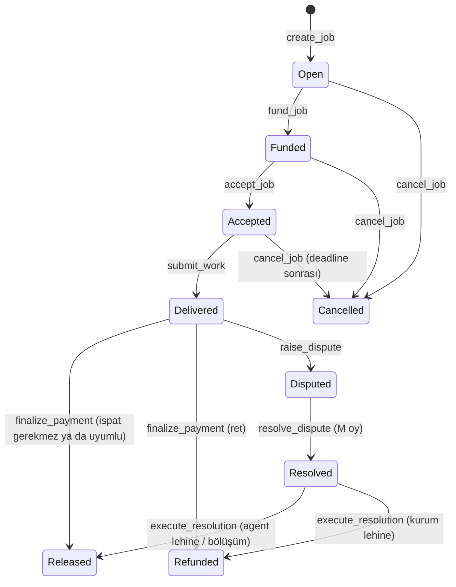

# Square protokolü

Harici geliştirici ve ekip için protokolün özeti. Normatif kaynaklar:
- [program arayüzü](design/program-interface.md): talimatlar, hesaplar, PDA seed'leri, hata kodları.
- [event şeması](design/events.md).
- [`did:aip` Solana profili](did-aip/method-spec-v2-solana.md).

Bu doküman onları birbirine bağlar; çelişki olursa normatif kaynak geçerlidir. Sözleşmeyi IDL'ler (`idl/*.json`)
taşır; TypeScript tarafı [`@squaresdk/solana-sdk`](../packages/sdk/README.md) ve HTTP tarafı
[OpenAPI](api/openapi.yaml)'dir.

## Roller ve programlar

| Program | Ne tutar | Kim yazar |
|---|---|---|
| `square_registry` | Agent kayıtları (`AgentRecord`, `did:aip`), cüzdanların screening kayıtları | Agent sahibi, screener authority |
| `square_policy` | Kurumlar, harcama politikalarının commitment'ı, alıcı listesinin Merkle kökü | Kurumun yetkilisi (anahtar ya da Squads vault) |
| `square_verifier` | Release ispatları (`ReleaseProof`, Groth16), kurumun günlük sayacı (`OperatorState`) | Kurumun yazılımı; escrow CPI'ı |
| `square_escrow` | Job'lar ve kasaları, alacak piyasası, dispute, itibar, doğrulama kayıtları | Kurum, agent, alıcı, arbitrator'lar, keeper |

Programların upgrade authority'si ve config'lerin admin'i 2-of-3 Squads vault'udur
([upgrade runbook'u](runbooks/upgrade.md)).

## Sekiz adım

| # | Aktör | Ne olur | Talimat |
|---|---|---|---|
| 1 | Kurum | Kurum hesabını açar, harcama politikasının commitment'ını ve günlük tavanını zincire yazar. Politika içeriği zincire çıkmaz | `init_institution`, `set_policy` |
| 2 | Agent | Kaydolur. Kayıt bir `did:aip` tanımlayıcısıdır; agent card'ın hash'i zincirdedir | `register_agent` |
| 3 | Screener, kurum | Kurum ve agent cüzdanları taranır (`record_screening`). Kurum job'u agent kaydına bağlar ve fonlar. Eşiği aşan işte önce Travel Rule commitment'ı gelir | `create_job`, `commit_travel_rule`, `fund_job` |
| 4 | Agent | İşi kabul eder ve teslim eder (işin SHA-256'sı ve URI'si). Challenge penceresi başlar | `accept_job`, `submit_work` |
| 5 | Agent, alıcı | Agent release'in netini (alacak) satabilir. Alıcı kurumun alıcı listesindedir ve screening'i temizdir | `list_claim`, `buy_claim` |
| 6 | Keeper | Challenge bitince ödemeyi yapar, keeper ücretini alır | `finalize_payment` |
| 7 | Kurumun yazılımı | Politikalı işte, ödemenin politikaya uyduğunu Groth16 ispatıyla job'a bağlar (finalize'dan önce) | `set_compliance_proof` |
| 8 | Escrow → verifier | Ödemede itibar, doğrulama kaydı ve kurumun günlük sayacı yazılır | `finalize_payment` içinde, `record_release` CPI'ı |

Ödeme kime gider: alacak satılmışsa (`ClaimListing.status == Bought`) alıcıya, değilse `Job.agent_wallet`'a.
İspat bağlama ve ödeme aynı kuralı kullanır. Policy'li işte ispat yoksa `finalize_payment` `ProofRequired` ile
reddedilir ve escrow bekler.

Fonlama başka zincirden de gelebilir: CCTP ile yakılan USDC aynı tx'te mint edilip job'u fonlar
([cctp-funding.md](design/cctp-funding.md)).

## Job durum makinesi

| Durum | Anlamı | Kasada |
|---|---|---|
| `Open` | Açıldı, fonlanmadı | — |
| `Funded` | Tutar kasada, agent'ın kabulü bekleniyor | Tutar |
| `Accepted` | Agent kabul etti, teslim bekleniyor | Tutar |
| `Delivered` | Teslim edildi, challenge penceresi sürüyor ya da bitti (keeper bekliyor) | Tutar |
| `Disputed` | Kurum itiraz etti; arbitrator'ların oyu bekleniyor | Tutar ve bond |
| `Resolved` | Karar kesinleşti, `execute_resolution` bekleniyor | Tutar ve bond |
| `Released` | Ödendi (agent ya da alıcı) | — |
| `Refunded` | Kuruma iade edildi | — |
| `Cancelled` | İptal edildi; fonlanmışsa tutar kuruma döndü | — |

- **Keeper ücreti:** Her ödemede `amount × keeper_fee_bps / 10 000`'dir; net `amount − ücret`.
- **İtibar:** Her settlement `AgentReputation`'a yazılır (alacak satılmış olsa da agent kaydına) ve bir
  `ValidationRecord` üretir.
- **Dispute:** Bir job'da en fazla bir dispute açılır. Arbitrator'lar M-of-N oy verir; ödemeyi
  `execute_resolution` yapar.
- **Dispute'un süresi:** Süresi dolan dispute ve ispatsız bekleme kh0ra'nın PR'ında (#184) gelir
  (`lapse_dispute`, `escalate_missing_proof`; ADR 0016).

## Event'ler

Event'lerin tek kaynağı IDL'lerdir. Yayım ve sürüm kuralları [event şemasında](design/events.md), alan tabloları
[program arayüzü §10](design/program-interface.md#10-referans-tabloları)'dadır. SDK event'leri tx loglarından çözer
(`client.decodeEvents`, `client.decodeTransactionEvents`). Indexer onları `chain_events`'e yazar; API
`GET /v1/events` ile sunar.

| Program | Event'ler |
|---|---|
| `square_registry` | `AgentRegistered`, `AgentUpdated`, `AgentStatusChanged`, `AgentOwnershipTransferred`, `AgentDeregistered`, `ScreeningRecorded`, `RegistryConfigUpdated` |
| `square_policy` | `InstitutionCreated`, `InstitutionMultisigSet`, `PolicyCommitted`, `PolicyUpdated`, `PolicyDeactivated`, `BuyerRootCommitted` |
| `square_verifier` | `ComplianceProofSet`, `ReleaseRecorded`, `MppPaymentVerified`, `VerifierConfigUpdated` |
| `square_escrow` | `JobCreated`, `TravelRuleCommitted`, `JobFunded`, `JobAccepted`, `WorkSubmitted`, `JobAgentWalletSynced`, `ClaimListed`, `ClaimBought`, `ClaimCancelled`, `ReleaseVerified`, `ReleaseRefused`, `Finalized`, `ReputationRecorded`, `ValidationRecorded`, `DisputeRaised`, `DisputeVote`, `DisputeDecided`, `DisputeResolved`, `DisputeLapsed`, `MissingProofEscalated`, `JobCancelled`, `ArbitratorsUpdated`, `EscrowConfigUpdated` |

Bir job'un geçmişi escrow event'leriyle ve verifier'ın ispat event'leriyle izlenir. Web'in denetim görünümü
ve API'nin `listEvents({ job })`'u bunları sırayla gösterir.

## Kimlik: `did:aip`

Agent kaydı bir DID'dir: `did:aip:2:solana:<chain-ref>:<registry>:<AgentRecord>`
([yöntem spesifikasyonu §3](did-aip/method-spec-v2-solana.md#3-method-syntax)).
- **Çözüm:** Kayıt zincirden okunur. DID belgesi kaydın sahibinin ve cüzdanının anahtarlarıyla kurulur.
  Servisler agent card'dan gelir.
- **Kart bütünlüğü:** Agent card yalnızca SHA-256'sı zincirdeki `agent_card_hash`'e eşitse doğrulanmış sayılır
  ([§5.5](did-aip/method-spec-v2-solana.md#55-agent-card-integrity-normative)).
- **Devre dışı bırakma:** Kayıt `Deregistered` ya da kart `active: false` ise DID devre dışıdır
  ([§5.6](did-aip/method-spec-v2-solana.md#56-deactivation-normative)).
- **Uygulama:** [`@squaresdk/solana-identity`](../packages/identity/README.md) çözümleyicidir.
  Test vektörleri: [`did-aip/test-vectors.json`](did-aip/test-vectors.json).

## Uyum

- **Screening:** Kurum, agent ve alıcı cüzdanlarının temiz ve süresi dolmamış screening kaydı fonlamada, alacak
  alımında ve ödemede okunur ([screener runbook'u](runbooks/screener.md)).
- **Politika ispatı:** Release devresi ödemenin politikaya uyduğunu politikayı açmadan ispatlar
  ([release-circuit.md](design/release-circuit.md)). Tazelik ve günlük sayaç kuralları:
  [ADR 0012](decisions/0012-ispat-tazeligi-ve-gunluk-sayac.md).
- **Travel Rule:**
  - Eşiği aşan işte kaydın commitment'ı fonlamadan önce job'a bağlanır
    ([ADR 0015](decisions/0015-travel-rule-commitment-ve-esik.md)).
  - Kayıt API'de şifreli saklanır ([ADR 0017](decisions/0017-travel-rule-saklama-erisim-ve-paylasim.md)).
