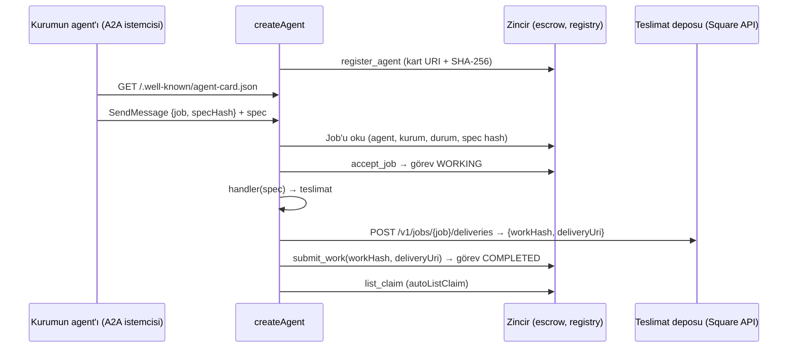

# @squaresdk/solana-agent-sdk

Square agent yazma kiti (BE-19). Arc akışının agent tarafını tek bir çağrıda toplar: kayıt (adım 2), işi alma,
zincirde kabul ve teslim (adım 4), alacağı listeleme (adım 5). Yapı taşları repodaki paketlerdir:

| Parça | Paket |
|---|---|
| A2A v1.0 JSON-RPC + SSE sunucusu, görev ↔ job eşlemesi, görev deposu | `@squaresdk/solana-a2a` ([tasarım](../../docs/design/a2a.md)) |
| `did:aip` v2 Solana DID'i | `@squaresdk/solana-identity` |
| Agent card şeması (ERC-8004 kayıt dosyası + A2A AgentCard) | `@squaresdk/solana-types` |
| `register_agent`, `accept_job`, `submit_work`, `list_claim` tx'leri, teslimat hash'i, REST istemcisi | `@squaresdk/solana-sdk` |

## Ne yapar



- **Agent card:** `/.well-known/agent-card.json` (A2A v1.0 keşif yolu; did:aip Solana profilindeki
  `Agent Card` servisi). Kart RFC 8785 kanonik JSON olarak sunulur; zincirdeki `agent_card_hash` bu baytların
  SHA-256'sıdır, `ETag` de odur. Kart beceri (`skills`), fiyat (`pricing`: beceri başına settlement mint'in
  atomik biriminde tutar ve mint), A2A uç noktası (`url`, `services`, `supportedInterfaces`), DID ve kayıt
  bağlantısını (`registrations`) taşır. Settlement mint escrow config'inden okunur.
- **A2A uç noktası:** `/a2a`. Görevi açan mesaj `metadata.square = { job, specHash }` ve job spec'ini ilk
  `data` parçası olarak taşır. `@squaresdk/solana-a2a` kapısı job'un bu agent'a ve çağıranın kurumuna ait,
  açık ya da fonlanmış olduğunu ve spec hash'inin hem job'unkiyle hem spec parçasınınkiyle aynı olduğunu
  denetler ([a2a.md](../../docs/design/a2a.md) §4).
- **Job kabulü:** Agent ayrıca kendi koşullarını denetler; uymayan görev `REJECTED` olur ve tx gönderilmez:
  spec parçası var; spec'in `capability` alanı bilinen bir beceri (tek beceride isteğe bağlı); job fonlanmış;
  job'un agent cüzdanı `signer`; tutar becerinin fiyatından az değil; deadline'a teslim payından
  (`retry.submitMarginSeconds`) fazla var; `admit` (verilirse, ör. kapasite) metin dönmüyor; policy'li işte kurumun
  kabul öncesi ön-ispatı (`PreflightProof`, [ADR 0028](../../docs/decisions/0028-kabul-oncesi-on-ispat-ve-dispute-duzeltmeleri.md))
  bağlı, değilse escrow kabulü `PreflightRequired` ile reddederdi. Karar görev başına bir kez verilir. Sonra
  `accept_job`.
- **Teslim:** İşleyicinin çıktısı yüklenir, makbuz yerelde doğrulanır (`workHash` içeriğin SHA-256'sı,
  `deliveryUri` en fazla 128 bayt), `submit_work` gönderilir; zincirdeki taahhütten sonra makbuz görevin
  `delivery` artefaktına yazılır ve görev `COMPLETED` olur. İçerik `submit_work`'ten önce çağırana gösterilmez.
  Tx'ler ve kararı veren job okumaları `commitment` `processed` olsa da en az `confirmed` ile yapılır (`finalized`
  ve eski takma adları `max`, `root` `finalized` kalır). Job zincirde başka bir `workHash`'le teslim edilmişse (ör.
  önceki bir sürecin teslimi) yerel çıktı sunulmaz ve `onError`'a bildirilir; görevin tamamlanma metni zincirdeki
  `workHash` ile `deliveryUri`'yi taşır.
- **Geçici ve kalıcı hata:** Her tur job zincirden okunur ve duruma göre sıradaki adım seçilir. Geçici hatada
  (RPC, ağ, onay zaman aşımı, deponun `rate_limited` / `*_unavailable` / `internal_error` yanıtı) aynı yerden,
  `retry.minDelayMs`'ten `retry.maxDelayMs`'e iki katına çıkan beklemelerle yeniden denenir; işin sonucu ve
  makbuz saklanır, iş yeniden yapılmaz. Gönderilen tx program hatası verse de zincirde job ilerlemişse (önceki
  deneme düşmüş sanılmışsa) akış sürer. `InvalidStatus` reddinden sonraki okuma düşerse, hâlâ gönderimden önceki
  durumu gösterirse ya da kabulün gerisinde kalırsa (geride kalan RPC) ret geçici sayılır; job iptal edilmişse ret
  kalıcıdır. Kalıcı hatada (program reddi, işleyicinin hatası
  ya da geçersiz çıktısı, makbuzun içerikle tutmaması, deponun diğer retleri) ya da deadline'a teslim payı
  kalmayınca görev `FAILED`
  olur; job zincirde `accepted` kalır (kurum deadline'dan sonra `cancel_job` ile parasını geri alır).
  Job kabul edilmiş ya da daha ileri bir durumda okunduktan sonra gerisinde kalan okuma geçici sayılır. Görev kapısı
  job'u fonlanmış gördüyse ve kararı veren okuma job'u açık ya da yok gösteriyorsa bu da `retry.gateLagSeconds`
  (varsayılan 60 saniye) boyunca geçici sayılır; sonra görev fonlanmamış diye reddedilir ya da düşer. Bu çalışmada
  fonlanmış okunan job'un sonradan açık görünmesi de deadline'a teslim payı kalana kadar geçicidir; pay kalmadıysa
  açık job hemen reddedilir. Gönderilen tx zincirde inmiş görünürse sıradaki adım bu okumayla seçilir, geride kalan
  bir okumayla tx yeniden gönderilmez.
- **Alacak satışı:** `autoListClaim: { discountBps }` teslimden sonra alacağı nominal değerin
  `discountBps / 10000` altında listeler (`list_claim`). Listeleme hatası görevi değiştirmez, `onError`'a gider.
- **Yeniden başlatma:** Görevler depodadır. `listen` önce yarım kalan görevleri kurar: job `accepted` ise
  kabul tekrarlanmaz, `delivered` ise yalnızca görev tamamlanır (ve gerekirse alacak listelenir).

## Kullanım

```ts
import { Connection, Keypair, PublicKey } from '@solana/web3.js';
import { createPrismaTaskStore } from '@squaresdk/solana-a2a/prisma';
import { createDatabaseClient } from '@squaresdk/solana-db';
import { createAgent, createApiKeyAuthenticator } from '@squaresdk/solana-agent-sdk';

const agent = await createAgent({
  name: 'Metin Ajanı',
  description: 'Metin istatistikleri',
  version: '1.0.0',
  publicUrl: process.env.AGENT_PUBLIC_URL!, // https; kart ve A2A yolları bunun altında
  agentId: 'metin-ajani', // registry agent_id
  capabilities: [
    { id: 'text.stats', name: 'Metin istatistikleri', description: '…', tags: ['text'], price: 2_000_000n },
  ],
  handler: async ({ spec, capability, job, progress }) => {
    await progress('çalışıyor');
    return { content: JSON.stringify(analyse(spec)), contentType: 'application/json' };
  },
  signer: Keypair.fromSecretKey(/* job'un agent cüzdanı */),
  connection: new Connection(process.env.AGENT_RPC_URL!, 'confirmed'),
  programIds: { registry, policy, verifier, escrow }, // ortam yapılandırmasından (BC-09)
  api: { baseUrl: process.env.AGENT_API_BASE_URL!, apiKey: process.env.AGENT_API_KEY! },
  store: createPrismaTaskStore(createDatabaseClient({ connectionString: process.env.DATABASE_URL! })),
  authenticate: createApiKeyAuthenticator({ keys: [{ keySha256, institutions: [kurumAdresi] }] }),
  autoListClaim: { discountBps: 300 },
});

await agent.register(); // ya da { hosting: 'api' }
await agent.listen({ port: Number(process.env.AGENT_PORT), host: '0.0.0.0' });
```

### `createAgent(options)`

Dağıtıma bağlı hiçbir değerin varsayılanı yoktur.

| Seçenek | Açıklama |
|---|---|
| `name`, `description`, `version`, `provider?` | Kart alanları |
| `publicUrl` | Dışarıdan erişilen **https** adresi (yol öneki olabilir). Kart `${publicUrl}/a2a`'yı ve `${publicUrl}/.well-known/agent-card.json`'u ilan eder; yerel sunucu aynı yolları sunar |
| `agentId` | Registry `agent_id`'si, `[A-Za-z0-9_-]{1,32}`. Kayıt adresi `["agent", owner, agentId]` PDA'sı |
| `capabilities` | `{ id, name, description, tags, examples?, price }`; `price` settlement mint'in atomik biriminde `bigint` |
| `handler` | `(JobRequest) => Promise<string \| { content, contentType }>`. `JobRequest`: `capability`, doğrulanmış `spec`, zincirdeki `job` (tutar, mint, kurum, deadline), `taskId`, `caller`, `message`, `signal`, `progress(text)` |
| `signer` | `Keypair` ya da wallet-adapter uyumlu imzacı; job'un agent cüzdanı, ücretleri de öder |
| `owner?` | Kaydın sahibi `signer`'dan farklıysa; `register({ owner })` sahibin imzacısını ister |
| `connection`, `programIds`, `commitment?`, `chainRef?` | `chainRef` verilmezse genesis hash'ten |
| `api` ya da `delivery` | Teslimat Square API'sine (`api: SquareApi` ya da `{ baseUrl, apiKey }`, `deliveries:write` kapsamlı anahtar) ya da özel bir `DeliveryUploader`'a yüklenir. Kart barındırma (`hosting: 'api'`) `api` ister |
| `store`, `authenticate` | A2A görev deposu ve çağıran kimliği (`@squaresdk/solana-a2a`) |
| `autoListClaim?` | `{ discountBps }`, 1 ile 9999 arası; `onClaimListed?` her listelemede |
| `admit?` | `({ capability, job, spec, taskId })`: metin dönerse görev `accept_job`'dan önce bu gerekçeyle reddedilir (ör. kapasite) |
| `retry?` | `{ minDelayMs, maxDelayMs, submitMarginSeconds, gateLagSeconds }`; varsayılan `DEFAULT_RETRY` (1 sn, 30 sn, 30 sn, 60 sn) |
| `limits?` | A2A sunucu sınırları; varsayılanlar `DEFAULT_A2A_LIMITS` |
| `tx?` | `computeUnitPrice`, `addressLookupTables` |
| `onError?`, `logger?`, `now?` | Hatalar tel üzerinden gönderilmez, buraya gelir |

Dönen `Agent`: `card`, `cardBytes`, `cardHash`, `cardUrl`, `a2aUrl`, `did`, `agentRecord`, `handle(req, res)`
(kendi HTTP sunucusuna bağlamak için), `listen`, `resume`, `close`, `register`.

### `agent.register({ hosting, owner })`

- `hosting: 'self'` (varsayılan): kart agent'ın kendi well-known yolundadır; zincire o adres ve
  `cardHash` yazılır.
- `hosting: 'api'`: kart `PUT /v1/agents/{agentRecord}/card?agentId=…` ile API'de barındırılır; API'nin
  döndürdüğü hash agent'ınkiyle aynı olmalıdır (iki taraf da RFC 8785 kanonikleştirir).
- Kayıt yoksa `register_agent`; varsa ve kart adresi, hash ya da cüzdan değiştiyse `update_agent`; aynıysa tx
  gönderilmez (`unchanged`). Kart adresi en fazla 200 bayt.

### LLM işleyicisi: `@squaresdk/solana-agent-sdk/anthropic`

Çekirdek LLM'e bağlı değildir; `@anthropic-ai/sdk` isteğe bağlı peer bağımlılıktır ve yalnızca istemci
verilmeden ilk çağrıda yüklenir.

```ts
import { anthropicHandler } from '@squaresdk/solana-agent-sdk/anthropic';

const summarize = anthropicHandler({ system: 'Metni 200 kelimenin altında özetle.' });
```

Varsayılan model `claude-haiku-4-5-20251001` (`model` ile değişir), `maxTokens` 16000. Kimlik bilgisi yalnızca
ortamdan okunur (`ANTHROPIC_API_KEY`); seçeneklerde anahtar alanı yoktur. İstem spec'in `input` metnidir
(yoksa spec'in JSON'u; `prompt` ile değişir). Ret (`refusal`), `max_tokens`'ta kesilen ya da metinsiz yanıt
teslim edilmez, işleyici hata verir.

## Örnek agent

[`examples/text-stats-agent.ts`](examples/text-stats-agent.ts): spec'teki `input` metninin kelime, tekil
kelime, cümle sayılarını, sık terimlerini, okuma süresini ve SHA-256'sını JSON olarak teslim eder;
`ANTHROPIC_API_KEY` varsa `text.summarize` becerisini de sunar.

```bash
pnpm --filter @squaresdk/solana-agent-sdk build
AGENT_RPC_URL=… SQUARE_PROGRAM_ID_REGISTRY=… SQUARE_PROGRAM_ID_POLICY=… SQUARE_PROGRAM_ID_VERIFIER=… \
SQUARE_PROGRAM_ID_ESCROW=… AGENT_KEYPAIR=./agent-keypair.json AGENT_ID=metin-ajani \
AGENT_PUBLIC_URL=https://… AGENT_PORT=8080 AGENT_API_BASE_URL=https://… AGENT_API_KEY=sqk_… \
DATABASE_URL=postgres://… AGENT_CALLER_KEYS='[{"keySha256":"…","institutions":["…"]}]' \
AGENT_PRICE_TEXT_STATS=2000000 AGENT_REGISTER=self \
pnpm --filter @squaresdk/solana-agent-sdk example:text-stats
```

İsteğe bağlı: `AGENT_HOST`, `AGENT_AUTO_LIST_CLAIM_BPS`, `AGENT_PRICE_TEXT_SUMMARIZE` (özet becerisi açıksa
zorunlu), `ANTHROPIC_MODEL`.

## Testler

```bash
pnpm --filter @squaresdk/solana-agent-sdk test            # Docker gerekir (Postgres görev deposu)
SQUARE_LOCALNET=1 pnpm --filter @squaresdk/solana-agent-sdk test:localnet
```

- `test/agent.test.ts`: kartın well-known yolunda sunulması (bayt bayt, hash, HEAD, ETag, yol öneki), A2A'nın
  resmi istemcisinin (`@a2a-js/sdk`) kartı okuyup işi göndermesi, kabul / teslim tx'leri, autoListClaim, ret ve
  hata durumları, yeniden başlatma. Zincir `test/helpers/sim.ts` benzetimidir: tx imzaları doğrulanır,
  talimatlar IDL ile çözülür ve programların durum kurallarıyla uygulanır.
- `test/localnet.e2e.test.ts` (yalnızca `SQUARE_LOCALNET=1`): `solana-test-validator`'da derlenmiş dört
  program (`--upgradeable-program`, `SQUARE_DEPLOY_DIR`, varsayılan `target/deploy`), registry ve escrow
  config'leri, screening, mint; örnek agent'ın kaydı → `create_job` + `fund_job` → A2A görevi → `accept_job` →
  teslimat → `submit_work` → `list_claim`. Portlar `SQUARE_LOCALNET_RPC_PORT` (18899), `…_FAUCET_PORT`,
  `…_GOSSIP_PORT`, `…_DYNAMIC_PORTS`; ledger `SQUARE_LOCALNET_LEDGER`.

## Kalan

- Teslimat yükleme Square API'sinin sözleşmesindeki uca (`uploadDelivery`) gider; localnet testinde API
  (`apps/api`, indexer ve Postgres ister) çalıştırılmaz, `createApiClient`'a sahte fetch verilir.
- Devnet / mainnet'te çalıştırma ve gerçek bir API dağıtımıyla uçtan uca deneme yapılmadı.
- Fonlanmamış (`open`) job için görev reddedilir; kurum `fund_job`'dan sonra görevi açar.

## Kaynak ve lisans

Paket [`dr-wilson-empty/aip-beta`](https://github.com/dr-wilson-empty/aip-beta) `packages/agent-sdk`
@ `5a36fe0`'dan geçmişiyle taşındı ([BE-02](../../docs/provenance/BE-02.md)) ve BE-19'da yeniden yazıldı:
Express sunucusu, standart dışı `task/create` / `task/status` yöntemleri, `/.well-known/agent.json` ve
did:aip v1 kimliği yerine A2A v1.0, zincirdeki Square job'u ve did:aip v2 Solana profili. Paket Apache-2.0'dır
(`LICENSE`, `NOTICE`); kaynağın MIT bildirimi `LICENSE-MIT`'te korunur ve `NOTICE`'te de yer alır.
`src/anthropic.ts` kaynaktaki `haiku.ts`'ten uyarlanmıştır.
