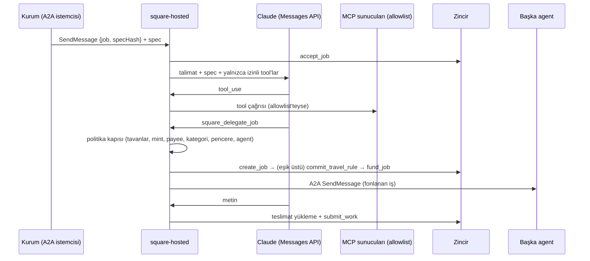

# @squaresdk/solana-hosted

Konfigürasyondan çalışan kurum agent'ı (BE-29). Kurum, agent'ını kod yazmadan bir YAML ya da JSON dosyasıyla tanımlar:

- **Capability:** Her capability bir Claude çalıştırmasıdır. Yalnızca izin verilen MCP tool'larını görür.
- **Delegasyon:** Agent, kurum politikası altında başka agent'lara iş açabilir.
- **Duty:** Kurumun kendi job'larına release ispatını bağlar ve dispute crank'ini yürütür.

Yapı taşları yeniden yazılmaz:

| Parça | Paket |
|---|---|
| Agent card, A2A uç noktası, job kabulü ve teslimi, `register_agent` | `@squaresdk/solana-agent-sdk` (`createAgent`) |
| Capability başına MCP bağlantıları | `@squaresdk/solana-mcp/client` (`McpClientPool`) |
| Politika kuralları (`normalizePolicy`, ret bitleri), ispat izleyicisi (`watchJobProof`), uzak prover | `@squaresdk/solana-policy` |
| `create_job`, `commit_travel_rule`, `fund_job`, `execute_resolution` tx'leri; Square API istemcisi (teslimat, Travel Rule kaydı, oturum) | `@squaresdk/solana-sdk` |
| Claude | `@anthropic-ai/sdk` (Messages API, tool use) |



## Çalıştırma

```bash
pnpm turbo run build --filter @squaresdk/solana-hosted...
node packages/hosted/dist/bin.js --config ./hosted.yaml --check   # doğrular, başlatmaz
node packages/hosted/dist/bin.js --config ./hosted.yaml
```

Yayından sonra komut `square-hosted --config …` olur. Paket, ADR 0001'in yayın ön koşulları tamamlanana kadar
`private: true` kalır; pack-smoke'ta yayınlanabilir olarak denetlenir.

Açılış sırası:

1. Yapılandırma ve politika belgesi şemayla doğrulanır. Geçersizse hiçbir şey başlatılmaz ve bütün sorunlar yollarıyla
   listelenir.
2. Ortam değişkenleri ve anahtar dosyaları denetlenir.
3. Kayıt yapılır (`register: self | api`), A2A sunucusu dinlemeye başlar ve duty'ler başlar.

Claude istemcisi kimlik bilgisini yalnızca ortamdan okur (`ANTHROPIC_API_KEY`). Postgres görev deposu için
`@squaresdk/solana-db` kurulmalıdır (isteğe bağlı peer bağımlılık).

## Yapılandırma

Şema [`src/config.ts`](src/config.ts)'tedir; politika belgesi `@squaresdk/solana-types`'ın `PolicyDocument`'ıdır.
Göreli yollar yapılandırma dosyasının dizinine göre çözülür. Dağıtıma bağlı hiçbir değerin varsayılanı yoktur.
`--check` dosyayı başlatmadan doğrular.

| Bölüm | İçerik |
|---|---|
| `agent` | Kart alanları, `publicUrl` (https), `agentId`, `register` (`self`, `api`, `none`), `listen`, `autoListClaim?`, `callers` (A2A anahtarlarının SHA-256'sı ve yetkili kurumlar) |
| `chain` | `rpcUrl`, `commitment`, `programIds`, `computeUnitPrice?` |
| `api` | Square API'si (`baseUrl`, `apiKeyEnv`, `authDomain?`): teslimat yükleme, kart barındırma, job keşfi. `authDomain` API'nin `API_AUTH_DOMAIN`'idir; Travel Rule delegasyonu açıksa zorunludur |
| `store` | A2A görev deposu: `{ type: postgres, urlEnv }` |
| `signers` | `agent`: job'ların agent cüzdanı (keypair dosyası). `institution`: `keypair` ya da `unsigned` (`publicKey`, `outboxDir?`) |
| `mcp` | `servers` (`stdio`: `command`, `args`, `env`, `cwd`; `http`: `url`, `headers`), havuz ayarları (`maxConcurrency`, `toolCacheTtlMs`, `requestTimeoutMs`, `reconnect`) |
| `capabilities[]` | `id`, `name`, `description`, `tags`, `price` (u64 dize), `instructions` (sistem talimatı), `model`, `effort?`, `contentType?`, `tools` (`{ server, allow: [...] }`), `delegation?`, `limits` |
| `delegation?` | `policyFile`, `policyAccount?`, `defaultCategory`, `allowedAgents` (`agentRecord`, `categories?`, `a2a?`, `travelRule?`: `beneficiary`, `beneficiaryVasp`), `deadlineSecs` (job'un son tarihi: varsayılan ve en geç şimdi + bu süre), `challengePeriodSecs`, `maxJobsPerDay` (UTC gününde açılabilecek en çok job; zorunlu, kurumun job rent'ini sınırlar), `ledgerPath`, `travelRule?` (`originator`, `originatingVasp`) |
| `duties?` | `intervalMs`, `discovery.api`, `policyWatch?` (`policySecretPath`, `paymentCategory`, `intervalMs`, `prover`), `crank?` (`executeResolution`, `lapseDispute`) |

**Sırlar dosyaya yazılmaz.**

- API anahtarları ortam değişkeninin adıyla verilir (`apiKeyEnv`, `{ fromEnv: AD }`).
- Keypair'ler Solana CLI biçimindeki dosyanın yoluyla verilir.
- Politika sırrı 64 hex karakterlik bir dosyadır.
- Eksik ortam değişkenleri açılışta adlarıyla raporlanır; değerleri hiçbir yere yazılmaz.

**Çapraz denetimler:**

- Allowlist'teki her sunucu `mcp.servers`'ta tanımlı olmalıdır.
- `delegation: true` olan capability `delegation` bölümünü, o da kurumun imzacısını ister.
- Duty'ler kurumun yerel keypair'ini ister. Bunun sebebi, ispat bağlama ve crank tx'lerinin zamana bağlı olmasıdır.
- İspat bağlama, kurumun politika belgesini ister.

## Capability çalıştırma

- **İş akışı:** Gelen işi `@squaresdk/solana-agent-sdk` alır, denetler ve `accept_job` gönderir. İşleyici işi
  capability'nin çalıştırma bağlamına verir.
- **İstem:** Claude'a sistem talimatı olarak `instructions` gider. Kullanıcı mesajı spec'in `input` metnidir; yoksa
  spec'in JSON'udur.
- **Tool döngüsü:** Messages API'yle elle yürütülür. Her tool çağrısında allowlist denetimi ve her yanıtta token sayımı
  bu döngüde yapılır.
- **Teslim:** Claude'un son metni teslimat olarak yüklenir ve `submit_work` gönderilir.
- **Teslim edilmeyen yanıtlar:** Ret (`refusal`), `max_tokens`'ta kesilen, bağlam penceresi dolan ya da metinsiz yanıt
  teslim edilmez. Bu durumda görev `FAILED` olur.

**Tool allowlist'i iki yerde uygulanır:**

1. Claude'a yalnızca `tools[].allow`'daki tool'lar, sunucunun bildirdiği şemayla ve `${sunucu}__${tool}` adıyla
   gösterilir. Allowlist'teki bir tool sunucuda yoksa çalıştırma başlamaz.
2. Claude listede olmayan bir ad yazarsa çağrı MCP sunucusuna gitmez. Claude'a `is_error` sonucu döner ve
   `deniedToolCalls` sayacına yazılır.

**Tool sonuçları:**

- MCP içeriği metne çevrilir. Görsel ve kaynak blokları türü ve boyutuyla özetlenir.
- `maxToolResultBytes`'ı aşan sonuç kesilmez; Claude'a sınırı bildiren bir hata olarak döner.

**Delegasyon tool'u:** `delegation: true` olan capability'ye `square_delegate_job` tool'u eklenir (bkz.
[Delegasyon](#delegasyon)).

## Delegasyon

Kurumun hosted agent'ı başka bir agent'a iş açar: `create_job`, tutar Travel Rule eşiğinin üstündeyse
`commit_travel_rule` ve `fund_job`. Fonlanan iş, hedef agent'ın A2A uç noktası yapılandırılmışsa ona gönderilir.

**Politika kapısı:** Claude'dan bağımsızdır ve tx kurulmadan önce çalışır. Kurallar kurumun yerel politika belgesinden
(`PolicyDocument`) okunur. Değerler release devresinin gördüğü biçime `normalizePolicy` ile indirgenir. Ret, devrenin
ret bitleri ve adlarıyla (`REFUSAL`, `refusalRules`) döner.

| Kural | Ret |
|---|---|
| Brüt tutar > `maxPerTx` | `perTx` |
| Bugün bağlanan + tutar > `maxDaily` | `dailyPrivate` |
| Bugün bağlanan + tutar > `dailyCeiling` | `dailyCeiling` |
| Settlement mint `tokenWhitelist`'te değil | `mintNotAllowed` |
| Hedef agent'ın cüzdanı `blockedPayees`'te | `payeeBlocked` |
| Kategori `allowedCategories`'te değil (ya da agent'a açık değil) | `categoryNotAllowed` |
| An zaman penceresinin dışında (UTC, iki uç saat dahil) | `outsideTimeWindow` |
| Agent `allowedAgents`'ta değil | `agentNotAllowed` |
| Eşik üstü ama kaydın kurum ya da agent tarafı yapılandırılmamış, ya da kurum imzacısı `unsigned` | `travelRuleUnavailable` |
| Bugün açılan job sayısı `maxJobsPerDay`'e ulaştı | `dailyJobLimit` |

- **Sınırlar:** Sınırdaki değer izinlidir (`≤`), bir birim fazlası reddedilir. Reddedilen istekte ne tx kurulur ne de
  defter değişir.
- **Tutar:** Brüt tutardır. Release'teki net tutar keeper ücreti kadar küçüktür; brüt tutarla denetlemek daha sıkıdır.
- **Günlük sayaç:** Kurumun bu agent üzerinden bugün (UTC) açtığı delegasyonların toplamıdır. Delegasyon defterinde
  (`ledgerPath`, 0600) tutulur.
- **Eşzamanlılık:** Kapı ve tutarın ayrılması tek sırada yürür. Eşzamanlı iki istek aynı günlük boşluğu iki kez
  harcayamaz.
- **Aynı spec:** Job adresi kurum ve spec hash'inden türer. Aynı spec'le yeniden çağrı aynı job'dur; sayaca bir kez
  yazılır ve sıradaki adımdan devam eder. Koşullar ilk ayırmanınkidir: agent, tutar ya da kategori farklıysa çağrı
  `DelegationError` ile düşer ve tx kurulmaz. `create_job` defterdeki koşullarla ve ayırmadaki son tarihle kurulur.
  Son tarihi geçmiş ve zincirde açılmamış bir ayırma silinir; çağrı kapıdan yeniden geçer. Aynı spec için süren
  bir delegasyon varken gelen ikinci çağrı beklemez, `DelegationError` ile düşer.
- **Job sayısı:** Her job'un hesabı kurumun ödediği ve kapanmayan bir rent'tir. Tutar sınırları küçük tutarlı çok
  sayıda delegasyonu durdurmadığı için UTC gününde en çok `maxJobsPerDay` job açılır.

**İmza** (MCP paketindeki ilkeyle aynı):

- `institution.type: keypair`: tx'ler yerel anahtarla imzalanıp gönderilir.
- `institution.type: unsigned`: her çağrı sıradaki imzasız tx'i döner (`awaiting_signature`). Tx, `outboxDir`
  verilmişse `<job>-<adım>.json` olarak yazılır. Kurum tx'i kendi cüzdanında imzalayıp gönderir; aynı istek yeniden
  verilince bir sonraki adıma geçilir.

> **Uyarı:** Delegasyon tool'u açık bir capability, Claude'a (ve onu yönlendiren her girdiye, ör. MCP tool
> sonuçlarındaki prompt injection'a) kurumun parasıyla iş açtırabilir. Politika kapısı tutarı, agent'ı, kategoriyi ve
> günlük toplamı Claude'dan bağımsız olarak sınırlar. Politikayı ve `allowedAgents`'ı dar tutun; kullanıcı onayı gereken
> yerde `unsigned` kipi seçin.

**Travel Rule** (BE-23, ADR 0015 ve 0017):

- **Kayıt:** `TravelRuleRecord` (IVMS101 alt kümesi). Kurum tarafı `delegation.travelRule.originator`'dan, yararlanıcı
  tarafı izinli agent'ın `travelRule.beneficiary`'sinden gelir; tutar ve mint job'unkidir. Claude kişisel veri yazmaz.
- **Saklama:** Kayıt hosted agent'ta tutulmaz. `create_job`'dan sonra Square API'sine gönderilir
  (`PUT /v1/jobs/{job}/travel-rule`). API kaydı zarf şifrelemesiyle saklar, salt'ı kendisi üretir ve commitment'ı döner;
  bu commitment `commit_travel_rule` ile job'a bağlanır. Defterde yalnızca commitment durur.
- **Oturum:** Uç kurumun güncel yetkilisinin oturumunu ister. Hosted agent oturumu kurumun keypair'iyle imzaladığı meydan
  okumayla açar (`/v1/auth/challenge` → `/v1/auth/session`) ve süresi dolana kadar yeniden kullanır. Yalnızca bu cüzdan
  ve nonce için, `api.authDomain` alan adında Square oturum mesajı (Sign-In With Solana biçimi) imzalanır; başka bir
  metin ya da başka bir Square kurulumunun meydan okuması imzalanmaz. İmzasız kipte
  oturum açılamaz; eşik üstü delegasyon tx'siz reddedilir.

## Duty'ler

Duty'ler yalnızca kurumun kendi job'ları için ve yapılandırmayla açılır.

- **Adaylar:** Delegasyon defterinden ve `discovery.api: true` ise Square API'sinin kurum süzgecinden gelir. Her aday
  zincirden okunur; kurumu bu imzacı değilse atlanır.
- **`policyWatch`:** Politikaya bağlı, bitmemiş her job'a bir `watchJobProof` izleyicisi açar. İzleyici kurumun yerel
  politikasını, politika sırrından türeyen salt'ları (`derivePolicySalts`) ve uzak prover'ı kullanır. İspat yoksa ya da
  bayatlarsa (ADR 0012) yeniden üretip `set_compliance_proof` ile bağlar. Job bitince ya da ispat tüketilince izleyici
  kendiliğinden durur.
- **`crank`:** Dispute'un permissionless adımlarını yürütür.
  - `Resolved` job'da `execute_resolution` gönderir.
  - Son tarihi geçmiş `Disputed` job'da `lapse_dispute` gönderir: bond kuruma döner, kurumun token hesabı yoksa aynı
    tx'te açılır.
  - `finalize_payment` [apps/keeper](../../apps/keeper/)'ın işidir ve burada yapılmaz. Keeper dispute adımlarını
    yürütmediği için iş yinelenmez.
- **Hata yalıtımı:** Bir job'daki hata diğer job'ları durdurmaz; `onError`'a gider.

## Çalışma zamanı izolasyonu

Karar: [ADR 0022](../../docs/decisions/0022-hosted-agent-calisma-zamani-izolasyonu.md). İzolasyon süreç içidir ve her
capability'nin kendi çalıştırma bağlamı vardır.

| Özellik | Davranış |
|---|---|
| MCP bağlantıları | Capability başına ayrı `McpClientPool`; havuzda yalnızca allowlist'teki sunucular |
| Zaman | `timeoutMs`: bütün çalıştırma (Claude + tool'lar); `AbortSignal` tool çağrılarına iner. Kuyrukta bekleme sayılmaz |
| İstek ve token | `maxTurns`, yanıt başına `maxTokens`, bütün isteklerin toplamı `maxTotalTokens` |
| Eşzamanlılık | `maxConcurrency` çalıştırma; fazlası `maxQueue`'ya kadar bekler. Sınır `accept_job`'dan önce denetlenir (agent-sdk `admit`): yer yoksa görev reddedilir, kabul edilmiş bir iş yer bekler ve düşmez |
| İptal | Kuyrukta iptal edilen iş slot almadan çıkar; kapatma kuyruğu reddeder |
| Hata | Çalıştırmanın istisnası yalnızca kendi görevini `FAILED` yapar; diğer capability'ler, A2A sunucusu ve duty'ler sürer |
| Gözlem | `stats()`: capability başına `active`, `queued`, `completed`, `failed`, `rejected`, `deniedToolCalls` |

Worker ya da alt süreç seçilmedi. Çalıştırmalar G/Ç bağımlıdır ve Claude'un ürettiği kodu yürütmez. Stdio MCP
sunucuları zaten ayrı süreçtir. Kurumun anahtarı tek süreçte kalır. Capability başına bellek sınırı yoktur; bellek
süreç (konteyner) düzeyinde sınırlanır.

Yapılandırma güvenilen operatör girdisidir: stdio MCP sunucusu agent'ın işletim sistemi kullanıcısıyla çalışır ve
agent'ın okuyabildiği dosyaları okuyabilir. Şema, imzanın delegasyon kapısı dışına çıkacağı yanlış yapılandırmayı
reddeder: sunucunun ortamında `SQUARE_SIGNER_KEYPAIR` olamaz, argümanlarında agent ya da kurum keypair dosyası
geçemez. Güvenilmeyen birinin yazdığı yapılandırma için sunucuların ayrı kullanıcıda ya da konteynerde çalışması
gerekir ([ADR 0022](../../docs/decisions/0022-hosted-agent-calisma-zamani-izolasyonu.md)).

## Programatik kullanım

```ts
import Anthropic from '@anthropic-ai/sdk';
import { createHostedAgent, loadHostedConfig, depsFromConfig } from '@squaresdk/solana-hosted';

const loaded = await loadHostedConfig('./hosted.yaml');
const hosted = await createHostedAgent(loaded.config, await depsFromConfig(loaded, process.env));
await hosted.start();
// hosted.delegator?.delegate({ agentRecord, spec, amount }) — politika kapısından geçer
```

`createHostedAgent(config, deps)` bağımlılıkları dışarıdan alır: bağlantı, görev deposu, Claude istemcisi
(`messages.create` yüzeyi), imzacılar, politika, defter, prover ve MCP hedefleri. Testler sahte Claude istemcisi ve
benzetim zinciri verir.

## Testler

```bash
pnpm --filter @squaresdk/solana-hosted test           # Docker gerekir (Postgres görev deposu)
SQUARE_LOCALNET=1 pnpm --filter @squaresdk/solana-hosted test:localnet
# MCP tool'lu capability gerçek Claude API'siyle (anahtar ortamdan):
ANTHROPIC_API_KEY=<anahtar> HOSTED_E2E_REAL_CLAUDE=1 SQUARE_LOCALNET=1 pnpm --filter @squaresdk/solana-hosted test:localnet
```

Birim ve kabul testlerinde Messages istemcisi enjekte edilir (`test/helpers/claude.ts`). Gerçek Claude API'si yalnızca
`HOSTED_E2E_REAL_CLAUDE=1` ile localnet testinde çağrılır.
- **Bu modda:** Claude, işi MCP sunucusundaki `word_count` tool'uyla yürütür. Sonuç gerçek programlarla teslim edilir.
- **Delegasyon:** Senaryo belirli tool çağrılarına dayandığı için sahte istemcide kalır.
- **Koşu:** 2026-10-06'da `claude-opus-5-5` ile koşturuldu ve geçti.

| Test | Kapsam |
|---|---|
| `test/config.test.ts` | Şema: JSON / YAML, yol çözümü; geçersiz yapılandırma ve politikanın reddi; ortam |
| `test/claude.test.ts` | Tool döngüsü (tool sonucu, paralel çağrı, `pause_turn`); allowlist dışı adın reddi; tur ve token sınırları, ret, kesik yanıt; MCP tool dönüşümü (bellek içi MCP sunucusu) |
| `test/runtime.test.ts` | İzolasyon: allowlist, zaman sınırı, eşzamanlılık ve kuyruk, iptal, kapatma, bir capability çökerken diğerinin sürmesi |
| `test/guard.test.ts` | Politika kuralları: sınır değerler, günlük tavanlar, mint, payee, kategori, zaman penceresi, çoklu ihlal |
| `test/delegation.test.ts` | Benzetim zincirinde delegasyon: izinli istek; aşan istek tx kurulmadan reddedilir; sınırda izinli; günlük birikim; eşzamanlılık; Travel Rule (depo, commitment, ret); imzasız kip; A2A gönderimi; defter |
| `test/travel-rule.test.ts` | Travel Rule deposu (sahte API): imzalı meydan okumayla oturum, kaydın saklanması, oturumun yeniden kullanımı ve yenilenmesi, hatalar |
| `test/duties.test.ts` | `execute_resolution`, son tarihe göre `lapse_dispute`, başka kurumun job'u, hata yalıtımı, ispat izleyicisinin parametreleri ve imzası, API keşfi (sahte saat ve API) |
| `test/runner.test.ts` | Argümanlar, `--check`, bağımlılıkların kurulması, outbox, kurulum hataları, `start` / `close` |
| `test/hosted.e2e.test.ts` | Kabul: YAML'dan `runFromConfig` (stdio MCP sunucusu alt süreç, Postgres), kayıt, A2A işi → Claude + izinli tool → teslim; delegasyonun başka bir agent'a job açıp fonlaması ve o agent'ın teslimi; tavanı aşan delegasyonun tx'siz reddi |
| `test/localnet.e2e.test.ts` | Aynı kabul, `solana-test-validator`'da derlenmiş dört programla (yalnızca `SQUARE_LOCALNET=1`) |

**Benzetim zinciri** (`test/helpers/sim.ts`) agent-sdk'nınkinin genişletilmiş hâlidir. Tx imzalarını doğrular,
talimatları IDL ile çözer ve şu talimatları programların durum kurallarıyla uygular:

- kurum: `create_job`, `commit_travel_rule`, `fund_job`;
- agent: `accept_job`, `submit_work`, `list_claim`;
- crank: `execute_resolution`, `lapse_dispute`;
- registry: `register_agent`, `update_agent`.

**Localnet ortamı:**

- Portlar: `SQUARE_LOCALNET_RPC_PORT` (18899), `SQUARE_LOCALNET_FAUCET_PORT`, `SQUARE_LOCALNET_GOSSIP_PORT`,
  `SQUARE_LOCALNET_DYNAMIC_PORTS`.
- Ledger: `SQUARE_LOCALNET_LEDGER`. Programlar: `SQUARE_DEPLOY_DIR` (varsayılan `target/deploy`).

## Kalan

- **Teslimat yükleme:** Square API'sinin sözleşmesindeki uca gider. Testlerde API (`apps/api`) çalıştırılmaz; sahte
  fetch kullanılır.
- **İspat bağlama:** Gerçek prover ve devre artefaktlarıyla uçtan uca denenmedi. Testte izleyici enjekte edilir;
  `watchJobProof`'un kendisi `@squaresdk/solana-policy` testlerindedir.
- **Localnet kapsamı:** Localnet testi kayıt, teslim ve delegasyonu (`create_job`, `fund_job`) gerçek programlarla
  dener. Dispute crank'i (`execute_resolution`, `lapse_dispute`) yalnızca benzetim zincirinde denendi; localnet'te
  dispute penceresi beklemesi gerekir.
- **Dağıtım:** Devnet / mainnet'te ve Railway'de çalıştırılmadı. Servis tanımı (Dockerfile, `railway.json`) yoktur.
- **Travel Rule ve gerçek API:** Kayıt ucu sahte API'yle denendi; localnet testinde eşik 0'dır ve `apps/api` çalıştırılmaz.
- **Yeniden başlatma:** Capability'nin çıktısı yalnızca bellekte durur. Süreç kabul edilmiş bir işte yeniden başlarsa
  işleyici yeniden çalışır; Claude alt işi başka sözcüklerle yeniden delegasyon yapabilir. Defter yalnızca aynı spec'i
  tekilleştirir, farklı spec yeni bir job'dur (günlük sınırlar içinde).
